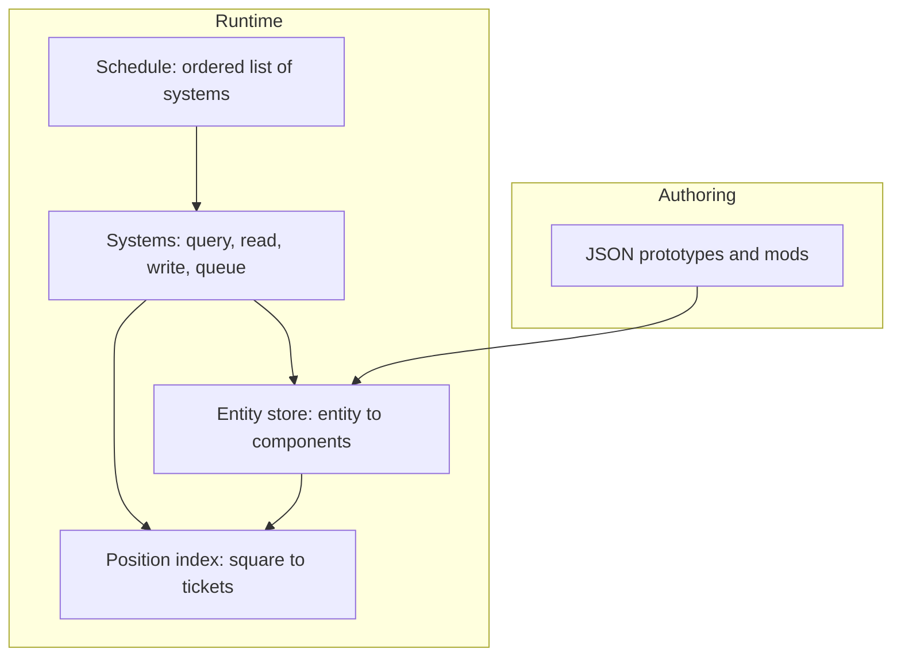
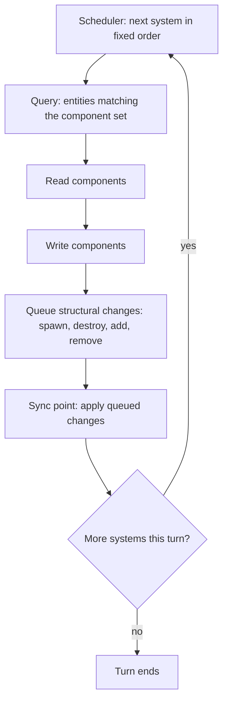

# 01 — Architecture

## Principles

1. One source of truth: the entity store. Anything else is derived and rebuildable.
2. Uniformity in *storage*, not in *content*. Every thing is an entity; what an
   entity can do is decided by which components it has.
3. The most frequent question in the game is "what is at this square?". It must be
   one step, not two.
4. Logic lives in systems. Data lives in components. Order lives in a list.
5. An index, never a pointer. All references are IDs into tables.

---

## Layers

The index is drawn as fed by the store because that is the dependency direction:
the store is truth, the index is a cached view of it. If they ever disagree, the
store wins and the index is rebuilt.

---

## 1. The entity store

**Rule:** every thing that exists in the world is an entity with a ticket. Walls,
floors, furniture, traps, fields, ground items, creatures, vehicles, projectiles.

- An entity is a 64-bit handle: slot index plus generation counter.
- Components are plain structs stored per-slot; no inheritance, no vtables.
- Entities are created and destroyed constantly; tickets are recycled with a
  bumped generation so a stale ticket fails loudly instead of hitting a new entity.
- Empty air is **not** an entity. Nothing exists there, and the index says so.
  This is the difference between "uniform storage" and "an entity per square".

**What an entity is not:** an object. It has no methods, no invariants of its own,
and no pointers to other entities. Behaviour is applied to it from outside by
systems.

---

## 2. Components

Components are grouped by concern, not by kind of thing. A starting catalogue:

| Component | Carried by | Contents |
|---|---|---|
| `Position` | everything placed | square, plus footprint rectangle for multi-square things |
| `Tile` | terrain, furniture, flooring | prototype reference |
| `BlocksMovement` / `BlocksSight` | walls, furniture | flags, not booleans scattered in rules |
| `WalkCost` | floors, terrain | movement cost |
| `Field` | fire, smoke, acid | kind, strength, remaining duration |
| `Item` | loose items | prototype, condition, charges, rot |
| `Container` | backpacks, vehicles, tiles | list of held entities |
| `Actor` | creatures | marker: takes turns |
| `Brain` | creatures, NPCs | behaviour parameters, goal |
| `ActionPoints` | creatures, vehicles | budget remaining this turn |
| `Stats` | creatures | health, speed, stamina |
| `Effect` | creatures | timed modifiers, keyed set |
| `BodyPlan` | creatures | limbs and their state |
| `Vehicle` | vehicles | parts, controls, fuel |
| `Projectile` | missiles | heading, speed, damage on contact |
| `Active` | anything with a timer | "this needs looking at every turn" |

**The actor/scenery distinction is emergent, not structural.** A dog is an entity
with `Actor` and `Brain`; a wall is an entity without them. No system checks "is
this scenery?" — a system that queries `ActionPoints` simply never sees a wall.

Keeping that distinction emergent is the point: it means a new kind of thing can be
introduced by composing components rather than by choosing a storage class.

---

## 3. The position index

**Shape:** one dense array slot per square of the loaded world, each holding either
nothing or a short list of tickets.

| Approximate scale | Value | Source |
|---|---|---|
| Squares per level | 17,424 | 132 × 132 reality bubble |
| Levels in play | 21 | z-levels from −10 to +10 |
| Total slots | 365,904 | arithmetic |
| Index memory at 4 bytes/slot | ~1.5 MB | arithmetic |

So the index is small enough to be dense and boring — it does not need to be
clever, and it does not need an entity per empty square.

**Rules:**

- The index is never the source of truth. It is rebuilt by walking entities that
  carry `Position`.
- Every spawn, destroy and move updates it. This is the one discipline the design
  requires, and it belongs inside the storage layer so callers cannot forget.
- Insert order is stable, so queries that iterate a square return a deterministic
  order. Determinism is a design requirement, not an accident.

**Why it exists at all:** "what is at this square?" is asked by movement, vision,
pathfinding, item pickup, interaction, rendering and explosion resolution — many
times per turn, per square. Doing it by scanning entities is the one thing this
architecture must never do.

---

## 4. Prototypes

Two levels of identity, and only one of them is mutable.

| | Prototype | Entity |
|---|---|---|
| What | Definition of a kind | One actual thing |
| Lifetime | Loaded at startup, immutable | Spawned, mutates, destroyed |
| Holds | Component list and default values | Only the values that differ |
| Shared | Yes, by every instance | No |

Example: the sock prototype says 40 g, warmth 5, covers feet.

| Entity | Prototype | Own state |
|---|---|---|
| #8123 | sock | 78% condition, inside a backpack |
| #8124 | sock | 100% condition, on the floor |

Both are the same sock. Neither owns its weight. Editing the prototype would
change every sock in the world, which is why it never happens at runtime.

**Prototypes may inherit from prototypes** ("wool sock" is "sock" plus overrides),
so definitions form a hierarchy while live entities stay flat. This is what keeps
tens of thousands of content definitions authorable and 5,000 socks cheap.

**Content pipeline:** JSON (or an equivalent data format) is loaded into typed
registries at startup; entities store a prototype ID, never a copy. This is the
part of CDDA that is already right and should be kept verbatim — CDDA registers
188 content types in one table ([init.cpp:271](../references/Cataclysm-DDA/src/init.cpp#L271))
and materialises each into versioned registries
([generic_factory.h:134](../references/Cataclysm-DDA/src/generic_factory.h#L134)).
Mods only ever touch this layer, which is why modding is unaffected by anything
else in this document.

---

## 5. Systems and scheduler

**A system is a function with two declarations:** which components it reads, and
which it writes. Everything else follows from that.

**Ordering is data.** The schedule is an ordered list, loaded at startup, not a
chain of calls inside one giant function. CDDA's turn is a single 285-line
function that hardcodes the order of about twenty subsystems
([do_turn.cpp:455](../references/Cataclysm-DDA/src/do_turn.cpp#L455)); that is the
thing being replaced, not the subsystems themselves.

**Sync points.** Structural changes are queued and applied at a sync point. A turn
is already an atomic step, so this matches the domain: most work queues and lands
once per turn. Insert extra sync points only where ordering genuinely demands
immediate visibility (for example, an item picked up must be visible to the next
action in the same turn).

**Determinism.** A single random stream, systems in fixed order, stable iteration
order within queries. This is a hard requirement for saves, tests and replaying a
bug report. CDDA enforces it with a custom lint that bans stray random sources
(`tools/clang-tidy-plugin/DeterminismCheck.cpp`); the same discipline applies here.

**Parallelism.** Not in the first version. The read/write declarations are recorded
from day one so that independent systems can later run concurrently without
re-architecting. Note that CDDA explicitly bans threads for policy reasons
([FREQUENTLY_MADE_SUGGESTIONS.md:55](../references/Cataclysm-DDA/doc/FREQUENTLY_MADE_SUGGESTIONS.md#L55));
that constraint is not inherited here, but it is also not assumed.

---

## 6. Chunks and streaming

- The world is divided into chunks (32 × 32 squares, say). Chunks are the unit of
  loading, saving and waking.
- **Only loaded chunks have entities.** A square in an unloaded chunk has no
  entity and an index slot marked unloaded — a third state next to "empty" and
  "occupied", which is what makes streaming honest.
- A chunk is not required to be an entity itself, but it may be, to give systems a
  handle for waking and sleeping. This is left open; see decisions.
- "Asleep" is a component (`Active`), not a special case in code. Only entities
  with `Active` are visited every turn; everything else is touched when queried.

That last point is how the design gets its speed: a wall costs nothing per turn,
because no system selects it. This mirrors CDDA's active-item and dirty-submap
caches ([map.cpp:5601](../references/Cataclysm-DDA/src/map.cpp#L5601),
[map_field.cpp:164](../references/Cataclysm-DDA/src/map_field.cpp#L164)), which are
the techniques that make the current game fast despite its size.

---

## 7. Persistence

- A save is a dump of entities and their components, with prototype references by
  ID. The position index is **not** saved; it is rebuilt on load. This removes a
  whole class of corruption bugs.
- Versioning: prototypes are versioned, entities reference IDs, and a migration
  step rewrites old components. CDDA's save compatibility record is the benchmark
  to respect here.
- Open: format (binary vs text), chunk-granular saves, and how mods that disappear
  between saves are handled.

---

## 8. Invariants and failure modes

| Invariant | If broken |
|---|---|
| Every entity with `Position` appears exactly once in the index | Ghost entities, invisible walls, items that cannot be picked up |
| Index order is deterministic | Reproducibility of saves and bug reports |
| Prototypes never mutate at runtime | Every instance of a kind changes at once |
| Structural changes only at sync points | Iteration invalidated mid-system, use-after-free, or duplicate processing |
| Systems declare read/write sets honestly | Silent data races later if systems are parallelised |

The design's real risk is not speed. It is **index drift** and **system order
dependence**, and both are prevented by construction: index writes live in the
storage layer, and system order is a data file that can be inspected and diffed.
