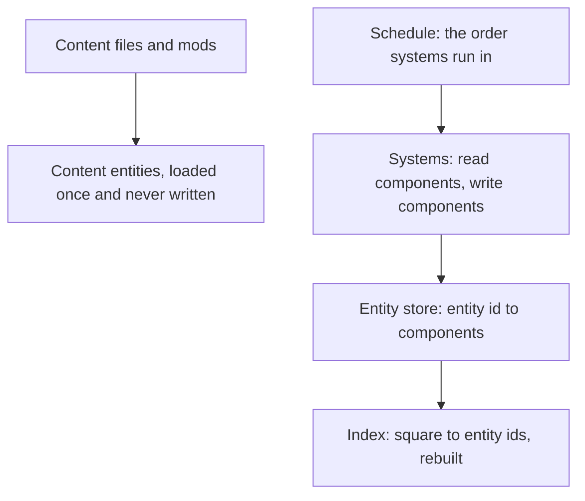
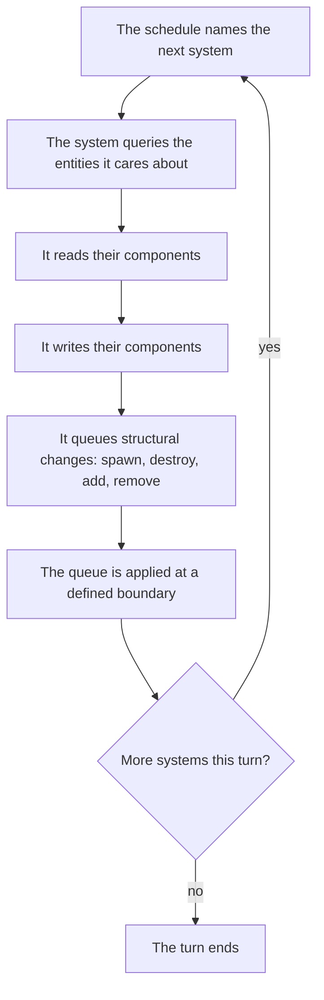

# 01 — Architecture

## The architecture is absolute

This port translates the reference's **logic** into this architecture. It never imports the
reference's **structure**.

| Comes across | Does not come across |
|---|---|
| what a rule decides, and the numbers it uses | the classes, members and containers it decides them in |
| the data's meaning: an item has charges, a field has an age | per-square arrays, parallel containers, caches beside the truth |
| the order the game's own steps depend on | a turn function that calls twenty subsystems in code |
| the tables and constants it reads | the shape of the objects those tables are loaded into |

The rules below are not preferences to be weighed against convenience. Code that breaks one is
wrong even when it produces the right answer, because the next person adding a kind of thing will
build on whichever shape they find.

1. One store: entities and components. Nothing else is authoritative.
2. A thing is an entity. What it is and what it can do is the components it carries.
3. "What is at this square?" costs one step, and that step is a derived index.
4. Data in components, logic in systems, order in the schedule.
5. References are entity ids, never pointers.

`crates/sim/tests/sim_suite/architecture.rs` holds the line, and most of it is **dynamic**: it
builds a world, rebuilds the index and compares the two.

- the index is exactly the store, in both directions;
- a drifted index is caught, and a rebuild repairs it (this test is the proof that the comparison
  above can fail, so it is never vacuous);
- a destroyed thing leaves no ghost, and its id stops resolving;
- a thing is whatever components it carries: add one and the queries that ask for it see the
  thing, remove it and they stop, with the entity never recreated;
- a query never sees what it did not ask for;
- no entity is an empty shell, so no state exists that is not a component on a thing.

Two **ledgers** read the sources, because the thing they count has no runtime surface: the set of
globals may only shrink, and the simulation may hold no pointer or shared ownership. A ledger is
not proof of behaviour; it is the record of a debt.

## Principles

1. **One store.** The entity store is the only source of truth. Every fact about the
   world is a component on an entity. Nothing is stored in a per-square array, a side
   table or a global that runs beside the store.
2. **A thing is an entity.** What a thing is, and what it can do, is decided by the
   components attached to it. Composition, not class.
3. **"What is at this square?" is one step.** The index answers it, and the index is
   derived from the store.
4. **Data in components, logic in systems, order in the schedule.**
5. **References are entity ids, never pointers.**

---

## Layers

The index is drawn as fed by the store because that is the dependency direction: the
store is truth, the index is a rebuilt view of it. If the two disagree, the store wins
and the index is rebuilt.

---

## 1. The entity store

**Every thing that exists is an entity.** A square, the ground of that square, a wall,
a piece of furniture, an item lying on the floor, an item inside a bag, a creature, a
fire, a patch of smoke, a torch, an item type, the clock: all of them are entities.

- An **entity** is an id. On its own it holds nothing.
- A **component** is a plain struct attached to an entity, holding data. It has no
  methods. Behaviour comes from systems that read and write it.
- An entity is not an object. It has no invariants of its own and no pointers to other
  entities.

### The three shapes an entity can take

This list is exhaustive: every entity in the game is one of these three rows.

| Shape | What it means | Which entities | How it is stored |
|---|---|---|---|
| **In the world** | it stands on a square | squares, ground, walls, furniture, items on the ground, creatures, fire, smoke, light sources | `Position` plus the components that describe it |
| **Held by another** | it is inside, on or part of another entity | an item inside a container, in a pocket, in a stomach | `Inside` (which entity holds it), and no `Position` |
| **Not in the world** | it has no square at all | content types, the clock, the random-number generator, options, weather, the square index | its component, and no `Position` |

There are no other storage shapes. A square is not a container of slots: it is an
ordinary entity of the first row, and the things standing on it are separate entities
that happen to share its position.

### A square holds no contents

A square knows nothing about what is on it. It has no terrain slot, no furniture slot,
no trap slot and no item slot. Its components are values that belong to the square
itself — its position, and values a system computes for it — and nothing else.

Everything standing on a square is an entity in its own right, with a `Position` that
equals the square. Ground, walls, furniture, items, creatures, fire and light sources
are all the same category of thing, placed there, and any number of them can share a
square. What may share a square is decided by the entities themselves — see
[rules are data](#rules-are-data-carried-by-entities).

### A square is an ordinary entity

The square is not a special kind of object. It is an entity with a `Position`, created
when the level is materialised, and it exists so that per-square values have an address
to live at. Once ground is an entity, a level of 132 × 132 squares holds 17,424 square
entities plus the entities standing on them.

### Things that exist once are entities too

A singleton is not a second kind of storage. It is an entity with a marker component, and the
pattern is the same one as for a wall:

| Piece | What it is |
|---|---|
| the data | a normal component, e.g. `SupportLost`, `Radiation`, `Memory`, `FieldRules` |
| the marker | a component that only this entity carries, e.g. `TheFallingQueue` |
| the helper | `singleton::<T, M>` — finds the entity, or spawns it with a default the first time |

`crates/sim/src/singletons.rs` holds the helpers, and `support_lost`, `radiation`, `memory` and
`field_rules` are the first four converted. Asking twice returns the same entity, which is how
"there is exactly one" is tested rather than assumed.

The rest of the globals are still globals: `Climate`, `FieldTable`, `Light`, `Map`,
`PositionIndex`, `Prototypes`, `Scent`, `ScentTable`, `Weather`. The architecture gate counts
them and they may only shrink.

### Rules are data carried by entities

Coexistence is a rule of the entities involved, never of the square.

- An entity may carry a component saying what it **admits** on its square: a wall
  admits nothing else; dirt admits a structure and loose items.
- An entity may carry a component saying what it **requires**: a wall requires a
  solid surface under it.
- An entity that supports things on top of it carries its own **capacity**.

Placement is one system: it asks the entities standing on the square whether a
newcomer is admitted, then asks the newcomer whether what the square already holds
satisfies its requirements. A refusal is the incumbent's rule, not a check written in
a central list of kinds.

### What the store holds today

**As built:** the seventeen components in [§2](#2-components), on entities created by
`drop_item`, `spawn_monster` and the field system.

**Target:** the same, plus a ground entity per generated square, plus the placement,
requirement and capacity components of [rules are data](#rules-are-data-carried-by-entities).

**Not yet built, and named here so the gap is not mistaken for a decision:** terrain,
furniture and traps are still held in per-square arrays inside the level
([`Submap`](../crates/core-types/src/submap.rs)), not as components. That is the
largest remaining violation of principle 1.

**The same goes for every `Resource` in the code today** — thirteen of them:
`FieldRules`, `FieldTable`, `PositionIndex`, `SupportLost`, `Light`, `Map`,
`Prototypes`, `Memory`, `Radiation`, `Scent`, `ScentTable`, `Weather`, `Climate`. Each
is a singleton standing beside the store. They are not a second design; they are the
part of the port that has not moved yet. The target is an entity per singleton, with a
marker component, exactly as [§1](#the-three-shapes-an-entity-can-take) describes for
the third shape.

---

## 2. Components

Components are grouped by concern, not by kind of thing. This is the catalogue of the
components that exist today (`crates/sim/src/lib.rs`):

| Component | Carried by | Contents |
|---|---|---|
| `Position` | every entity that stands on a square | the square: column, row, level |
| `Field` | fire, smoke, blood, acid, gas | kind, strength, age, decay rules |
| `GroundItem` | loose items | prototype id, count, charges, age, damage, how it burns |
| `Monster` | creatures | kind, hit points, moves |
| `CorpseOf` | a corpse item | which creature it was, and how big it was |
| `LightSource` | anything that shines | brightness |
| `Container`, `Inside`, `InPocket` | item trees | what holds what, and in which pocket |
| `Inventory`, `Player`, `CraftInProgress`, `MealTally` | the character | what they carry, what they are doing, what they have eaten |
| `ItemFlags`, `ItemDamage`, `ItemFaults`, `Butchery` | items | flags, damage level, faults, butchering state |

**Values computed for a square are components too.** A square's brightness, what a
character can see of it, how much scent or radiation it carries: each is a component on
that square's entity, written by exactly one system and overwritten on the next
recompute. They are never saved and never read back as input by a rule.

**A component appears in the store only when a system needs it.** Reserved names for
parts of the port that are not built yet: `Actor`, `Brain`, `ActionPoints`, `Stats`,
`Effect`, `BodyPlan`, `Vehicle`, `Projectile`, `Active`.

**The creature/scenery distinction is emergent, not structural.** A dog is a `Monster`
with behaviour systems behind it; a wall is an entity that no system queries. Nothing
checks "is this scenery?" — a system that asks for creatures never sees a wall. A new
kind of thing is a new composition of components, not a new storage class.

---

## 3. The index

The index maps a square to the entities standing there.

**Shape as built:** a map keyed by `(x, y, z)`, holding either nothing or a short list
of entity ids, rebuilt in one pass by walking every entity that carries `Position`
([`PositionIndex`](../crates/sim/src/lib.rs)). **Shape as targeted:** one dense slot
per square of a materialised reality bubble. The interface (`.at(x, y)`,
`.at_level(x, y, z)`) does not change either way.

| Scale | Value |
|---|---|
| Squares per level | 17,424 (132 × 132) |
| Levels in play | 21 (z-levels −10 to +10) |
| Total slots | 365,904 |
| Index memory at 4 bytes per slot | ~1.5 MB |

**Rules:**

- The index is never a source of truth. It is rebuilt, not patched: one pass over the
  entities carrying `Position`. A rebuild cannot drift, and asking it twice in a row
  costs the same as asking once. Incremental maintenance is a later optimisation and
  must land behind the same interface.
- Entity order inside one square is spawn order, so iterating a square is
  deterministic. Determinism is a requirement, not an accident.
- The index is derived, so it is never saved, and it is never consulted to decide
  whether something exists; the store decides that.

**Why it exists:** "what is at this square?" is asked by movement, vision, pathfinding,
item pickup, interaction and rendering, many times per turn per square. Answering it by
scanning entities is the one thing this architecture must never do.

---

## 4. Content

Two levels of identity, and only one of them is mutable.

| | Content type | Entity in the world |
|---|---|---|
| What | the definition of a kind | one actual thing |
| Storage | an entity with its data components and no `Position` | an entity with `Position` and its components |
| Lifetime | loaded at startup, never written afterwards | spawned, changed, destroyed |
| Shared | yes, by every instance | no |

Example: the sock content type says 40 g, warmth 5, covers feet.

| Entity | Refers to | Own state |
|---|---|---|
| #8123 | sock | 78% condition, inside a backpack |
| #8124 | sock | 100% condition, on the floor |

Both are the same sock definition. Neither owns its weight. Writing to a content type
at runtime would change every sock in the world, which is why nothing does.

**Content types may inherit from other content types** ("wool sock" is "sock" plus
overrides), so definitions form a hierarchy while live entities stay flat.

**Pipeline:** JSON is loaded into content entities at startup; world entities store a
reference to the content entity, never a copy. This is the part of the reference
implementation that is already right and is kept: it registers 188 content types in one
table ([init.cpp:271](../references/Cataclysm-DDA/src/init.cpp#L271)) and materialises
each into versioned registries
([generic_factory.h:134](../references/Cataclysm-DDA/src/generic_factory.h#L134)).
Mods only ever touch this layer.

---

## 5. Systems and the schedule

**A system is a function with two declarations:** which components it reads, and which
it writes. Everything else follows from that.

**Order is data.** The schedule is an ordered list of systems, declared in one place,
not a chain of calls buried inside one large function. The reference's turn is a
single 285-line function that hardcodes the order of about twenty subsystems
([do_turn.cpp:455](../references/Cataclysm-DDA/src/do_turn.cpp#L455)); replacing that
is the point, not replacing the subsystems.

**Structural changes happen at defined boundaries.** A turn is already an atomic step,
so queueing landed work once per turn matches the domain. Extra boundaries are added
only where ordering demands immediate visibility, for example an item picked up must be
visible to the next action in the same turn.

**Determinism.** One random stream, systems in a fixed order, stable iteration order
within queries. This is a hard requirement for saves, tests and replaying a bug report.
The reference enforces it with a lint that bans stray random sources
(`tools/clang-tidy-plugin/DeterminismCheck.cpp`); the same discipline applies here.

**Parallelism.** Not in the first version. Read and write declarations are recorded from
the start so independent systems can run concurrently later without re-architecting.

---

## 6. Chunks and streaming

- The world is divided into chunks, and a chunk is the unit of loading, saving and
  waking.
- **Only loaded chunks have entities.** A square in an unloaded chunk has no entity at
  all, and the index has no slot for it. "Not loaded" is a state of the index, not a
  value stored on a square.
- A chunk does not have to be an entity; it may become one to give systems a handle for
  waking and sleeping.
- **Asleep is a component** (`Active`), not a special case in code: only entities with
  `Active` are visited every turn, and everything else is touched when it is asked for.

That last point is where the speed comes from: a wall costs nothing per turn because no
system selects it.

---

## 7. Persistence

- A save is a dump of entities and their components, with references to content types by
  entity id. The index is not saved; it is rebuilt on load, which removes a class of
  corruption bugs. Values computed for a square are not saved either; they are
  recomputed.
- Content types are versioned, world entities reference them, and a migration step
  rewrites old components.
- Open: the format (binary or text), chunk-granular saves, and how mods that disappear
  between saves are handled.

---

## 8. Invariants and failure modes

| Invariant | If broken |
|---|---|
| Every entity with `Position` appears exactly once in the index | Ghost entities, invisible walls, items that cannot be picked up |
| No component holds world state that the store does not hold | Two sources of truth that drift |
| Index order is deterministic | Saves and bug reports stop being reproducible |
| Content types never change at runtime | Every instance of a kind changes at once |
| Structural changes only at defined boundaries | Iteration invalidated mid-system, or duplicate processing |
| Systems declare their reads and writes honestly | Silent data races once systems are parallelised |

The design's real risk is not speed. It is **two sources of truth** and **order
dependence**, and both are prevented by construction: there is one store, and system
order is data that can be inspected and diffed.
