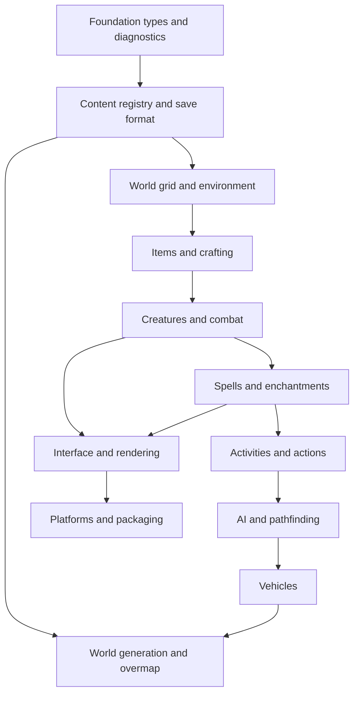

# 05 — End-to-end porting roadmap

Baseline: `0.I-1`, commit `7b2efa5`, 840 files / 565,083 LOC in `src/` (third-party excluded).
Every file is assigned to exactly one phase in [appendix-file-map.md](appendix-file-map.md) — 100% coverage, no orphans.

This roadmap answers one question: **what gets ported when, and what proves it was ported correctly.**

---

## 1. Ordering principles

| # | Rule | Why | Evidence |
|---|---|---|---|
| R1 | Leaves first | Foundation headers are depended on by nearly everything; porting a mid-layer file before its dependencies means porting it twice | `type_id.h` 293 includers, `debug.h` 269, `point.h` 221, `coordinates.h` 195 | <!-- verified: include fan-in counts -->
| R2 | Build the measuring instrument before the thing it measures | Without a state dump, a replay driver and a digest, a ported system cannot be proven equal — only "looks fine" | No `--dump-*` flag exists at baseline; the harness is new code we write | <!-- verified: grep '"--dump' src/ = 0 hits -->
| R3 | Vertical slices, not horizontal layers | Every phase must end with something that runs and diffs; a half-ported layer has no gate | — |
| R4 | Data before behaviour | 160 JSON types and 6,220 files are the shared input of every later phase; a digest mismatch found here costs minutes, found in P7 it costs weeks | `init.cpp:263-471` registrations | <!-- verified -->
| R5 | Interface last | The UI has the weakest oracle (zero presentation tests) and cannot be validated until the simulation under it is correct | 0 test files include `uilist.h`, `input_context.h`, `sdltiles.h` | <!-- verified -->
| R6 | Packaging last | Build files are throwaway until the binary is worth shipping | 9 release artifacts across 5 targets (`release.yml` matrix) | <!-- verified -->

---

## 2. Phase map

| Phase | Files | LOC | Share | Depends on | Exit gate | Effort class |
|---|---|---|---|---|---|---|
| P0 Foundation | 189 | 62,866 | 11.1% | — | RNG + text + JSON parity vs oracle | mechanical, RNG redesign |
| P1 Registry & saves | 131 | 61,911 | 11.0% | P0 | prototype digest equal; oracle self-consistent | mechanical ×92 types, save format redesign |
| P2 World grid | 60 | 40,200 | 7.1% | P1 | environment-only replay equal | moderate |
| P3 Items | 86 | 91,446 | 16.2% | P2 | item/inventory/crafting replay equal | moderate, `item_location` redesign |
| P4 Creatures | 83 | 74,569 | 13.2% | P3 | creature/combat replay equal | redesign |
| P5 Spells & enchantments | 10 | 9,444 | 1.7% | P2–P4 | spell/enchantment replay equal | moderate |
| P6 Activities | 22 | 26,317 | 4.7% | P5 | activity replay equal | moderate |
| P7 AI | 57 | 38,090 | 6.7% | P6 | combat/NPC session replay equal | redesign |
| P8 Vehicles | 21 | 25,752 | 4.6% | P7 | vehicle session replay equal | redesign |
| P9 World generation | 43 | 47,547 | 8.4% | P1, P8 | same seed → same world digest | moderate, mapgen redesign |
| P10 Interface | 113 | 59,329 | 10.5% | P4, P5 | scripted frame parity, 0 cell diffs | redesign |
| P11 Platform | 25 | 27,612 | 4.9% | P10 | packaging + perf within 10% | throwaway + platform work |
| **total** | **840** | **565,083** | **100%** | | | |

Sizes are the C++ lines being replaced, not the Rust lines to be written. They are a proxy for
surface area, not effort: P0 is 11% of the code and the highest-risk 11%, because everything
inherits its mistakes.

---

## 3. Milestones

| # | After | Meaning | Proof |
|---|---|---|---|
| M0 | P0 | Harness exists; no gameplay yet | RNG draw-for-draw equality; JSON accept/reject parity — **passed**; see [parity.md](parity.md) |
| M1 | P1 | The game's *content* loads identically | Prototype digest equal over 6,220 files, 42 mods, 160 types |
| M2 | P2 | The world ticks identically for environment-only sessions | Replay hash per turn over weather/light/field sessions |
| M3 | P3–P6 | A character can act, craft, fight and cast identically | Replay hash over recorded gameplay sessions |
| M4 | P7–P8 | Full simulation parity including NPC/monster AI and vehicles | Replay hash on late-game combat and driving sessions |
| M5 | P9 | Worlds generate identically from a seed | Same seed → same overmap, city layout, hordes and map chunks |
| M6 | P10 | Playable: visually equivalent | 0 cell differences on the semantic frame gate |
| M7 | P11 | Shipped on the agreed platforms within the perf budget | Artifacts built; perf gate green |

M1 is the first milestone that proves anything. Everything before it is scaffolding.

**Where the work stands.** M0 is passed. The id half of M1 is **finished**: all 90
registries the reference reports are now reproduced exactly, with nothing invented
- terrain and its types, overmap specials, effect-on-conditions, items, monsters,
materials, fields, traps and the rest. Seven loader families
carry field-level corpora from the reference's own dumps (terrain and furniture,
traps, materials, field types, item types, monster types, and the generated
prototypes those loaders create), the registry gate is **90 of 90 id sets
exactly, with no named gaps at all**, and JSON reading and writing match over all
6,220 data files. The last eight ids closed because a plain `flags` member *replaces*
inherited flags while `extend.flags` adds to them - treating the two the same way is
what kept two overmap terrain types wrong.

**P9 has a world on both sides now.** The reference's own overmap, noise field and final terrain can be
dumped in one run from one seed, and the port's rules are checked against that terrain tile for tile: **1,681 of
1,681 tiles accounted for**, with every disagreement being a square the town wrote over. The world layer itself has
gone from a blank grid to woodland from the reference's own noise (**matched to a part in a million on 1,681
points**), cities, streets, **shaped road tiles** in the reference's box-drawing vocabulary, and buildings placed
from the reference's own **258 specials, 35 locations, 178 houses, 223 shops and 51 parks** - the whole specials family, loaded, placed and gated against itself. Two bugs the comparison found and reading would not have: the
regional file's forest thresholds (**0.2 / 0.25**) override the header's, and the noise is shifted by a
**forest growth adjustment** that only appears away from the origin.

**The map level is open, and scored.** A second reference dump captures one 24x24 chunk the generator actually built,
with the overmap terrain it belongs to and the terrain id of all **576 squares**. The port reproduces that chunk's whole
rule: corner depths hashed from absolute positions, the curve between them, the six-ticket raffle, the layer chain, the
region's palettes and their chains, furniture that does not replace the ground, and the four neighbours read from the
world rather than assumed. Measured against the dump it matches **291 squares of 576** - and the way that number moved
matters more than the number: seven separate bugs came out of watching it, each invisible from reading the code. A
neighbour that owns no biome must not be divided by its depth; the ceiling is the region's **densest** forest, not the
square's own; the ground gets its **own** raffle, stepped back by the margin, rather than reusing a failed feature's
ticket; palette names chain, so resolving once leaves placeholders on the map; and the raffle's die is a raw 32-bit
value, not a real one. Two consecutive rounds took the score **down** on purpose - 316 to 302, 305 to 291 - because the
assumption behind the higher number was the wrong one, and the ledger says so beside each figure.

What is left is a single square. The pass lays grass at the chunk's corner where the reference lays forest floor, and
two cheap explanations are already dead: the corner's arithmetic checks out by hand (the empty ticket wins 76% there),
and the sample is not mirrored (identity 291 against a best mirror of 307). So the next step is not another inference
but an instrument: a per-square trace saying which ticket the reference drew, whether a layer fired, and what came out.
**That instrument is built and the trace has been taken** (`CDDA_MAP_TRACE`, one line per square, 31 chunks). It says
the corner draws the same ticket the port's arithmetic predicts, so the disagreement is **downstream of the ticket** -
in what plain ground, own biome and neighbour each turn into - rather than in the raffle itself.

The suite now also runs **on a second machine and a second platform**: `tools/remote_test.py` syncs the workspace to
a Linux desktop and runs every gate there in about thirty seconds, so the same 1,217 cases are verified on macOS and
Linux on each run.

**P2 stands here.** Read this against `03-decisions.md`: things are nouns, systems are verbs,
and answers are neither. T1 (a square and the ground on it are entities), T2 (positions come from the store, and the
index is rebuilt from it) and T3 (computed values and their caches) are done.

**`bevy_ecs` is now the backbone** (P2-T0a): the World is the store, entities are the ids,
components are the columns, and the schedule is data. The entity store (P2-T0b) is done and
smoke has begun to move onto it (P2-T0c): a field is an entity with a square, a strength and an
age, and the field system walks it. The old per-square container is **deleted**: the map
layer no longer stores fields, and the lighting system reads smoke from the store instead of a
copy. Two sources of truth became one.

The rest of P2-T0c is done too: the sun writes into the same `Light` answer as the torches
(`cast_sunlight`), so daylight and lamps meet in one place instead of two that a reader has to
reconcile. The ground is still held in per-square arrays, which is the one remaining violation
of the decision: it becomes an entity when the ground task lands. Every map-shaped structure
that exists today was written before that task existed, which is how the plan and the decision
drifted apart: one store is what makes "adding a kind of thing" not mean "writing a container
for it".

T4 has its first processor: smoke and the rest decay, and gas now spreads to a neighbour with
the reference's thinning rule - the fraction of age that moves is the age divided by the
intensity, and a square already holding the gas gets thicker rather than a second field. What is
missing from the processor is the *direction*: the reference picks it with wind power and a
dice roll. The wind half of that now exists - shelter, forest, height and an upwind wall, in the
reference's order - and it is now wired: `spread_gas` rolls for the chance, picks a starting neighbour, walks
clockwise from it and moves one unit, with wind-facing squares resisted by a dice roll. The first fire processors are in as well: a flame burst burns down and becomes a fire vent,
and the vent thins one turn in three and becomes a burst, carrying the age across the change.
Hot air is ported too, so both fire processors now leave the wisps the reference leaves. Vertical movement is **ported and gated** as of round 517-519: the reference tries the square
below first, then a neighbour, then the square above, and two recorded gas sessions replay it
die for die, one of them dropping through a stairwell. Of the twenty-one processors, ten are in
with gates (`fd_fire` and the fire vents, smoke and the hot air kinds, gas spread, the
extinguisher, the shock and acid vents, the self-upgrade, underwater dissipation, and now
`fd_incendiary`); the rest need subsystems the port does not have yet - monsters, items, the
fungal and radiation grids - and the ledger says which is which rather than leaving them
unnamed. T5 illumination is complete end to end, including point
sources and smoke dimming what is behind it.

step.

**T6 vision is well past "not started" and T7 scent is ported to the turn.** What exists and is gated:

| Layer | What it does | Gate |
|---|---|---|
the cast | `map::sees`'s Bresenham walk, stopping before the target so a wall is visible as a wall | 8 tests |
the level | `lit_level`, the chain from `apparent_light_at`, the draw path's answer | 6 tests |
what is shown | `shown_at` = "drawn at all"; `lit_level_at_square` = "at which level" | 5 tests, plus a pin that the two agree |
the wall's face | the eight-neighbour quadrant rule for opaque squares | 2 tests |
scent | marks from `NO_SCENT`/`REDUCE_SCENT`, the `ScentWindow` arithmetic, decay, and the deposit the turn starts with | 11 tests |

**Weather is end to end.** The reference was rebuilt on this machine as a tracked background job (no install was needed - the build tree was configured), which produced the
first oracle dump of the phase: **20 weather types** with their derived numbers. The loader is gated on it, the `Weather` resource takes a loaded type rather than a hand-set
penalty, and a test proves fog dims a lamp by exactly the absorption it adds. The weather *system* is no longer a gap: the generator, the condition loop, the sun and the manager are
ported and gated (see [parity.md](parity.md)), on the recorded ten-day day and on 240 hours of the
manager with fourteen absorption changes. What remains of weather is declared rather than unknown: the
falling-snow tile layer, and the lightning strike - and the strike waits on creatures, because the
reference's own use of it is to supercharge a monster in `monster.cpp`.

**The frame gate has both halves, and its terms are measured.** The reference's own frame is committed beside the prototype corpora (1,681 squares with glyph, terrain,
furniture and light), and its glyph column has been read rather than assumed: 1,638 of the 1,681 squares print the terrain prototype's own symbol and 43 print something drawn on
top of it. So the port can be diffed square by square over 1,638 squares today, and the remaining 43 are a named gap that closes when items and creatures exist. What is left is
the join: build the port's world for that fixture and diff.

**A frame can be drawn, and it is text.** `sim::frame::frame` asks the three questions a cell needs - what is there, how lit, how seen - once per view, and `Frame::levels`
prints one character per square (`B L l * .`). That string is the semantic frame gate's unit of comparison, and the tests already assert against it square by square. What it
still needs is an oracle: the reference's own frame for the same fixture, which is the same outstanding build as the weather dump.

**"Hazy" is answered now.** The sight cast carries the reference's own fraction (`cast_seen_light`), so a square seen only through smoke is `BRIGHT_ONLY` - a glow with nothing in
it - and a wall in plain sight is `BRIGHT`. What T6 still lacks is the *grid*: the port asks "how clearly is this square seen" one square at a time and rebuilds the cast for each
answer, where the reference keeps a `seen_cache` per level and rebuilds it once. That is a shape problem, not a rule problem, and it is the next step before a frame is drawn.

Fields come before vision for a reason: smoke is both a field and a thing that blocks sight,
and the light model is now good enough to notice the difference.

Every porting task follows [14-test-porting.md](14-test-porting.md): dump first, write
the failing gate, port the smallest thing that clears it, then tighten the gate. The
fast loop is `python3 tools/test_fast.py`, which runs the test binaries concurrently
(43 s for the whole suite against 156 s serial) and reports what each one cost.

P2 has begun with its first task: tile storage, the uniform page that costs nothing
until it diverges ([parity.md](parity.md)). **A gate that is piped is not a gate.** Clippy has been run every round and twice committed over
since the output went through `grep` for the word "error": the exit status was never read, and a
`-D warnings` failure lists `error:` lines that a grep for something else does not show. The gate is
`cargo clippy ... | grep -cE "^error"` returning **0**, not "I looked and saw nothing".

Run long oracle commands in the
foreground, never backgrounded - a cancelled background dump keeps parsing for
ever, and two of them once held this machine above a load average of eleven. Killing the job
does not kill the process: last round a cancelled dump's child kept generating a map for minutes
after its shell was killed. The check after every long run is `pgrep -fl cataclysm`.

Resume at the mapgen loader: start from `load_and_add_mapgen_function`
(`src/mapgen.cpp:1400-1480`), reproduce the terrain ids it derives from
`om_terrain` arrays - chunked per position and per rotation - and hold them to
`corpus/prototypes/ids.json`, which already names every one of them.

Two smaller gaps are recorded rather than forgotten: the chi-squared roll, which
needs libc++'s gamma sampler and drives NPC mutation timing (`src/npc.cpp:663`),
and `normal_roll_chance`'s error function, which agrees to 4e-8 rather than
exactly. Neither is dead code; both are named where they are used.

---

### The mapgen family's groundwork is measured and pinned (round 493)

The generator is not written, but everything it has to satisfy is now a number or a test rather than a reading of the schema:

| Fact | Value | Where |
|---|---|---|
registry | the reference's **6,306**, both directions | `content_suite::mapgen_keys` |
keys in the data | 6,284, plus 26 in code, minus 4 selectors | same |
entry shape | the map is under `object` in **all 6,216**; never at the top level | same |
terrain declaration | eight combinations, each pinned (2,411 palette-only, 150 grid-with-no-terrain, 1,302 placement-only, ...) | same |
palette graph | **481** palettes, 5,304 references, 278 names, **0** dangling, **0** cycles | same |
first step written | `mapgen::resolve_rows` turns a grid into terrain ids through its own map | `content_suite` |

Two mechanisms remain to be written before a chunk can be produced: **transitive palette resolution** (the graph is proven acyclic, so a plain walk suffices) and
**predecessor mapgens** (one chunk in the data is drawn over another). The thick forest - the chunk we dumped - is generated in code, so the first end-to-end comparison will need a
chunk whose mapgen the data describes rather than that one.

### The mapgen family has its first gate (round 461)

The registry is an equality now: the keys written in the data, plus the twenty-six the game registers in code, minus the four `om_terrain` ids that are selectors rather than chunks,
comes to the reference's **6,306** exactly, and the test names what a port would miss and what it would wrongly offer as two separate failures.

That was the precondition for generating anything. What follows is the generator itself, and the two things it needs are already in the corpus: the palette a chunk is drawn from
(`corpus/maps/reference_map.json`, 27 terrain kinds over 576 squares) and the shape a generated chunk must take (24 by 24, every id known to the terrain loader).

### The oracle now covers all three questions (round 435)

The instrumented reference answers what the port has to match, and as of this round it can be asked all three kinds of question:

| Question | Flag | Corpus |
|---|---|---|
what the data says | `--dump-weather`, `--dump-fields`, `--dump-terrain`, `--dump-items`, `--dump-prototype-ids` | `corpus/prototypes/` |
what one square looks like | `--dump-frame` | `corpus/frames/` |
what generation produced | `--dump-map` | `corpus/maps/` |

The third needed a guard rather than a fix: a read past the loaded chunk waits for overmap generation that a headless run never performs, so the dump now asks only for squares the map
holds. With that, the reference's answer to "what does this chunk look like" is reproducible on demand, which is what a mapgen gate needs.

### M2 is closed: every clause of the exit gate now has a session and a receipt (round 556)

The gate reads: *per-turn state hash equality on environment-only sessions covering weather transitions, fire and gas spread, light changes across z-levels, scent
diffusion, and vision.* All five clauses are now met, each by a replayed reference recording rather than by a hand-written case:

| Clause | Fixture | What is compared | Result |
|---|---|---|---|
weather transitions | `corpus/fields/weather-session.json` | 27 turns: the sky recomputed from the generator's inputs, the manager's decisions replayed from the reference's dice, sector included | receipt `0x4c221d74263f52f4`, equal to the record's |
fire and gas spread | `gas-60`, `gas-fall`, `gas-wind`, the fire sessions | every field on every square, turn by turn, die for die | receipts `0xbb4513a5ce73269a`, `0x033342d5a7845618`, `0x12ca5c3c692106d4` |
light across z-levels | `corpus/fields/light-session.json` | `map::light_at` on every square of the fire's level, seven turns | **175 of 175 squares agree** (round 555) |
scent diffusion | `corpus/fields/scent-session.json` | the diffusing window, turn by turn | receipt `0xaac13754071041c0`, equal to the record's |
vision | `corpus/vision/start-location.json` | the whole `seen_cache` over three levels | **867 of 867 squares agree** (round 544) |

Two of the five clauses had to be *built* before they could be gated - the light session had no light in it until round 552, and its first recording was wrong in a way that
took an instrument fix to see (round 555: the dump built every level before reading any). That is the milestone's real lesson: **an oracle that records the wrong column is
worse than no oracle**, because it fails a correct port and passes an incorrect one.

What is *not* in M2 and stays declared: the field processors that need subsystems (monsters, items, the fungal and radiation grids), and the weather beyond the manager -
pressure systems moving across the overmap, which needs an overmap.

**Next: P3.** The roadmap's P3 is items, inventory, crafting and interaction, and the ledger already carries declared partials to close in order: eating and its data,
crafting activity and time, skills, container handling, item weight and volume, and consuming.

### P3 crafting, after the oracle gate (updated at round 1007)

**The crafting rules now have a corpus gate of their own.** `--dump-crafting` gives what every recipe **produces** for a batch of one and of two, `content_suite::crafting_results`
compares all **12,582** batches, and the disagreements are **counted, not tolerated**:

| Outcome | Batches | What closes it |
|---|---|---|
the port makes exactly what the reference makes | **12,256** | - |
the reference wraps the result in a **container** | **302** | **item containment**: an item inside an item, which the port has for pockets on a creature but not for things in things |
the byproducts are drawn from an **inline `byproduct_group`** | **14** | the group model at load time and a draw at craft time - `{"item": "arrow_wood_heavy", "count": [0, 4]}` |
unexplained | **0** | - |

**So P3's next two pieces are named:** item containment (302 batches, and it is what `contained` recipes need), then `byproduct_group` (14 batches, and it needs the
item-group model that already exists for **named** groups to grow an **inline** form).

**What P3 still lacks beyond those:** the **charge** half of the fifth-percent hook (the hook exists and the proficiencies use it; the tool charges are still spent at the
finish), the **skill** ticks moved onto the same boundary, focus's other two equilibrium inputs, and the container eligibility rule for liquids.

### Where the work stands after the dialogue census (updated at round 992)

**The dialogue frontier is now blocked on world generation, and the numbers say so.** Forty-six of the census's run-time refusals are one gap: a census world built from
data alone has **no overmap**, so an effect that aims at an `om_terrain` (`mapgen_update`, 18) or searches the overmap (`u_location_variable`, 28) correctly refuses. Those
move in the built-world census or in **P9 world generation**, not with another reader.

**P3 items is the phase the roadmap points at next**, and its *data* side is already measured: `corpus/recipes.json` holds 6,291 recipes and the content suite pins
requirements, tools and skills against it (`recipe_requirements`, `recipe_tools`, `recipe_skills`, `recipes`). What it does **not** have is a behaviour gate - the port has
`crafting::begin_craft` / `finish_craft`, and no oracle dump to prove them against.

**So the next round's first task is a harness flag, not a port rule:** `--dump-crafting`, one record per recipe carrying what `craft::can_craft` decides (skill check,
tool and quality availability, component counts, the time it takes) so the port's crafting has a red gate of its own. **The oracle must lead the loader**, and here it does
not yet.

### What the next round should pick up (updated at round 976)

**The frontier is dialogue effects, not weather.** M2 is closed and the environment family is measured; since then the work has been the effect-on-condition census, which is
the port's instrument for "how much of the data's scripting can this game carry out". The numbers below are pinned in `crates/sim/tests/sim_suite/numbers.rs` and printed by
the census tests; every one of them is a *count of the corpus*, not an estimate.

| Census | Now | Of |
|---|---|---|
programs readable | **577** | 692 |
programs that run in a fresh world | **387** | 692 |
programs refused at run time | **190** | 692 |
conditions readable | **3,226** | 3,708 |
effect entries runnable | **1,527** | 1,612 |

**What the remaining refusals are, in the order the call graph ranks them:**

1. **`run_eocs(calls a program that is not installed)` (53)** - upstream of thirty-two unreadable programs. **This is the bucket that shrinks when a reader lands**, and it
   is the honest measure of how much of the corpus is one rule away.
2. **`mapgen_update` (18)** - the census installs the update tables, so the refusal is inside `apply` or the aiming; needs one refusing entry's JSON.
3. **`place_override` (17)** - a store the port lacks: the place's name and the turn it changes back.
4. **`u_spawn_monster` (14)** - the monster spawn rule exists; these entries aim somewhere or name a group the census does not install.
5. **`if` (12)** and **`math` (10)** - conditions inside a branch.

**The remaining unreadable entries are now dominated by stores, not readers.** The diagnostic in `content_suite::refusals` ranks the thirty-two programs by the first
entry that refuses: `key` (3, a `revert_location` needing a **submap baseline**), `effect` (2, a `foreach`), `else` (2, `map_in_city` needing the **city layer**),
`false_eocs` (2, a trade branch), `group` (2, whole-group spawning), `run_eocs` (2), and a tail of one-offs. **Three of the six biggest causes are stores the port has
never had**, which is why the last four rounds spent a diagnostic before each rule: the frontier moved from readers to storage, and no reader-shaped tool could say so.

**And the stores the frontier is waiting on, named so they stop being rediscovered:** mutation categories, camps and allies (`npc_allies`), submap reverts
(`revert_location`), event arguments (`trigger_event`), place renaming (`place_override`), and item selection menus (`u_run_inv_eocs: "manual"`).

The gate reads: *per-turn state hash equality on environment-only sessions covering weather transitions, fire and gas spread, light changes across z-levels, scent
diffusion, and vision.* All five clauses are now met, each by a replayed reference recording rather than by a hand-written case:

The weather is a **system** now: the generator's numbers, the condition loop, the sun it needs, and the manager that holds them between turns are all ported and gated, the last
three against the reference's own recorded day. Two things finish it and one thing starts the next piece of M2.

1. ~~Join the pieces into one call~~ - done in round 511: `weather::System::tick` computes the point, decides the sky and books the next change in one call, and reproduces the
   recorded day from the recorded dice alone.
2. ~~The transparency flush, for real~~ - done in round 512: `Map::on_weather_change` marks the level's light stale exactly when the sight penalty changes, and the next read rebuilds
   once. The reference's loop over the overmap's depth is a single mark until the port has more than one level.
3. **A ten-day weather recording** is now the gate (round 514): `--dump-weather-manager` covers the manager's own path, the port replays 240 hours with fourteen absorption
   changes, and it found three real bugs (a data function that could not see the point, a missing requirement chain, and sight penalties that were all one). One temperature sits a
   moment's temperature is now bit-exact: the hook `harness_weather_temperature_terms` records the pre-narrowing double and its terms, which showed the residual was a
   fixture written to ten digits and a `float` product the port was computing in double. One humidity hour remains one ulp out, which is macOS `cos` against Linux `cos`.
4. **Weather in the world** is wired (round 513): `Climate` is a resource, `tick_climate` runs a turn of it, and `run_environment_turn` takes the world's wind over its own.
   The recorded session with a transition now exists (round 531: `--turn-minutes` and the sky on every turn) and both halves of it are gated - the point is recomputed from the
   generator's own inputs (round 532) and the manager's decisions are replayed from the reference's dice, sector included (round 533).
5. **Vision across z-levels** now has its oracle (round 536): `--dump-visibility` writes each level's `seen_cache` and `transparency_cache`, and the first fixture shows
   the character seeing squares of the level below through an opening and nothing above it. `cast_zlight` is now transcribed whole in `cdda_core_types::zlight`, and it
   **reproduces the reference's own seen cache on 867 of 867 squares** over three levels (round 544). Two port-wide bugs fell out on the way: `MAX_VIEW_DISTANCE` was 72
   where the reference computes 60, and `rl_dist` was Chebyshev where `CIRCLEDIST` makes it the truncated Euclidean length.
6. **The per-turn state hash exists** (rounds 547-549): fields, scent and the sky are three layers of one digest, and every environment session has a receipt number. The sight cast is now the reference's (round 545): `Level::seen_cast` runs `cast_zlight`, and ~~one red gate stays as the next thing to fix - smoke's transparency is not folded into the span before the square behind it is written~~ **closed in round 570**: the frame's transparency table now folds the furniture layer and the fields in, and the fields **multiply** the way `calc_transp` says rather than winning a `min` - which makes smoke at its second intensity ten times as absorbing as air and smoke at its third intensity a wall. Two gates pin it (`frame_smoke`): a square behind smoke is seen less, and behind dense smoke not at all.

## 4. Phase detail

### P0 — Foundation types, IDs, RNG, text, diagnostics (189 files, 62,866 LOC)

**Contents.** Coordinates and geometry (`coordinates.h` 1,172; `point.h` 514; 38 origin/scale aliases in `coords_fwd.h:44-103`), units, calendar/time, RNG wrapper, `string_id`/`int_id`/`type_id`,
`generic_factory` scaffolding, JSON read/write types, flexbuffer wrapper, translation lookup, colours,
options table, path handling, assertions and debug reporting, containers (`colony`, `list`, `mdarray`,
`cata_bitset`), hashing, formatting.

**Why first.** `coordinates.h` is included by 195 files and `point.h` by 221. The coordinate layer is
pure value types with no state and no RNG — the cheapest place to be exactly right, and the most
expensive place to be approximately right.

**Hard parts, not mechanical.**
- **Origin/scale legality.** The C++ type system refuses illegal cross-scale arithmetic by only
  defining operators where legal (`coordinates.h:97-196`). A naive `Point(i32,i32,i32)` in Rust
  compiles and silently reintroduces the bug class the types exist to prevent. Rust newtypes must
  reproduce the same legality matrix, not just the arithmetic. <!-- verified -->
- **RNG equivalence.** The engine is `std::minstd_rand0` (`rng.h:30`) — trivially portable. The
  *distributions* are not: 1,441 wrapper call sites go through `std::uniform_int_distribution`,
  `uniform_real`, `normal`, `exponential`, `chi_squared` (`rng.cpp:16-97`), whose algorithms are
  library-specific. See blocker B1. <!-- verified -->
- **JSON semantic strictness.** Duplicate keys are a hard error (`flexbuffer_cache.cpp:74`), unvisited
  members are reported globally (`flexbuffer_json.cpp:14`). A conventional Rust deserialiser accepts
  files the reference rejects, which weakens content validation for every later phase. <!-- verified -->
- **Diagnostics.** Debug levels, error formatting and the test hooks that later gates depend on.

**Not in this phase:** anything that mutates the world.

**Exit gate.** Byte-identical text/formatting output on a fixture corpus; 10M-draw RNG comparison
across every wrapper; JSON accept/reject parity on a corpus of valid, duplicate-key, and malformed
files; the CI pipeline from [port-validation.yml](../.github/workflows/port-validation.yml) runs green.

---

### P1 — Content registry, mods, save format, oracle harness (131 files, 61,911 LOC)

**Contents.** The 160 JSON type loaders, `generic_factory` instantiation for ~92 prototype types
across 68 files / 64,883 LOC, mod manager and dependency graph, options and keybindings, the save/load
graph, compression and archives, plus the harness modes the oracle needs (`--replay`, `--dump-state`,
`--dump-frame`, `--dump-prototype-digest`).

**Why here.** Two independent reasons converge. First, all later phases read prototypes through this
layer, so a wrong inheritance rule corrupts every system at once. Second, the differential harness needs
(a) deterministic RNG from P0, (b) save loading and (c) a state dump — so the harness cannot start
before this phase and everything after it depends on the harness. <!-- inference: ordering rationale -->

**Hard parts.**
- **Inheritance and merge semantics are the content language.** `copy-from` appears 16,444 times,
  `extend` 4,240, `proportional` 2,151, `relative` 790, `delete` 781, `abstract` 465 across 6,220 files.
  The merge operators are *not* centralised — each type implements its own (`assign.cpp:60-398`,
  `mapdata.cpp:1072-1088`, `monstergenerator.cpp:823`). <!-- verified -->
- **Provenance is load-bearing.** Every prototype carries the `src` string of the mod that defined it
  (`generic_factory.h:305,317,352`), used for duplicate detection and origin display. <!-- verified -->
- **Load order is filesystem order** (BFS with per-level sort, `filesystem.cpp:332,372-374`) while mod
  order is a user-ordered list replayed verbatim (`mod_manager.cpp:427-444`). <!-- verified -->
- **`int_id` is explicitly unstable across reloads** (`string_id.h:59-73`) — which confirms the design's
  rule that entities reference prototypes by string id and that any integer index is a rebuildable cache.
- **Save format** — see blocker B2.
- **Options are C++, not data**: 188 `add(...)` declarations (`options.cpp`) plus 88 JSON options. Decide once
  whether they become a data table or stay code; either way it is 4,206 lines to move. <!-- verified -->

**Exit gate (M1).** Prototype digest equality across the full data set and all 42 in-repo mods
(the digest is now ported and **88 of the 90 registries pass**; the two left, `city` and `magic_type`, hold no ids at all); mod load-order
and duplicate-detection parity; oracle self-consistency gate green (see B1); a reference state dump loads
into the port and reproduces the same digest.

---

### P1 status at round 341

**M1 is green.** Both halves of the exit gate are met and evidenced:

- **prototype digest equality — 88 of the 90 registries**, the other two (`city`, `magic_type`) holding no ids at all. Fifteen are checked through a real loader and
  the rest through the id-set rule in [digest_ids.rs](../crates/content/tests/content_suite/digest_ids.rs), which carries the reference's own counterexamples as
  comments: a registry named unlike its JSON type (41 of them), a nested object that is not an entry, a null prototype made in code, an id not called `id`.
- **mod load order and duplicate detection — both parity.** `--dump-mods` gives the reference's own resolved order for all 43 mods and the port reproduces it
  exactly; `Factory::insert` now rejects two definitions from one source with the reference's own sentence and lets another source override in place.

What P1 does **not** claim: the loaders are gated on id sets and, for fifteen registries, on full prototype digests. Field-level equality for the other seventy
registries comes with whatever system first reads each of those fields — that is what the rest of the plan is.

### P2 — World grid and environment (60 files, 40,200 LOC)

**Contents.** Submap storage and the tile SoA, the world's submap owner, the reality bubble view,
per-level caches, fields, light and vision, scent, sound events, temperature and weather, terrain and
furniture records, traps, zones, map memory, the map half of the turn schedule.

**Why here.** Environment runs without items or creatures, so it is the first phase where a full turn
can be executed and compared end to end on a loaded map.

**What already matches the target design.** The tile layer is *already* structure-of-arrays
(`maptile_soa`, `submap.h:62-70`) and the scent grid is already a dense 132×132 array
(`scent_map.h:50-52`), as is the pathfinding flag grid (`pathfinding.h:134`) and the 13 per-level arrays in
`level_cache.h:26-98`. **The dense-index shape is not new — what is missing is a single one for
entities.** <!-- verified -->

**Hard parts.**
- **Ownership.** One global owns all submaps (`mapbuffer.h:91`); the bubble is a non-owning raw-pointer
  vector (`map.h:2114`), and the code itself flags the ownership semantics as unsound
  (`mapbuffer.cpp:99`). The port decides ownership once. <!-- verified -->
- **Light.** 21 levels × 4 quadrants per square × 13 caches with five dirty bits, and a separate
  vehicle pass that exists because vehicle caching mutates neighbouring levels (`map.cpp:9549-9571`). <!-- verified -->
- **Fields.** Behaviour is a C++ processor list selected by 21 data-driven predicates
  (`map_field.h:20-26`); field processing also writes into the scent grid mid-iteration
  (`map_field.cpp:428,500`). <!-- verified -->
- **Hidden cross-call state** to eliminate: `static tripoint_abs_ms player_prev_pos` inside the cache
  builder (`map.cpp:9584-9585`), and a shared `static` object handed out by uniform submaps
  (`submap.h:202-203,219-220`). <!-- verified -->

**Progress, round 316.** Fields, fire and gases now run a whole turn in the reference's order (`run_environment_turn`), the oracle can record a
session turn by turn (fields, scent, terrain, furniture) **and** label its own dice, and one five-turn fire session is replayed by the port to the
same age and intensity. Not yet: weather as a system, light across z-levels, and vision.
Since then: the outside cache and the weather's sight penalty are wired into the cast, the sun runs the transcribed cascade over three rungs, `map::sees` and the field half of
`sight_transparency` are ported, and the scent marks now come from the loaded terrain flags. The store carries `z`, gases use it (fall first, rise last), fires answer in whole
squares, smoke rises through an open floor, and every terrain answer - including the fuel rule's own dice - comes from loaded prototypes (`MapFacts`
over `TerrainFacts`) rather than from a test double. **Every session in `corpus/fields/replayable.txt` replays die for die, including one whose only catchable square is a plank on concrete** - the item
branch of the spread rule now has an end-to-end receipt, and the replay of it corrected two further rules (the flashpoint's fuel gate, smoke coming from
the fuel block). (`corpus_sessions`, machinery in `reference_session`), the first
end-to-end parity receipt for an environment session and now a mechanism rather than a test: a new rule needs a new fixture, not a new test.

**Exit gate (M2).** Per-turn state hash equality on environment-only sessions covering weather
transitions, fire and gas spread, light changes across z-levels, scent diffusion, and vision.

---

### P3 — Items, inventory, crafting, interaction (86 files, 91,446 LOC)

**Contents.** `item` (16,206 LOC) and its contents/pockets, item groups, inventory and item location,
the item factory, materials, crafting and recipes, requirements and qualities, constructions, use
actions (187 functions), examine actions (107 functions), consumption, butchery, liquids, auto-pickup.

**Largest single phase by line count (16.2%).**

**Hard parts.**
- **`item_location` is a hand-rolled weak-reference scheme** — a shared implementation object plus a
  weak aliasing anchor embedded in every item (`item_location.h:184`, `safe_reference.h:68`,
  `item.h:3279`) — existing solely to survive items moving between map, vehicle, pockets and inventory.
  A single entity store with generational handles deletes this problem rather than porting it. <!-- verified -->
- **Raw prototype pointers on instances**: `item::type`, `item::corpse`, `craft_data::making`
  (`item.h:3262,3277`). Under the locked design these become IDs resolved at use — a pervasive but
  mechanical change. <!-- verified -->
- **Every item consumes RNG at construction** (`int seed = rng(0, INT_MAX)`, `item.h:3347`), so item
  creation order is part of the RNG contract. <!-- verified -->
- **Crafting touches the map positionally** — the recipe check inventories a radius around the crafter
  (`crafting.cpp:645`). <!-- verified -->
- **Behaviour hidden behind function pointers**: construction specials are C function pointers named by
  string from JSON (`construction.h:83`, four static tables at `construction.cpp:2286+`). <!-- verified -->

**Exit gate (M3a).** Replay equality on item, pocket, crafting, construction and use-action sessions;
the corresponding reference tests (iteminfo 3,322 lines, item_pocket 2,995, crafting 2,476) re-expressed
as port-side tests.

### P3 status at round 600

Read this with `docs/parity.md`, which carries a row per behaviour; what follows is the shape of the phase.

**In and gated.** Item types and their prototypes (the digest half of M1). Item volume and weight with the
charge rule, contents and the integral volume. Pockets and containers: the compatibility chain, insertion and
removal, and the per-charge volume cap. Item groups: the collection and distribution dice, the holiday skip,
the fixed count that draws no die, the recursion set that stops a cycle at its second visit, the container
overflow behaviours (**spill, discard, and the `none` that loses the item too**), the corpse that takes what
does not fit, and the leading `std::shuffle` — reproduced against **36 recorded permutations**, because that
shuffle runs on the standard library's engine and no `rng()` hook ever sees its dice. Consuming: the charges
walk (spawn order, the filter asked before the type, the liquid gate before both, contents **pre-order** after
their container) and the amounts walk (whole items, contents **first and bottom up**) — two functions that look
alike and are not. Crafting: requirement satisfaction, the batch time rule and its floor, the work turns, and
the unfinished craft that holds its own parts. The line family a use action needs: the 2D and 3D walks,
`squares_closer_to`, `move_along_line`/`continue_line`, and `clear_path` with its three habits (the last square
never checked, the inclusive flat comparison against the strictly-climbing one, and support in either column).

**Also in, at round 612.** The item damage family's *type* half: `damage_max`, the degradation increments and the
`damage_level` bands, gated over 9,912 types (79,296 measurements). The *instance* half came at round 613:
`ItemDamage` is the two-number state with its invariant, `mod_damage`'s three-way branch, and the degradation a hit
adds by the bands it crosses (`factor( 0 )` is `-1`, which is why the first hit degrades twice as fast as the
second). Round 614 closed the rest of it:
`rand_degradation`, whose die is asked between **zero and the item's own damage** and whose answer truncates
rather than rounds, and `degradation_symbol`, the five-step bar that is empty for a type that cannot degrade.
Round 615 closed the faults too:
`cdda_content::faults` loads all 54 of them with `copy-from`, and the gate compares **every field of every
fault** — which is where the three non-obvious rules came from (a name is a translation object, a description is a
string; `copy-from` inherits scalars; the modifier lists are **appended**, not replaced). Round 616 added **which faults
each type can catch** — the `faults` array plus the `fault_group` expansion, which is a finalisation pass and not the
type's own text, gated over all 915 types. Round 617 added the pick:
`pick_fault` and `can_have_fault`, with the four things that make a weighted list behave — a raw `rng_bits()` draw and
not an `rng( lo, hi )`, a modulo by the total weight walked from the front, a blocked set that is one-directional,
and a single-entry list that returns **without rolling at all**. Round 618 added `set_fault` and
`remove_fault`: a fault **takes away the faults it prevents**, before it is added, so a chipping staff that cracks is
cracked and not chipped — and a refused fault changes nothing, not even that removal. Round 619 closed the repairs' **data**:
all 40 `fault_fix` entries, gated field by field — including the odd pair that a grind takes damage **off** and puts
degradation **on**, which is what makes repeated repairs a losing game. What is left of the damage family: the
repair *activity* that uses a fix, its requirement tree, and `item::tname`'s name prefix.

Round 620 opened the **use actions**, which every later P3 piece sits on: the `use_action` member now loads, and its
largest actor — `transform`, 431 entries plus 28 `delayed_transform` — is read field by field and gated **per item
type**. `sealed` defaults to **true** and `target_charges`/`cost` to **-1** (meaning "the item's own"), which are the
kind of defaults that are invisible until they are wrong everywhere at once. The other 29 actor types are kept by name
rather than dropped, so a type's list is never quietly short.

Round 621 added the `consume_drug` actor, all **108** of them, and it found the kind of bug the actor family is going
to keep finding: `vitamins` live in a `std::map`, so they come back **sorted by id**, and reading them in file order
disagreed on 30 of the 108. The corpus also proves a declared gap honestly — `bp_null` everywhere, nothing permanent,
no damage over time — by asserting those counts at **zero** rather than passing on them silently.

Round 622 added `link_up`, all **108**, where the **defaults are the behaviour**: 106 of the 108 never state an
efficiency, so the actor's own 0.85 — losing a sixth of the power — is what every cable does, and the default target
set is `{ no_link, vehicle_port }` rather than empty, which shrinking fails on 101 of 108.

Round 623 added `firestarter`, all 42, for one line of C++ worth a gate: `moves_slow` falls back to **`moves * 10`**, computed
from the fast cost *after* it is read — so `"moves": 50` alone means 500, not the member's 1,000. The member default is the
obvious wrong guess, and it fails 7 of the 42.

Round 624 added `holster`, all 76 — an actor with **no data at all** beyond two messages, because the pocket does the
storing, and one behavioural line worth a gate: `can_holster` is `!active && can_contain`, so an **active item cannot go
into a holster even when it fits**. That is the first place the port needed an item's `active` flag, and until it has
one the rule takes it as an argument.

Round 625 added two actors that put something into the world: `deploy_furn` (39, one mandatory member the reference
refuses to default) and `place_trap` (28, with **two halves at two levels** — the unburied half reads the actor's own
object, the buried half reads a nested `"bury"` object and only when there is a `bury_question` to ask).

Round 626 closed a hole the port had been living with: `delayed_transform` was being read as a plain `transform`, so 28 actions lost their age and
their not-ready message while the gate stayed green, because it only asserted the fields a `transform` has. The recording now writes the derived class's
members too, and the gate compares the whole actor.

Round 628 finished that audit on the same actor: **22 members, three clamps, two default sentences**. A negative `moves` is a
content error, `need_fire` and `need_charges` are lifted to zero, and the actor supplies "The %s is empty!" and "You need a
source of fire!" itself — which 391 and 458 of the 459 lean on, so emptying either default fails the gate.

Round 629 moved the use actions from a list to the **map they really are**, and that alone exposed a rule the port had
backwards: a stated `use_action` **replaces** the inherited list (`optional` clears the container before inserting), it does
not merge. An earlier merge disagreed on 31 of 2,653 types. The route also forced the port to grow the finalisation pass
that lends a type actions it never wrote down — its **qualities' usages**, a mod slot's attach action, a gun's detach and
modify, and a zero charge scale for anything that plugs in — which is 336 types plus every gun and gunmod.

Round 630 turned the same lens on ammunition. An effect list is a container too, so a stated list is **cleared** and
`extend`/`delete` reach it — 238 of 736 rounds were wrong without that, every one of them a round that inherits its effects
and extends them. The reader was also asking the *object* whether it declares the AMMO subtype instead of asking the item,
which loses the block entirely for a child that inherits its ammo slot; no such child exists in this content, so that half is
pinned by a fixture. And the registry: tempting to refuse an effect it lacks, but the reference does not — `rock` lists four
**flag** names among its ammunition effects and loads without a murmur, so the gate pins the slack instead of tightening it. Round 658 opened the effect's **self-description**: `get_avg_mod` (4,160 recorded cases) and `kill_roll` (1,392 recorded rolls, the cap on the intensity index included).
Both arrived the same way — a new `--dump-effect-derived` profile, the port reading the same JSON the reference reads, and a corpus gate whose both-branch counts prove it is not
vacuous. Two things the recording made plain: the average reads the stated maximum **as an integer** before deciding whether a range exists (so the shipped data, which never
states a fractional maximum, cannot exercise that branch — a type assembled for it does), and the kill chance's index is capped at the **last** entry, which is the opposite of
clamping to the first that a reading assumes.

Round 657 finished what 656 started: `generate_canonical` and `normal_distribution` are libstdc++'s too, so **all 98 wrapper draws** and the raw engine stream match the
oracle. GCC 16's canonical is not the standard's prose — it builds an integer from two draws and divides it **with truncation** by `R^2 / 2^53 = 511` before converting, so
the classic formula is wrong on the fourth digit of every real drawn (`0.1315377…` against `0.1317951…` for seed 1) — and the normal answers the **second** value of each
polar pair while keeping the first. Every `#[ignore]` from the switch is gone: the five sim assertions were re-derived against the measured behaviour (a fire's age also
pays sixty turns when it spreads, so the fuel test now gives it a barren neighbour; hot air promises up to five wisps rather than exactly five; residue's smoke gate is
opened to test the intensity comparison behind it; three blows kill a two-hit-point victim on some seeds and not others).

Round 656 found a **foundational** difference and fixed it: the port's dice were libc++'s (macOS) while every recording it replays comes from a **gcc** oracle. The standard
leaves the distributions implementation-defined and the two libraries disagree on **64 of 98 draws** — `corpus/rng/wrappers-libcxx.csv` against `wrappers-gcc.csv`, same program,
same seeds. `uniform_int` is now libstdc++'s, branch for branch, verified draw for draw against corpora regenerated by gcc.

Two things this exposed. First, GCC 16 rewrote `generate_canonical` and `normal_distribution`, so those and libstdc++'s exponential are declared (`#[ignore]` with the reason)
rather than left passing against the wrong numbers, and four dice-tuned sim assertions are queued the same way. Second, a whole class of tests was sampling badly: `Rolls::new(0)`,
`Rolls::new(1)`, ... samples one end of the distribution, because `uniform_int` maps a small engine value to a small answer — measured at 1,278 hits in 2,000 for `one_in( 100 )`
where the chance promises twenty. Those loops now use `spread_seed`, a documented Knuth mixer, and the numbers they assert are the measured ones.

Round 655 assembled the first per-turn pass: the hunger and thirst branches of `process_one_effect` on a real avatar, 252 recorded cases, 99 of which move something.
Four rules hide between them and each has a mutation that fails — the amount is `get_amount` on the turn the effect **arrives** and `get_mod` after, the chance is
**skipped** for a brand-new effect, the clamp's answer is a **movement** rather than a value, and thirst floors at -100 where hunger caps at 300.

The round's real find was in the **oracle**, not the port: a rolling shape recorded a movement of two on all eighteen of its cases, and chasing that produced
`--dump-rng-probe` — seed 12345 gives 95, 84, **10**; 12346 gives 71, 97, **10**; 12347 gives 46, **10**, **10**. The reference's dice plateau after two draws, whatever
the seed. So a dump that rolls and records only the outcome is asserting the plateau, not the rule: the rolling shape was removed from the grid and the roll is pinned
port-side on dice the test writes itself. The open defect is written up in `docs/11-oracle-harness.md`; it does not affect `effect-activated`, which records each die
**it saw** and replays exactly that. Next: the same assembly for the branches the body cannot hold yet, starting with sleepiness.

Round 654 ported the clamp every per-turn branch leans on: `bound_mod_to_vals`, 875 cases. It is small and two of its rules are backwards from instinct — a limit of zero
means **no limit** rather than a clamp to zero (55 cases catch that), and the answer is the movement rather than the value, so the floor is tested against a movement the
ceiling may already have shortened (two cases catch that, and only when the ceiling comes first). With the table, the arithmetic, the chance, the clock, the die and now
the clamp, the only thing missing from a per-turn pass is the assembly.

Round 653 added the last piece of the chance machinery: `activated` — the arithmetic plus the **clock** and the **die**. 14,760 cases, each replayed on the exact float the
reference rolled, with whether a die was taken recorded too so a rule that rolls when it should not fails even when the answer coincides. 1,797 fire, 9,124 roll. The
recording caught the *harness's* bug rather than the port's: "did it take a die" was measured backwards, because `rng_float` pulls more than one engine value and I
compared the wrong one — 5,636 against the truth of 9,124. With the chance, the table, the clock and the die all pinned, `process_one_effect` is now expressible: what
remains is the per-turn body of it, one effect name at a time.

Round 652 ported the **chance arithmetic** on top of them: 112 effect types, 2,152 percentages, gated to 1e-12. Four rules stack — a zero value with no stated chance
answers zero, a stated bottom flips the formula's shape, a tick of zero means *one*, and the intensity is the raw one — and the recording corrected a belief in the gate
itself: there are no percentages above one hundred, but there are **158 negative** ones, because a chance or a bottom can be stated below zero and nothing clamps it.
The gate now asserts the measured shape (233 zeroes, 27 at one hundred, 1,734 between, 158 negative) instead of a guess. Two recording defects were found and fixed on
the way: `%.10g` was too coarse to compare at 1e-12 (now `%.17g`), and the reduced path had been hand-written into the oracle, which would only have recorded the
formula back at itself — so it was removed, and the level-one cells stay pinned by the modifier gate. Next: `effect::activated`, which is this percentage plus the dice.

Round 651 opened the **modifier tables** — the data behind `process_effects`, and the last big piece of effect content: 180 effect types, 1,081 cells, each holding a base and a
scaling, keyed by effect name, action and **reduction level**. The level is the thing worth knowing: it is the *index in the JSON array*, not an intensity, so the array
that looks like a per-intensity table is really "base value, reduced value". Collapsing it loses a quarter of the cells on one effect and fails 1,185 value comparisons;
the recording names it immediately. The 139 keys are transcribed from the reference's thirty-one `extract_effect` calls in the same order so the two can be diffed. Next:
`process_one_effect`, which is what turns these numbers into speed, pain, damage and hunger every turn.

Round 650 closed the loop the effects family opened: the hunger effect a body wears is now a **real effect with a duration** rather than a string. It is installed for 24 hours at
intensity one, it is **not** refreshed while the character already has the one it should — the reference's `if( !has_effect( hunger_effect ) )` guard, which the earlier
recording pinned and this one now makes observable — and when the day runs out it is taken away and put back on the next update. Both mutations fail: refreshing on every
update loses the remaining day, and never re-applying leaves the character with no effect at all. The lunchtime pipeline is now closed from raw JSON to a worn effect
with a clock. Next: `process_effects`, which is where an effect's per-turn modifiers, damage and messages actually happen.

Round 649 gave effects a way **down**: 24 runs of eight turns over eight profiles, gating `effect::decay`. The interesting part is not the arithmetic but the three guards, each
of which a reading would plausibly get wrong and each of which the recording separates: intensity only steps while the effect is short of its ceiling (so a fresh effect
does not decay), the tick divides the **absolute** turn rather than the effect's age, and a positive step is suppressed by a blocker while a negative one is not. One
branch is honestly out of reach in this grid — eight turns cannot cross a ten-minute intensity boundary — so it is pinned by the merge recording and a unit test
instead of by a vacuous assertion. Next: `process_effects`, the pass that calls decay for everything worn and applies what each effect does while it lasts.

Round 648 taught the port to **wear** an effect: 30 runs of three applications each over six profiles, gating both halves of `Creature::add_effect` — creation and merge
into one already worn. The finding of the round is a pair of operators that look identical and behave oppositely: `dur * dur_add_perc / 100` is integer arithmetic
(three turns at 50% add one, not two), while `ceil( duration / int_dur_factor )` divides two `time_duration`s, whose `/` answers a `double`, so 21 minutes against a
ten-minute factor is intensity **3**. The port had the second one wrong — it was written as a truncating integer division — and the recording said so only after a
sequence of 7, 13 and 1 minutes was added to the grid. Next: decay, so an effect can be worn *down* as well as up.

Round 647 opened the **effects** family: 451 effect types loaded and gated field for field (21 fields each) against the reference's own registry, and — for the first time
— the effects are visible to the prototype digest, which grew from 90 registries to 91. The family is a plain `std::map` rather than a `generic_factory`, which is why
the digest could not see it and why there is no `copy-from` to merge. Four defaults differed from what reading suggested and the recording named all four; one member
turned out not to be data at all (`impairs_movement` is a hardcoded set of ten trapping effects). The 113 ids the reference **mints** for martial-art buffs are a named
gap with its count, not a shrug. Next: applying effects (`add_effect`, intensity, decay) — the subsystem the hunger effect, sleep, allergies and vitamin deficiencies
all sit on.

Round 646 closed `update_stomach`: the hunger-effect ladder now has a port, gated over 126 states (seven fillings × three ages of the last bite × six body-fat levels),
and with it the meal pipeline is complete from raw data to the effect a character wears. The recording caught two things reading had missed: **the fullness ratio is an
integer division**, so five sixths, three quarters and eleven twentieths are all the same test, and a float ratio fails the gate; and because of that — plus the
reference testing `emaciated` after `underweight` — **two of the nine hunger effects are unreachable code**, which the port keeps in the reference's order and asserts
stay unreachable. Next: the effects system itself (`add_effect`, durations, body parts), which the hunger effect, sleep, allergies and the vitamin deficiency rules all
need.

Round 645 removed the last recorded inputs from the food clock: `--dump-needs` records the four functions the rates are built from — starvation, the metabolic
multiplier, the basal rate and the activity-scaled burn — each called **separately** over 72 character states, so a disagreement names the function. What the grid
settled: `set_hunger` caps hunger at **300**, so a case asking for 600 is a character at 300 with a multiplier of exactly 1; the activity level rounds **up**; and
every term of the Harris-Benedict equation truncates. Bodyweight is recorded per case because starving changes it (1,738 → 1,631). With the rates now computed
rather than recorded, the meal pipeline is closed end to end: rates → digestion → body. Next: the hunger-effect ladder that closes `update_stomach`, which needs the
effects system.

Round 644 closed the meal: `Character::update_stomach` — the one place the compartments meet the character — now runs as a gated port over **10,116 traces** (every
comestible in six character states, at both a 1,500 mL and the 250 mL capacity a real character has). The recording calls the **real rule** with every input it reads
written down beside it, and the two dice it rolls are made reproducible by seeding the engine twice rather than avoided. The findings: the fullness ladder is **two
different ladders** depending on whether the last bite is under ten minutes old; only **one** vitamin in the content can be held positive (`iron`; `calcium` and `vitC`
state a ceiling of zero, so the other fifty are markers); and the sub-kilocalorie burn of the basal rate needed a `get_stored_calories()` getter added to the harness
patch, because the displayed figure rounds it away. Next: `calc_needs_rates` and `get_bmr`, which are currently recorded inputs, and then the hunger-effect ladder.

Round 643 gave the stomach its **exit**: `--dump-digest` traces a bite of each comestible through a 1,500 mL stomach and a 1,500 mL set of guts, six half-hour steps of
each, and the port agrees on every number of all 1,686 × 2 × 6. The two compartments turn out to be different machines wearing the same class — the stomach at a sixth
of its capacity per step, the guts at 5% of the metabolism — and three branches are counted rather than assumed: 354 drying foods that give water **back**, 719 steps
that released exactly the flat minimum, and 12 foods whose drug vitamin skips the trickle entirely. Next: `update_stomach` — what the body does with what the guts
release (hunger, thirst, stored kcal, vitamins) — and its interaction with `calc_needs_rates`.

Round 642 opened the **stomach**: `--dump-food-summary` records what a bite actually puts in it — the effective calories, the vitamins converted from RDA percentages,
the water `quench · 5 mL` of it, and the room the dry bulk takes up once density and calories-per-gram are accounted for — and the port agrees on all 1,686. Because
`stomach::ingest` adds the summary unchanged, the recording *is* the stomach after one bite. Three input rules had to be fixed before any of the maths could compare:
the port's item weight was documented in grams while it held **milligrams**; a charge-counted item's volume is divided between its stack size, which falls back to the
**comestible's** `charges` rather than the item-level `count` (219 drinks were a quarter too large); and a **`NO_DROP`** item weighs nothing at all, which is
acetylene's 40 g of data becoming a zero-gram item. Next: digestion — `stomach_contents::digest` and the absorption that follows.

Round 641 turned `fun_for` from inequalities into a **recording**: `--dump-fun-for` writes the exact pair for all 1,686 comestibles in 22 eater states, and the port
agrees on all 37,092. Three findings the inequalities could not reach: a food's taste is the **item's** (`get_comestible_fun` adds each flag's `taste_mod` — `BAD_TASTE`
is −5, which is why 22 mutant foods taste like −15 while their data says −10 — and floors a `MUSHY` item at −5); rot cannot be set on a food that does not spoil, so
the recording carries where it actually landed; and the sweep covers the interactions nobody writes a case for. `json_flag` gained a loader for `taste_mod`, the first
flag member the port has needed that carries a number rather than a decision.

Round 640 opened the **eating lane** with `Character::fun_for`: the enjoyment of a bite, ported as a pure `fun_for(&Food, &Eater)` and gated by eleven cases
transcribed from `tests/food_fun_for_test.cpp` — sick, rotten, cold, melted, species food, gourmand, monotony, taste blocker — plus the three branches upstream
never reaches (`HEMOVORE_FUN`, the bloodfeeder's half-interest in ordinary food, `bio_faulty_grossfood`). The block order is the reference's and it carries: the
ceiling is computed before the temperature and the traits, so a species food's ceiling keeps its unhappy number and a gourmand triples the *penalised* fun. Next in
this lane: a `--dump-fun-for` recording of exact pairs over a matrix of eater states, then `Character::consume` itself.

Round 639 finished the slot off with its three remaining scalars: `monotony_penalty` — the one member whose default is computed from the material list, `-1` becoming
**0 when any material is `junk`** and 2 otherwise — `addiction_potential`, and `petfood` as a sorted set. The gate now compares 25 fields × 1,686 types. Mutation
check: forcing the penalty to 0 fails 1,589 of them.

Round 638 closed the last two members of the comestible slot: `contamination` — a **probability** map whose reader defaults to 1.0, so `water`'s 0.1 is one in ten
(nine prototypes carry a disease) — and `rot_spawn`, which reads from the **defaults** rather than from the parent, so the egg abstract stating only `"chance": 0`
carries no monster and its 133 children each restate theirs. Both are gated; `rot_spawn`'s `chance`/`amount` stay declared because the reference leaves them
indeterminate for prototypes that state no `rot_spawn` at all, and `consumption_effect_on_conditions` has zero uses in the core content.

Round 637 finished the comestible slot: vitamins, addictions, contamination, the freezing point and the material list, 20 fields × 1,686 types. Four rules only the
recording could settle — a vitamin amount written as a **mass** is read on that vitamin's own microgram scale (`20 mg` of vitC is **21 units**); a bare
`addiction_type` string takes the item's own `addiction_potential`; a food that states no vitamins **derives them from its materials**, `max(healthy,1)*10` with each
material's contribution ceiled separately; and a stated `primary_material` **replaces the material list**, which is why `mead` has no honey vitamins. Two ordering
facts the gate caught: the derivation runs per prototype on the **raw** inherited slot, and `extend.vitamins` adds (`protein_shake`). `--dump-material-vitamins` became
its own recording so a food disagreement can be traced to the material data first.

Round 636 closed the **comestible slot** — the first of P3's declared partials, which the ledger had been meeting by reading numbers out of a dump rather than porting the
loader. `ItemType::comestible` now carries 15 members, and the gate is 1,686 types × 15 fields against `--dump-comestibles`. It found three rules the JSON does not
state: the slot **merges** on `copy-from` (`load_slot` reuses the parent's object), `proportional`/`relative` apply to every numeric member and are tried **instead of** a
stated value with the proportional product truncated toward zero, and `calories` is multiplied by 1,000 only at finalisation — multiplying during the load double-counted
54 inherited types, which the gate named one by one. `nutr` is derived rather than read, `kcal / ( 2500 / 288 )` in `f32`, because the reference does the division in the
type its constant has.

Round 634 opened the **examine actions** — the family the roadmap lists as "not started", 77 names over ~530 tiles. The split is the interesting part: 73 names are
bare strings with no data at all (a hardcoded C++ function), and only **4 carry members**, so the loader keeps a name for most tiles and an actor for
`appliance_convert` (38), `cardreader` (21), `effect_on_condition` (20) and `mortar` (1). The recording is `--dump-examine-actions`, 1,769 tiles, and it settled two
things the JSON cannot say: the reference's **default function is `iexamine::none`**, so 1,208 tiles say `none` without any prototype writing it; and **no prototype
states an examine action over a parent that has one**, so replace-vs-keep is pinned by a fixture rather than pretended. Round 635 moved the oracle build itself to the
server — `cmake`/`ninja`/`ncurses-devel` there, the patched source rebuilt from `0001-prototype-digest.patch`, and every dump now recorded on `cyc@elitedesk`.

Round 632 ported **whether** a transform may be used: `can_use`'s four conditions in the reference's own order, gated over
459 transforms in three standings each. The gate had to be built around `item::tname` — the recorded sentence has the item's name
formatted into it, so the port is held to the **template** and the two placeholder spellings that come with it (`%1$s` from the
three literals, `%s` from an actor's `need_charges_msg`). Six actors replace that default message, which is why the corpus is
worth having. The qualities' refusal came with it, message and all: the sentence names each unmet quality as `"<name> <level>"` and joins
them with an **Oxford comma**, so the nine verdicts the three quality-bearing actors produce are compared **whole** — that
sentence carries no item name, unlike the other four. Its plural and three-or-more branches are reached by no content, so they
are transcribed tests beside the code. Declared: the worn-mutation conflict, the two-sources half of the quality rule (the
character's own qualities and a one-tile inventory), and the **order** between `need_worn` and `need_wielding` — no actor
states both, so no recording can distinguish them; that pair is pinned by a transcribed test instead of pretending the corpus
covers it.

Round 631 ported what a `transform` action **does** to its item, not what its data says: `do_transform`'s item half over
`item::convert`, gated by building each of the 459 items and handing it to the reference's own `do_transform`. The finding
is what turns an item on — `active` is a **union of three unrelated conditions**, so a fermenting batch switches on because
its result is a *liquid* (comestibles have a temperature), and 11 of the 459 fail without that half. Charges survive only while
the count-by-charges-ness does; a target type with its own `countdown_interval` arms a timer the actor never mentions (declared
untested — no transform target has one); and the 4 shapes that put the result **inside** a container are declared rather than
guessed.

**Correction:** an earlier version of this line promised a "per-turn degradation
tick"; there is no such thing in the reference — `item::process_internal` does not degrade anything, and the only
degradation is the one a hit adds and the one `rand_degradation` rolls at spawn.

**Next, in order.** ~~The pockets' **length** limits~~ (in at round 602: `ItemType::longest_side`, gated over
all 9,912 types), ~~the pocket loader and its accept-lists~~ (rounds 603-605), ~~the accept rules in the
reference's order~~ (round 606: `check`, 4,752 real verdicts), ~~**corpses**' volume~~ (round 608: 8,078
measurements over 1,154 creatures). What is left of this sentence: the item's own `volume` **variable** override,
which nothing in the content sets yet, and ~~**crafts**~~ (round 609: the volume is the sum of the parts floored at
one millilitre, the weight the same sum with no floor). Then the layer the
phase is named for: an inventory that is a set of entity handles rather than an `item_location` scheme, so
that wielding, wearing and magazine loading can be ported once instead of twice. **Started at round 610**: the
`Inventory` component exists and its two counting walks are ported (`amount_of` counts items, `charges_of` sums
charges, both descend into contents and both skip `ITEM_BROKEN`). Round 611 added what the use actions ask
first: `has_amount`/`has_charges`, and `use_amount`/`use_charges` on the inventory, with the one gate that
separates the two walks — the charge walk enters **only a container**, the count walk enters anything. What an
inventory still needs: the binned-by-type index the reference keeps as a cache (a pure optimisation, and
therefore last), and the insertion side that decides which pocket a thing goes into — the reference's
`inventory::add_item`, which is `item_contents::insert_item` over each candidate pocket, already ported. Use and examine actions come
after that, because every one of them starts by asking an inventory something.

**Not started, and named.** Hunger and thirst themselves (the eating *data* is loaded: nutrition, quench and
charges-per-use), butchery, liquids as a system, auto-pickup, and the 107 examine actions.

---

### P4 — Creatures, body, effects, combat (83 files, 74,569 LOC)

**Contents.** `Creature`/`Character`/`Monster`/`Npc` state, effect maps, body parts and anatomy,
mutations, bionics, morale, needs, wounds and disease, melee and ranged resolution, projectiles,
dispersion, martial arts, weakpoints, harvest, death.

**Hard parts.**
- **Position plus four hand-maintained indexes.** A creature stores a bare absolute coordinate
  (`creature.h:803`) and invariants are repaired by a virtual `on_move` hook (`creature.cpp:316`); the
  tracker holds a vector, an unordered position map, a "removed this turn" graveyard that exists to keep
  dangling references alive, and a lazily rebuilt zone index (`creature_tracker.h:148,150,156,165`).
  Moving one monster linearly scans all monsters. <!-- verified -->
- **`Character` is a 1,269-member object** with five mutation containers that must stay consistent,
  index-addressed bionics, and three concurrent activity slots (`character.h:4022-4041,2794,2780`). <!-- verified -->
- **Effects are a nested map keyed by effect type then body part** (`effect.h:259`), i.e. per-creature
  allocation rather than a dense component. <!-- verified -->
- **~20 flat additive stat channels** on every creature (speed, dodge, hit, bash, armour bonuses) that
  every source — prototype, mutation, bionic, effect, enchantment, item — writes into. <!-- verified -->

**Exit gate (M3b).** Replay equality on combat, wound, mutation, bionic and morale sessions; vision and
ranged-balance test parity.

---

### P4 status at round 1022

**Ported and gated:** creature state, the position index (one store, so the reference's four parallel indexes have no counterpart), effects (six gates), body and anatomy
(three), melee (two), harvest (two), death, needs and hunger, wounds.

**Ported, thinly gated - the next P4 work:** `bionics.rs` (two rules, covered only through dialogue effects). It needs a dedicated gate that reads its own rules rather than
a dialogue that happens to call one. **Morale got its gate at round 1023** - five tests over stacking, caps, decay, expiry, removal and the fade curve.

**Started at round 1024-1025:** mutations - the data table (`cdda_content::mutations`) and three rules (`has`, `can_gain`, `gain`) with `Mutations` as one component holding
ids, read from the oracle's own dump (**514 valid mutations; 299 with prerequisites, 97 with cancels, 57 unpurifiable**). **Landed at 1026-1027:** same-category pruning, and `base_removal_chance` for starting traits (with a **recorded divergence**: the reference bails out of the gain, the port
completes it and keeps the trait). **The category dump landed at 1032:** 29 categories with `base_removal_chance` and `threshold_min`, plus `startingtrait` on all 514 mutations (85 of them starting traits),
both gated. **The dump carries every branch at 1034:** 959 mutations (514 valid), including all 30 thresholds - which are `valid: false` in the data and are named by other mutations'
`threshreq`, so a validity filter made the dump self-inconsistent. **The threshold requirement landed at 1033:** `threshreq` is a list of **requirements**, where `prereqs` is a list of alternatives, and the loader now reads `threshold` and
`threshreq` from the dump. **Not yet:** the category strength a threshold is gated on in play, and stat modifiers.

**Focus (P3 leftover) at round 1028:** pain now reaches `calc_focus_equilibrium` through the minute stage, and the stage's calendar gate is exercised by a test that
would fail if the wiring went away. **Sleepiness at 1029:** the value is stored (`needs::Sleepiness`, clamped to `[-1000, 1050]`), the ceiling
(`focus_equilibrium_sleepiness_cap`) is ported and wired into the minute stage. **The clock landed at 1030:** `needs_stage` on the schedule every five minutes, `roll_remainder( rates.sleepiness * five_mins )`, awake and capped, with the rates kept
on the creature (`NeedsRatesOf`). **The sleeping side at 1031:** `recovery_rate`, `sleep_off` and an `Asleep` marker - a sleeping creature recovers instead of climbing, and wakes when it would fall below
minus twenty. **Still not ported:** the reading penalty, and the comfort/temperature modifiers that scale recovery.

**Mutation reach at 1035:** the `u_mutate` dialogue effect now **gives** a mutation instead of refusing - the two tables live on a marked entity, `mutate_category` draws
with the reference's two tries, and the category is the creature's strongest. **Declared, not ported:** the good/bad roll and the vitamin cost per mutation.

**The instability modifier at 1045:** `instability_in_category` scales by `MUT_INSTABILITY_MOD` before flooring at zero, so a steadying mutation steadies the whole body -
**four rules now read the one cache** (capacity, stomach, clock, genes). **Still declared:** the per-mutation vitamin cost. **The bad roll at 1044:** `instability_in_category` (height per mutation, doubled off-tree), `total_in_category` and `roll_is_bad` (half the ratio, capped at 0.67) now decide
which half of a category a creature may draw from - **and a creature with no instability never rolls bad at all**, so a first mutation is always good or neutral.
**Declared:** the vitamin cost and the `MUT_INSTABILITY_MOD` modifier. **The third claimant at 1043:** `needs::rates_with_enchantments` applies `HUNGER`/`SLEEPINESS`/`THIRST` from the cache and **both** clocks call it - so a mutation that
says a creature sleeps less actually slows its sleepiness. With the carrying capacity and the stomach, that is **three unrelated rules answering from one table**.
**The tables installed for real at 1042:** `Step::Data` reads the reference's own vitamin and effect JSON and installs both, gated on **> 40 vitamins and > 100 effect types**
with `poison` answering its own duration - a gate in `cli`, because a test in `sim` may install whatever table it likes. **The vitamin table at 1041:** `vitamin_registry` holds the types in the store and `digest_stage` reads it, so a vitamin is absorbed only when its type is known - the
reference's own condition. **Still open:** nothing installs effect types from the reference's data yet. **The food clock landed at 1040:** `digest_stage` on the schedule every five minutes, the creature's own `STOMACH_SIZE_MULTIPLIER` read into it, and `BodyClock` standing in for
the weight-and-height figures. **Still open:** the vitamin and effect tables the stage passes empty, and the item/effect sources of the cache. **The wires ledger at 1039:** `docs/13-test-inventory.md` now names what each schedule stage reaches, and the three gaps it made visible: **the food clock is not on the
schedule** (`update_stomach` is called only from tests), `focus_stage` runs inside `creatures_stage`, and nothing reads a creature's cache into the body. **The next three
slices are those, in that order.** **The cache's second reader at 1038:** `StomachContents::capacity_of` applies `STOMACH_SIZE_MULTIPLIER` with the floor after the enchantment, and `Body::update_stomach`
takes the pair - but **the food clock is not on the schedule yet**, so the pair is `(0.0, 0.0)` at every caller. **The next wire is a stage that reads a creature's cache
into the body update.** **The cache began at 1037:** mutation enchantment values are loaded, summed (`mutations::enchantment_values`), applied (`apply_enchantments`) and **read** by
`creature::effective_strength` → `carrying_capacity`, so a `STRENGTH +1` mutation is four kilograms. **Order changed at 1036:** a mutation's stat changes are **enchantments** in 0.I-1 (`mutation.h:295`, `magic_enchantment.h:244-247`), not a `modifies` map, and the port has no
enchantment cache. That cache is P5's first component and closes three declared gaps at once (`digest.rs:123`, `needs.rs:126`, `body.rs:334`), so **it comes next, ahead of the
stat half of mutations.**

**Not started:** disease, martial arts, weakpoints. **Ranged began at round 1064:** the two rules every shot goes through are ported and gated - the sum of spread
sources with the total capped at a full circle (`dispersion.rs`, from `dispersion.cpp:8-42`) and the skill curve (`dispersion_from_skill`, `ranged.cpp:2477-2497`). **Neither
has a caller yet**, which `docs/13-test-inventory.md` names as a rule waiting; the next ranged round starts at `Character::get_weapon_dispersion` (`ranged.cpp:2500-2560`),
which composes them from a weapon's own dispersion, its skill and the aiming mode - and needs the gun table the port does not have.

### P5 — Spells and enchantments (10 files, 9,444 LOC)

**Contents.** Spell types and casting, spell effects, enchantments, terrain and furniture transforms,
teleporter lists, relic generation.

**Why not late: magic is core content, not a mod feature.** <!-- verified -->
- `SPELL` is a registered core type (`init.cpp:453`), finalised and consistency-checked alongside every
  other type (`init.cpp:797,903`).
- Core data casts spells in 20 files: monster special attacks, mutations, bionics, artifacts, traps,
  guns and scenario scripting. Mods add far more (169 spell files in Magiclysm, MindOverMatter and
  Xedra Evolved).
- `magic.h` is included by 42 files and `magic_enchantment.h` by 38 — creature stats, item stats, use
  actions, traps, projectiles and NPC attacks all read enchantments.
- Enchantments feed the same flat stat channels that mutations and bionics write to, so the creature
  phase cannot be called complete without them.

**Where it sits.** After creatures and items, before activities: a character that cannot cast is not a
character the replay corpus can exercise, and monster spell attacks are part of the AI phase.

**Deferred to a later phase:** relic procedural generation and the spellbook interface, which are
content-generation and presentation concerns rather than simulation.

**Exit gate (M3c).** Replay equality on spell, enchantment, mutation-granted spell and artifact
sessions; the reference's spell and enchantment tests re-expressed.

---

### P6 — Activities and the action pipeline (22 files, 26,317 LOC)

**Contents.** The activity actor hierarchy (~67 classes), the player activity record, activity handlers,
pickup, movement mode, the key-to-action pipeline.

**Hard parts.** The actor pattern itself is clean and translates directly (`clone_ptr<activity_actor>`
plus a dispatch table keyed by activity id, `activity_actor.h:135-137`). What must be *replaced* is the
generic argument soup that actors coerce — parallel arrays of items, ints, strings, coordinates, weak
monster references (`player_activity.h:62-72`) — with real per-actor payloads. <!-- verified -->

**Exit gate (M3d).** Replay equality on activity sessions; the 2,138-line activity test file
re-expressed.

---

### P7 — AI, pathfinding, dialogue and scripting (57 files, 38,090 LOC)

**Contents.** Monster planning and movement, NPC movement and decision making, pathfinding, behaviour
trees, NPC classes, trading and opinions, dialogue, conditions and effect-on-condition, speech, factions'
runtime side, missions.

**Hard parts.**
- **Two unrelated architectures for the same job.** Monsters run data-driven behaviour trees whose nodes
  are raw-pointer graphs with 13 string-keyed predicates and a `// TODO: make into an ID?` on the goal
  field (`behavior.h:86`, `behavior_oracle.cpp:34-47`); NPCs run a 28-value enum with a 28-way switch
  over ~30 hand-tuned float scorers and a cache holding weak references to every nearby creature
  (`npcmove.cpp:198-227,1608`, `npc.h:552`). <!-- verified -->
- **Pathfinding is self-contained but load-bearing**, including a tuning constant whose comment admits
  the search window is too small (`pathfinding.cpp:440`). <!-- verified -->
- **Highest risk of silent divergence in the whole port**: float scoring, tie-breaks and iteration order
  all decide which action is chosen, and one different choice changes every later turn. This phase needs
  trace-level gates, not just end-state hashes.

**Exit gate (M4a).** Replay equality on combat-heavy and NPC-interaction sessions; per-decision trace
hash equality for monster and NPC action selection; dialogue, mission and effect-on-condition test
parity.

---

### P8 — Vehicles (21 files, 25,752 LOC)

**Contents.** Vehicle model and prototypes, part definitions, movement and collision, vehicle
interaction, turrets, vehicle groups, appliance forms.

**Hard parts.**
- **No identity at all.** A vehicle is addressed by its owning submap plus a submap-local 2-D point with
  no z (`vehicle.h:2392`); world lookup falls back to a linear scan of a submap's vehicle vector. The
  port must invent the identity the reference never had. <!-- verified -->
- **Parts are a renumbering vector** with ~30 derived index vectors rebuilt by a single `refresh()`
  (`vehicle.h:2243,2305-2332`). Removing a part renumbers every later part. <!-- verified -->
- **Pointer-order tie-breaks in movement**: vehicles are held in a pointer-ordered set
  (`level_cache.h:81`) and the mover picks the maximum-moves vehicle with a strict comparison, so ties
  resolve by heap address (`map.cpp:729-737`). This is blocker B1 in its purest form. <!-- verified -->
- Raw two-way towing pointers, raw passenger pointers inside parts, and a vehicle whose turret brain is
  a heap-allocated NPC. <!-- verified -->

**Exit gate (M4b).** Replay equality on driving, collision, boarding and turret sessions.

---

### P9 — Overmap, world generation, factions, missions (43 files, 47,547 LOC)

**Contents.** Overmap storage and generation, map generation (JSON interpreter plus 11 builtin
functions), regional settings, world factory, hordes, cities, map extras, basecamps and faction camps,
missions.

**Why after P1 and P8.** Existing saves carry already-generated worlds, so the port can replay real
sessions long before it can *create* a world. Generation is deferred deliberately: it is the largest
pure-redesign surface and nothing before it needs it. <!-- inference: ordering rationale -->

**Hard parts.**
- **Map generation is a program, not a format**: 845 JSON files / 239,715 lines / 12 MB in a ~15-node DSL
  (palette, piece, constraint, place, setmap, nested, update, phase) interpreted by C++
  (`mapgen.h:194-568`). Porting it means writing an equivalent interpreter. <!-- verified -->
- **Generated worlds are order-dependent**: overmap noise draws from the single global engine, and
  shuffles during generation (`overmap.cpp:4921,5547,5623`) mean generating region A before B changes B.
  <!-- verified -->
- Overmaps live in an unordered map (`overmapbuffer.h:581`), so iteration order over loaded overmaps is
  unspecified — another B1 case. <!-- verified -->
- Basecamps have two different ownership models for the same type (by value in the overmap, by pointer
  in a submap). <!-- verified -->
- `faction_camp.cpp` is 6,354 lines — the largest behaviour file after items and map. <!-- verified -->

**Exit gate (M5).** Same seed → identical overmap digest, city layout, horde distribution and map
chunks over a corpus of seeds; basecamp and mission test parity.

---

### P9 status at round 271

Three more rounds of replaying the reference's own dice changed the picture again, and each change is measured rather than
argued:

| Finding | Consequence |
|---|---|
A biome layer can yield **furniture**; the reference treats that as no terrain and still runs the ground raffle | the port was writing a furniture id where terrain belongs - fixed; placing the furniture itself is a declared gap |
Forest items are placed **once per chunk**, not per square (`place_items` over the whole chunk, `item_spawn_iterations` times) | ported: the count comes from `roll_remainder(chance * spawn_rate / 100)`, then three draws per square attempt with up to twenty retries |
Expanding the item group costs **589-601 dice per chunk** | the placement rule accounts for a handful, so the bulk is item construction, which the port does not do - a sized gap, not a vague one |

The replay itself is the instrument: it walks the reference's 3.3-million-draw recording square by square, checks every
bounded draw's range, and stops exactly where the port stops agreeing. It replayed **31 squares exactly** before the first
draw the port cannot make.

### P9 status at round 264

The forest half of map generation is now measured against a traced reference rather than against a reading of the source, and
the measurements changed the design three times:

| Finding | Effect on the port |
|---|---|
| The corner rule never runs (it compares a biome copy's address) | not called; kept and documented as intent |
| Generation leaves **placeholders**, resolution is a later sweep | pass split into a placeholder form and `resolve_chunk_placeholders` |
| The reference's chunk as generated is **574 of 576** placeholders | the port now produces placeholders too, and only then resolves |

Remaining for P9's exit gate: replaying the reference's dice step by step so a chunk can be compared **square by square**
rather than by shares, then the same treatment for cities, roads, specials and map extras.

### P10 — Interface, rendering, audio (113 files, 59,329 LOC)

**Contents.** Output and text layout, the UI stack and window abstraction, menus, HUD widgets and panels,
input and keybindings runtime, colour, both rendering backends, tilesets, fonts, ASCII art, sound and
music, help, and the screens (inventory, crafting, overmap, character, medical, safemode, trade, diary).

**Why last.** Zero of the 218 test files exercise the UI, and there is no screen-by-screen behaviour
specification. The oracle for this phase is the one we build ourselves, and it only becomes meaningful
once the simulation beneath it is proven.

**Hard parts.**
- **The terminal build renders through ImGui into ncurses** rather than raw curses, and the two backends
  are mutually exclusive at build time (`CMakeLists.txt:154-155`, `cata_imgui.cpp:100-157`). The port must
  decide whether to preserve that dual-build model or to render cells directly. <!-- verified -->
- **Global mutable UI state**: a static UI stack, a static frame flag, file-scope clients
  (`ui_manager.cpp:26`, `sdltiles.cpp:79`). <!-- verified -->
- **The draw path is 5,616 lines of cache, occlusion, memory and rotation logic** (`cata_tiles.cpp`). <!-- verified -->
- HUD widgets and panels are already data-driven JSON (116 files under `data/json/ui`), so the *spec* is
  reusable even though the renderer is not. <!-- verified -->

**Exit gate (M6).** Semantic frame gate: for scripted input sessions, every cell's glyph, foreground and
background colour identical, zero tolerance; pixel diff as a nightly secondary signal; no UI-driven
divergence in the simulation hash.

---

### P11 — Runtime shell, platform, tooling (25 files, 27,612 LOC)

**Contents.** The game object and its turn loop, main entry and command line, the action handler,
gamemode, uistate, event bus, debug menu (~309 actions), map editor, overmap editor, screenshot support,
memory and difficulty instrumentation, crash handling, platform shims.

**Why last.** Nothing here is needed to prove correctness; all of it is needed to ship.

**Decisions to make before starting.** Which platforms are in scope (see B6), whether the debug menu
ships in release as it does today, and whether screenshots stay the only capture mechanism or become the
frame-dump path the visual gate needs.

**Exit gate (M7).** Artifacts build for the agreed platforms; the performance gate (no worse than 10%
on the frame and turn benchmarks) is green.

---

## 5. Critical path and parallelism

- **Critical path:** P0 → P1 → P2 → P3 → P4 → P5 → P6 → P7 → P8 → P9 → P10 → P11. It passes through items,
  creatures and AI because those are the systems with the most cross-dependencies.
- **Off the critical path, start early and run in parallel:** the harness modes and CI (P1), the
  prototype digest tooling (P1), port-side test-runner infrastructure and the semantic frame dump (P0/P1
  even though the UI is ported in P10), the tileset and soundpack parsers (P10 code, spec is
  documentation-only), and the platform evaluation for B6.
- **Never parallelise:** the coordinate/RNG/JSON foundation (P0) and the save format decision (B2) —
  both are inherited by everything downstream.

---

## 5b. Open questions found while porting

**Vehicle parts accessor - closed.** `vehicles::parts::get_all()` and
`vehicles::get_all_prototypes()`; 701 parts and 249 prototypes dumped and loaded.

**Items on the ground - unblocked.** The pile is now part of the store: items are entities with a
square, a type and charges, returned in drop order, which is what the fire processor needs to
consume a pile front to back the way the reference does. Next: terrain flammability, then `fd_fire`.

**Mapgen: explicit directory load - tried, no effect.** Loading `jsondir/mapgen` by path and then
finalising still leaves 325 keys, so the files either were already loaded or the registration is
deferred further. Combined with the game-order result, the picture is now: mapgens register per
overmap terrain, on demand, when a chunk is generated - not during data load at all.

**NPC classes - open, and it now falls through into a normal run.** Three attempts: ids plus
`is_common()` hung; ids only hung; ids only on the *game's own* load path (`load_core_data` then
`finalize_loaded_data`) hung, and its log shows the game's title art - so that branch does not dump
at all, it falls through and starts the game waiting for input. The dump was removed rather than
left in the tree. Next attempt: prove the branch is reached (print one line first), before asking
anything of `npc_class::get_all()`.

**Mapgen registry - promoted to B9 below.** Three explanations were tried and ruled out, and the
harness has no world-initialisation path to fall back on, so this is no longer an open question
worth spending rounds on. It is a blocker with a work item behind it.

## 6. Hard blockers

These are the findings that need a decision or an experiment before the phases that depend on them.
None of them stops the port; each one changes the plan if it resolves badly.

### B1 — The reference is not fully deterministic, so "identical output" needs a definition

**Verified evidence.**
- Vehicles are held in a pointer-ordered set and the mover breaks ties by pointer value
  (`level_cache.h:81`, `map.cpp:729-737`). <!-- verified -->
- Loaded overmaps are iterated in hash order (`overmapbuffer.h:581`). <!-- verified -->
- A single global RNG engine is drawn from by overmap-generation shuffles and by *every item at
  construction* (`rng.h:32`, `item.h:3347`). <!-- verified -->
- The RNG engine is portable, but its distributions are library-specific (1,441 call sites through
  `std::uniform_int_distribution` and friends, `rng.cpp:16-97`). <!-- verified -->
- The reference's own test suite pins no distribution outputs (`tests/rng_test.cpp` asserts statistical
  thresholds only) and CI seeds tests from the clock. <!-- verified -->

**Consequence.** Byte-exact equivalence cannot be asserted until we know how much of the oracle's output
depends on memory addresses and standard-library internals. A port using stable IDs will be *more*
deterministic than the reference, which shows up as a mismatch — a divergence in the right direction,
but still a red gate.

**Required before P1's gate.**
1. Oracle self-consistency: run the same binary twice on the same session, compare state hashes. Any
   session that fails is not usable as a fixture.
2. Configuration sensitivity: same session under the sanitizer build and under a different allocator.
   If hashes differ, the responsible systems are exactly the pointer-order ones (B1's list above).
3. Adopt a policy: the port picks one canonical order for those tie cases, and the harness either
   patches the oracle to match or records the session as order-sensitive and excludes it.

**Status:** blocking for any claim of exactness; mitigation path is defined and cheap (hours, not weeks).

### B2 — Save compatibility: **resolved, out of scope**

**Verified evidence.** The format is not pure JSON: a text `# version` header addressed by byte offset
(`savegame.cpp:185`), per-submap version members inside arrays (`mapbuffer.cpp:321,440-443`), a bespoke
zstd-frame archive container (`zzip.h:19-60`), three shipped zstd dictionaries that must match
bit-for-bit, two coexisting on-disk layouts selected by a world option, and 388 hand-written serialise
methods of which roughly 40% of the load code is conditional fix-up (`savegame_json.cpp`). There are
**no save or migration tests anywhere in the test suite**. <!-- verified -->

**Decision (settled): the port does not read reference saves.** It writes its own format.

**What that removes.** No transcription of the archive container, the dictionaries, the
byte-offset header, the two coexisting layouts, or the legacy fix-up paths.

**What it adds, and this is the part that matters for testing.** Sessions can no longer
start from a shared save file, so the reference must *hand over* its starting state
through the harness: the state dump becomes an input format the port can load, not
just an output for comparison. That format is ours, is debug-only, and only needs to
carry the fields the gates compare — far smaller than the save graph.

**What still has to work:** the port's own save and load, with round-trip identity
(invariant I9) and long-play sessions (T8), because players save.

### B3 — JSON acceptance semantics are load-bearing

Duplicate keys are a hard error and unvisited members are reported globally
(`flexbuffer_cache.cpp:74`, `flexbuffer_json.cpp:14`). A conventional Rust JSON reader would accept files
the reference rejects, quietly weakening content validation. Either reuse the vendored reader through FFI
or transcribe its error behaviour, and gate it with an accept/reject corpus. <!-- verified -->

### B4 — Translations are bound to the C++ message set

691 MB of catalogues across 28 locales, 11,484 `_()` call sites in C++ and 13,527 comment keys in data,
plus a custom plural-rule evaluator (`translation_plural_evaluator.cpp`, 466 lines). Any rewrite that
changes message ids invalidates all existing translator work. **Decision needed:** freeze the message-id
set and keep the gettext pipeline, or accept the loss. <!-- verified -->

### B5 — There is no presentation oracle; we have to build one

The reference has no state or frame dump flags (`grep '"--dump' src/` = 0), no replay capture, and zero
tests over the UI, input or rendering layers. The semantic frame gate in
[04-validation.md](04-validation.md) therefore requires new C++ code in the oracle *before* the port's UI
phase can be validated at all. This is the largest piece of infrastructure work in the plan that does not
appear in any phase's file list. <!-- verified -->

### B6 — Platform scope: **resolved, desktop only for now**

Windows (MSVC, MinGW, vcpkg), macOS (universal, dmg), Linux (tar, snap, two divergent Flatpak manifests),
Android (NDK, GLES, 33 platform-specific code sites) and WebAssembly (built in CI, commented out of the
release). Terminal and graphics builds are mutually exclusive, so the dual-build model is itself a
decision. <!-- verified -->

**Decision (settled): macOS, Linux and Windows, from one codebase.** Android and
web are deferred, not cancelled, and [12-platforms.md](12-platforms.md) lists the
seven constraints that keep them reachable — one window/input layer, one filesystem
layer, no required threads, one content loader, renderer separate from simulation,
input as events, audio behind an interface. All seven are already how the reference
behaves, so this is the default rather than extra work. Measured platform cost per
target is in the same document.

**Consequence for the plan.** P11's gate becomes "artifacts build and smoke-run on
the three desktop targets"; CI gains one build job per desktop target; the visual
gate keeps one pixel baseline per platform while the semantic frame gate stays
identical across them.

### B7 — Some behaviour can only be transcribed, never derived

Field processors are a C++ list selected by data (`map_field.h:20-26`), construction specials are named
function pointers (`construction.h:83`), map generation is a 239,715-line DSL over 11 builtin functions,
and tuning constants include values with in-source admissions that they are wrong
(`pathfinding.cpp:440`), loop bounds justified by anecdote (`map.cpp:683`), and empirically fitted
thresholds (`weather.h:59-74`). These must be copied exactly and marked as such; "improving" any of them
silently breaks replay equality. <!-- verified -->

### B9 — resolved, and it was my bug

The blocker was never the reference. `mapgen::has_mapgen_for` is a plain lookup, the data loads, and the registry is full: **24,191 of 24,218** overmap terrains have a map. My dump asked for `oter.id.str()`; the game asks for `oter.get_mapgen_id()`. Those agree for exactly 325 terrains, which is the number I mistook for "only the built-ins".

The lesson is the same one the vehicle-parts round taught: when a registry "looks empty", check the key before the loader. A dump that cannot see the data is not evidence that the data is missing.

### Original notes, kept

## B9 — The mapgen registry cannot be reached from the harness

Three explanations ruled out by experiment: forcing `calculate_mapgen_weights()` leaves the count
at 325; forcing `finalize_loaded_data()` aborts because `check_mod_data` already finalised; and it
is not a key-space mismatch, since `house` and `house_north` are both absent while `LIXA_*`,
`field` and `forest` are present - the signature of the built-in C++ mapgens alone. Every dump
path in the harness runs through `check_mod_data`, and there is no world-initialisation path to
fall back on.

**Work item:** give the harness a path that initialises a world, or a loader hook that registers
JSON mapgens without finalising twice, then gate the mapgen loader on the dump.

**What it does not block:** the rest of P1 and all of P2. The mapgen loader family simply has no
gate yet, which is written here so it cannot later be mistaken for done.

### B8 — Divergences we intend to accept

Two reference behaviours should *not* be reproduced, and each needs a written exception in the
validation spec: the shared `static` object returned by uniform submaps (writes through it mutate a
process-wide object, `submap.h:202-203,219-220`), and the "removed this turn" graveyard that exists to
keep dangling creature references alive (`creature_tracker.h:151`). Both are artefacts of the ownership
problem the port removes. <!-- verified -->

---

## 7. What "ported" means

The port is complete when all of the following hold, in the order the gates in
[04-validation.md](04-validation.md) define:

1. Every prototype loads to the same digest from the same 6,220 data files and 42 mods.
2. Recorded sessions replay to identical per-turn state hashes within the declared tolerance classes.
3. The invariant suite holds on every session, including the ones the reference fails.
4. The fuzzer runs a night of sessions without a crash, a hang, or a divergence it cannot minimise.
5. Every scripted visual session produces zero differing cells.
6. Frame and turn times are within 10% of the reference on the same hardware and data.
7. The agreed platform artifacts build from a clean checkout in CI.

Anything less is a system that "seems to work", which is the failure mode this whole document exists to
prevent.

---

## 8. First ten tasks

1. Pin the baseline (done) and record its digest inputs: data files, mods, dictionaries, RNG seeds.
2. Write the oracle self-consistency gate and run it (B1 step 1).
3. Run the allocator and sanitizer sensitivity experiment (B1 step 2); publish the outcome as the
   tolerance policy.
4. Add `--dump-state`, `--dump-prototype-digest` and `--replay` to the oracle — nothing else can be
   validated without them.
5. Build the prototype digest and run it against the reference; freeze the expected value.
6. Build the JSON accept/reject corpus (valid, duplicate-key, malformed, unknown-member) (B3).
7. Port the coordinate layer with its origin/scale legality matrix, plus compile-time tests that illegal
   arithmetic does not compile.
8. Port the RNG wrapper and prove draw-for-draw equality against the pinned oracle standard library.
9. Make the state dump loadable in both directions (B2 is settled: no reference
   saves, so this is how a session starts in the port).
10. Start the semantic frame dump in the oracle (B5) — it is the longest-lead infrastructure item and it
    gates P10.
