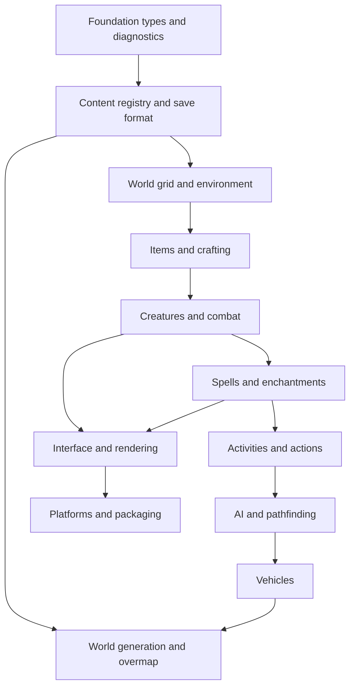

# 05 — End-to-end porting roadmap

Baseline: `0.I-1`, commit `7b2efa5`, 840 files / 565,083 LOC in `src/` (third-party excluded).
Every file is assigned to exactly one phase in [appendix-file-map.md](appendix-file-map.md) — 100% coverage, no orphans.

This roadmap answers one question: **what gets ported when, and what proves it was ported correctly.**

---

## 1. Ordering principles

| # | Rule | Why | Evidence |
|---|---|---|---|
| R1 | Leaves first | Foundation headers are depended on by nearly everything; porting a mid-layer file before its dependencies means porting it twice | `type_id.h` 293 includers, `debug.h` 269, `point.h` 221, `coordinates.h` 195 | <!-- verified: include fan-in counts -->
| R2 | Build the measuring instrument before the thing it measures | Without a state dump, a replay driver and a digest, a ported system cannot be proven equal — only "looks fine" | No `--dump-*` flag exists at baseline; the harness is new code we write | <!-- verified: grep '"--dump' src/ = 0 hits -->
| R3 | Vertical slices, not horizontal layers | Every phase must end with something that runs and diffs; a half-ported layer has no gate | — |
| R4 | Data before behaviour | 160 JSON types and 6,220 files are the shared input of every later phase; a digest mismatch found here costs minutes, found in P7 it costs weeks | `init.cpp:263-471` registrations | <!-- verified -->
| R5 | Interface last | The UI has the weakest oracle (zero presentation tests) and cannot be validated until the simulation under it is correct | 0 test files include `uilist.h`, `input_context.h`, `sdltiles.h` | <!-- verified -->
| R6 | Packaging last | Build files are throwaway until the binary is worth shipping | 9 release artifacts across 5 targets (`release.yml` matrix) | <!-- verified -->

---

## 2. Phase map

| Phase | Files | LOC | Share | Depends on | Exit gate | Effort class |
|---|---|---|---|---|---|---|
| P0 Foundation | 189 | 62,866 | 11.1% | — | RNG + text + JSON parity vs oracle | mechanical, RNG redesign |
| P1 Registry & saves | 131 | 61,911 | 11.0% | P0 | prototype digest equal; oracle self-consistent | mechanical ×92 types, save format redesign |
| P2 World grid | 60 | 40,200 | 7.1% | P1 | environment-only replay equal | moderate |
| P3 Items | 86 | 91,446 | 16.2% | P2 | item/inventory/crafting replay equal | moderate, `item_location` redesign |
| P4 Creatures | 83 | 74,569 | 13.2% | P3 | creature/combat replay equal | redesign |
| P5 Spells & enchantments | 10 | 9,444 | 1.7% | P2–P4 | spell/enchantment replay equal | moderate |
| P6 Activities | 22 | 26,317 | 4.7% | P5 | activity replay equal | moderate |
| P7 AI | 57 | 38,090 | 6.7% | P6 | combat/NPC session replay equal | redesign |
| P8 Vehicles | 21 | 25,752 | 4.6% | P7 | vehicle session replay equal | redesign |
| P9 World generation | 43 | 47,547 | 8.4% | P1, P8 | same seed → same world digest | moderate, mapgen redesign |
| P10 Interface | 113 | 59,329 | 10.5% | P4, P5 | scripted frame parity, 0 cell diffs | redesign |
| P11 Platform | 25 | 27,612 | 4.9% | P10 | packaging + perf within 10% | throwaway + platform work |
| **total** | **840** | **565,083** | **100%** | | | |

Sizes are the C++ lines being replaced, not the Rust lines to be written. They are a proxy for
surface area, not effort: P0 is 11% of the code and the highest-risk 11%, because everything
inherits its mistakes.

---

## 3. Milestones

| # | After | Meaning | Proof |
|---|---|---|---|
| M0 | P0 | Harness exists; no gameplay yet | RNG draw-for-draw equality; JSON accept/reject parity — **passed**; see [parity.md](parity.md) |
| M1 | P1 | The game's *content* loads identically | Prototype digest equal over 6,220 files, 42 mods, 160 types |
| M2 | P2 | The world ticks identically for environment-only sessions | Replay hash per turn over weather/light/field sessions |
| M3 | P3–P6 | A character can act, craft, fight and cast identically | Replay hash over recorded gameplay sessions |
| M4 | P7–P8 | Full simulation parity including NPC/monster AI and vehicles | Replay hash on late-game combat and driving sessions |
| M5 | P9 | Worlds generate identically from a seed | Same seed → same overmap, city layout, hordes and map chunks |
| M6 | P10 | Playable: visually equivalent | 0 cell differences on the semantic frame gate |
| M7 | P11 | Shipped on the agreed platforms within the perf budget | Artifacts built; perf gate green |

M1 is the first milestone that proves anything. Everything before it is scaffolding.

**Where the work stands.** M0 is passed. The id half of M1 is **finished**: all 90
registries the reference reports are now reproduced exactly, with nothing invented
- terrain and its types, overmap specials, effect-on-conditions, items, monsters,
materials, fields, traps and the rest. Seven loader families
carry field-level corpora from the reference's own dumps (terrain and furniture,
traps, materials, field types, item types, monster types, and the generated
prototypes those loaders create), the registry gate is **90 of 90 id sets
exactly, with no named gaps at all**, and JSON reading and writing match over all
6,220 data files. The last eight ids closed because a plain `flags` member *replaces*
inherited flags while `extend.flags` adds to them - treating the two the same way is
what kept two overmap terrain types wrong.

**P2 stands here.** T1 tile storage, T2 submap ownership and T3 per-level caches are done.
T4 fields is half done: an entry with the reference's decay rules, a tile layer that merges
several fields, a per-turn pass that ages and removes them, and one tick entry point - but no
processors, so fire does not spread and smoke does not drift.

T5 illumination is **complete end to end**: the astronomy gated on 424 samples of the
reference's own output, the sun's curve, the thresholds, the four quarters, the eight-segment
caster gated on grids the reference printed, the per-tile transparency memo, cached light
keyed by where it is cast from, and `Level::daylight`, which turns a moment into four numbers
per tile. What it does *not* have is the point-source accumulation loop, which is the next
step. T6 vision and T7 scent are not started.

Fields come before vision for a reason: smoke is both a field and a thing that blocks sight,
and the light model is now good enough to notice the difference.

Every porting task follows [14-test-porting.md](14-test-porting.md): dump first, write
the failing gate, port the smallest thing that clears it, then tighten the gate. The
fast loop is `python3 tools/test_fast.py`, which runs the test binaries concurrently
(43 s for the whole suite against 156 s serial) and reports what each one cost.

P2 has begun with its first task: tile storage, the uniform page that costs nothing
until it diverges ([parity.md](parity.md)). Run long oracle commands in the
foreground, never backgrounded - a cancelled background dump keeps parsing for
ever, and two of them once held this machine above a load average of eleven.

Resume at the mapgen loader: start from `load_and_add_mapgen_function`
(`src/mapgen.cpp:1400-1480`), reproduce the terrain ids it derives from
`om_terrain` arrays - chunked per position and per rotation - and hold them to
`corpus/prototypes/ids.json`, which already names every one of them.

Two smaller gaps are recorded rather than forgotten: the chi-squared roll, which
needs libc++'s gamma sampler and drives NPC mutation timing (`src/npc.cpp:663`),
and `normal_roll_chance`'s error function, which agrees to 4e-8 rather than
exactly. Neither is dead code; both are named where they are used.

---

## 4. Phase detail

### P0 — Foundation types, IDs, RNG, text, diagnostics (189 files, 62,866 LOC)

**Contents.** Coordinates and geometry (`coordinates.h` 1,172; `point.h` 514; 38 origin/scale aliases in `coords_fwd.h:44-103`), units, calendar/time, RNG wrapper, `string_id`/`int_id`/`type_id`,
`generic_factory` scaffolding, JSON read/write types, flexbuffer wrapper, translation lookup, colours,
options table, path handling, assertions and debug reporting, containers (`colony`, `list`, `mdarray`,
`cata_bitset`), hashing, formatting.

**Why first.** `coordinates.h` is included by 195 files and `point.h` by 221. The coordinate layer is
pure value types with no state and no RNG — the cheapest place to be exactly right, and the most
expensive place to be approximately right.

**Hard parts, not mechanical.**
- **Origin/scale legality.** The C++ type system refuses illegal cross-scale arithmetic by only
  defining operators where legal (`coordinates.h:97-196`). A naive `Point(i32,i32,i32)` in Rust
  compiles and silently reintroduces the bug class the types exist to prevent. Rust newtypes must
  reproduce the same legality matrix, not just the arithmetic. <!-- verified -->
- **RNG equivalence.** The engine is `std::minstd_rand0` (`rng.h:30`) — trivially portable. The
  *distributions* are not: 1,441 wrapper call sites go through `std::uniform_int_distribution`,
  `uniform_real`, `normal`, `exponential`, `chi_squared` (`rng.cpp:16-97`), whose algorithms are
  library-specific. See blocker B1. <!-- verified -->
- **JSON semantic strictness.** Duplicate keys are a hard error (`flexbuffer_cache.cpp:74`), unvisited
  members are reported globally (`flexbuffer_json.cpp:14`). A conventional Rust deserialiser accepts
  files the reference rejects, which weakens content validation for every later phase. <!-- verified -->
- **Diagnostics.** Debug levels, error formatting and the test hooks that later gates depend on.

**Not in this phase:** anything that mutates the world.

**Exit gate.** Byte-identical text/formatting output on a fixture corpus; 10M-draw RNG comparison
across every wrapper; JSON accept/reject parity on a corpus of valid, duplicate-key, and malformed
files; the CI pipeline from [port-validation.yml](../.github/workflows/port-validation.yml) runs green.

---

### P1 — Content registry, mods, save format, oracle harness (131 files, 61,911 LOC)

**Contents.** The 160 JSON type loaders, `generic_factory` instantiation for ~92 prototype types
across 68 files / 64,883 LOC, mod manager and dependency graph, options and keybindings, the save/load
graph, compression and archives, plus the harness modes the oracle needs (`--replay`, `--dump-state`,
`--dump-frame`, `--dump-prototype-digest`).

**Why here.** Two independent reasons converge. First, all later phases read prototypes through this
layer, so a wrong inheritance rule corrupts every system at once. Second, the differential harness needs
(a) deterministic RNG from P0, (b) save loading and (c) a state dump — so the harness cannot start
before this phase and everything after it depends on the harness. <!-- inference: ordering rationale -->

**Hard parts.**
- **Inheritance and merge semantics are the content language.** `copy-from` appears 16,444 times,
  `extend` 4,240, `proportional` 2,151, `relative` 790, `delete` 781, `abstract` 465 across 6,220 files.
  The merge operators are *not* centralised — each type implements its own (`assign.cpp:60-398`,
  `mapdata.cpp:1072-1088`, `monstergenerator.cpp:823`). <!-- verified -->
- **Provenance is load-bearing.** Every prototype carries the `src` string of the mod that defined it
  (`generic_factory.h:305,317,352`), used for duplicate detection and origin display. <!-- verified -->
- **Load order is filesystem order** (BFS with per-level sort, `filesystem.cpp:332,372-374`) while mod
  order is a user-ordered list replayed verbatim (`mod_manager.cpp:427-444`). <!-- verified -->
- **`int_id` is explicitly unstable across reloads** (`string_id.h:59-73`) — which confirms the design's
  rule that entities reference prototypes by string id and that any integer index is a rebuildable cache.
- **Save format** — see blocker B2.
- **Options are C++, not data**: 188 `add(...)` declarations (`options.cpp`) plus 88 JSON options. Decide once
  whether they become a data table or stay code; either way it is 4,206 lines to move. <!-- verified -->

**Exit gate (M1).** Prototype digest equality across the full data set and all 42 in-repo mods; mod load-order
and duplicate-detection parity; oracle self-consistency gate green (see B1); a reference state dump loads
into the port and reproduces the same digest.

---

### P2 — World grid and environment (60 files, 40,200 LOC)

**Contents.** Submap storage and the tile SoA, the world's submap owner, the reality bubble view,
per-level caches, fields, light and vision, scent, sound events, temperature and weather, terrain and
furniture records, traps, zones, map memory, the map half of the turn schedule.

**Why here.** Environment runs without items or creatures, so it is the first phase where a full turn
can be executed and compared end to end on a loaded map.

**What already matches the target design.** The tile layer is *already* structure-of-arrays
(`maptile_soa`, `submap.h:62-70`) and the scent grid is already a dense 132×132 array
(`scent_map.h:50-52`), as is the pathfinding flag grid (`pathfinding.h:134`) and the 13 per-level arrays in
`level_cache.h:26-98`. **The dense-index shape is not new — what is missing is a single one for
entities.** <!-- verified -->

**Hard parts.**
- **Ownership.** One global owns all submaps (`mapbuffer.h:91`); the bubble is a non-owning raw-pointer
  vector (`map.h:2114`), and the code itself flags the ownership semantics as unsound
  (`mapbuffer.cpp:99`). The port decides ownership once. <!-- verified -->
- **Light.** 21 levels × 4 quadrants per square × 13 caches with five dirty bits, and a separate
  vehicle pass that exists because vehicle caching mutates neighbouring levels (`map.cpp:9549-9571`). <!-- verified -->
- **Fields.** Behaviour is a C++ processor list selected by 21 data-driven predicates
  (`map_field.h:20-26`); field processing also writes into the scent grid mid-iteration
  (`map_field.cpp:428,500`). <!-- verified -->
- **Hidden cross-call state** to eliminate: `static tripoint_abs_ms player_prev_pos` inside the cache
  builder (`map.cpp:9584-9585`), and a shared `static` object handed out by uniform submaps
  (`submap.h:202-203,219-220`). <!-- verified -->

**Exit gate (M2).** Per-turn state hash equality on environment-only sessions covering weather
transitions, fire and gas spread, light changes across z-levels, scent diffusion, and vision.

---

### P3 — Items, inventory, crafting, interaction (86 files, 91,446 LOC)

**Contents.** `item` (16,206 LOC) and its contents/pockets, item groups, inventory and item location,
the item factory, materials, crafting and recipes, requirements and qualities, constructions, use
actions (187 functions), examine actions (107 functions), consumption, butchery, liquids, auto-pickup.

**Largest single phase by line count (16.2%).**

**Hard parts.**
- **`item_location` is a hand-rolled weak-reference scheme** — a shared implementation object plus a
  weak aliasing anchor embedded in every item (`item_location.h:184`, `safe_reference.h:68`,
  `item.h:3279`) — existing solely to survive items moving between map, vehicle, pockets and inventory.
  A single entity store with generational handles deletes this problem rather than porting it. <!-- verified -->
- **Raw prototype pointers on instances**: `item::type`, `item::corpse`, `craft_data::making`
  (`item.h:3262,3277`). Under the locked design these become IDs resolved at use — a pervasive but
  mechanical change. <!-- verified -->
- **Every item consumes RNG at construction** (`int seed = rng(0, INT_MAX)`, `item.h:3347`), so item
  creation order is part of the RNG contract. <!-- verified -->
- **Crafting touches the map positionally** — the recipe check inventories a radius around the crafter
  (`crafting.cpp:645`). <!-- verified -->
- **Behaviour hidden behind function pointers**: construction specials are C function pointers named by
  string from JSON (`construction.h:83`, four static tables at `construction.cpp:2286+`). <!-- verified -->

**Exit gate (M3a).** Replay equality on item, pocket, crafting, construction and use-action sessions;
the corresponding reference tests (iteminfo 3,322 lines, item_pocket 2,995, crafting 2,476) re-expressed
as port-side tests.

---

### P4 — Creatures, body, effects, combat (83 files, 74,569 LOC)

**Contents.** `Creature`/`Character`/`Monster`/`Npc` state, effect maps, body parts and anatomy,
mutations, bionics, morale, needs, wounds and disease, melee and ranged resolution, projectiles,
dispersion, martial arts, weakpoints, harvest, death.

**Hard parts.**
- **Position plus four hand-maintained indexes.** A creature stores a bare absolute coordinate
  (`creature.h:803`) and invariants are repaired by a virtual `on_move` hook (`creature.cpp:316`); the
  tracker holds a vector, an unordered position map, a "removed this turn" graveyard that exists to keep
  dangling references alive, and a lazily rebuilt zone index (`creature_tracker.h:148,150,156,165`).
  Moving one monster linearly scans all monsters. <!-- verified -->
- **`Character` is a 1,269-member object** with five mutation containers that must stay consistent,
  index-addressed bionics, and three concurrent activity slots (`character.h:4022-4041,2794,2780`). <!-- verified -->
- **Effects are a nested map keyed by effect type then body part** (`effect.h:259`), i.e. per-creature
  allocation rather than a dense component. <!-- verified -->
- **~20 flat additive stat channels** on every creature (speed, dodge, hit, bash, armour bonuses) that
  every source — prototype, mutation, bionic, effect, enchantment, item — writes into. <!-- verified -->

**Exit gate (M3b).** Replay equality on combat, wound, mutation, bionic and morale sessions; vision and
ranged-balance test parity.

---

### P5 — Spells and enchantments (10 files, 9,444 LOC)

**Contents.** Spell types and casting, spell effects, enchantments, terrain and furniture transforms,
teleporter lists, relic generation.

**Why not late: magic is core content, not a mod feature.** <!-- verified -->
- `SPELL` is a registered core type (`init.cpp:453`), finalised and consistency-checked alongside every
  other type (`init.cpp:797,903`).
- Core data casts spells in 20 files: monster special attacks, mutations, bionics, artifacts, traps,
  guns and scenario scripting. Mods add far more (169 spell files in Magiclysm, MindOverMatter and
  Xedra Evolved).
- `magic.h` is included by 42 files and `magic_enchantment.h` by 38 — creature stats, item stats, use
  actions, traps, projectiles and NPC attacks all read enchantments.
- Enchantments feed the same flat stat channels that mutations and bionics write to, so the creature
  phase cannot be called complete without them.

**Where it sits.** After creatures and items, before activities: a character that cannot cast is not a
character the replay corpus can exercise, and monster spell attacks are part of the AI phase.

**Deferred to a later phase:** relic procedural generation and the spellbook interface, which are
content-generation and presentation concerns rather than simulation.

**Exit gate (M3c).** Replay equality on spell, enchantment, mutation-granted spell and artifact
sessions; the reference's spell and enchantment tests re-expressed.

---

### P6 — Activities and the action pipeline (22 files, 26,317 LOC)

**Contents.** The activity actor hierarchy (~67 classes), the player activity record, activity handlers,
pickup, movement mode, the key-to-action pipeline.

**Hard parts.** The actor pattern itself is clean and translates directly (`clone_ptr<activity_actor>`
plus a dispatch table keyed by activity id, `activity_actor.h:135-137`). What must be *replaced* is the
generic argument soup that actors coerce — parallel arrays of items, ints, strings, coordinates, weak
monster references (`player_activity.h:62-72`) — with real per-actor payloads. <!-- verified -->

**Exit gate (M3d).** Replay equality on activity sessions; the 2,138-line activity test file
re-expressed.

---

### P7 — AI, pathfinding, dialogue and scripting (57 files, 38,090 LOC)

**Contents.** Monster planning and movement, NPC movement and decision making, pathfinding, behaviour
trees, NPC classes, trading and opinions, dialogue, conditions and effect-on-condition, speech, factions'
runtime side, missions.

**Hard parts.**
- **Two unrelated architectures for the same job.** Monsters run data-driven behaviour trees whose nodes
  are raw-pointer graphs with 13 string-keyed predicates and a `// TODO: make into an ID?` on the goal
  field (`behavior.h:86`, `behavior_oracle.cpp:34-47`); NPCs run a 28-value enum with a 28-way switch
  over ~30 hand-tuned float scorers and a cache holding weak references to every nearby creature
  (`npcmove.cpp:198-227,1608`, `npc.h:552`). <!-- verified -->
- **Pathfinding is self-contained but load-bearing**, including a tuning constant whose comment admits
  the search window is too small (`pathfinding.cpp:440`). <!-- verified -->
- **Highest risk of silent divergence in the whole port**: float scoring, tie-breaks and iteration order
  all decide which action is chosen, and one different choice changes every later turn. This phase needs
  trace-level gates, not just end-state hashes.

**Exit gate (M4a).** Replay equality on combat-heavy and NPC-interaction sessions; per-decision trace
hash equality for monster and NPC action selection; dialogue, mission and effect-on-condition test
parity.

---

### P8 — Vehicles (21 files, 25,752 LOC)

**Contents.** Vehicle model and prototypes, part definitions, movement and collision, vehicle
interaction, turrets, vehicle groups, appliance forms.

**Hard parts.**
- **No identity at all.** A vehicle is addressed by its owning submap plus a submap-local 2-D point with
  no z (`vehicle.h:2392`); world lookup falls back to a linear scan of a submap's vehicle vector. The
  port must invent the identity the reference never had. <!-- verified -->
- **Parts are a renumbering vector** with ~30 derived index vectors rebuilt by a single `refresh()`
  (`vehicle.h:2243,2305-2332`). Removing a part renumbers every later part. <!-- verified -->
- **Pointer-order tie-breaks in movement**: vehicles are held in a pointer-ordered set
  (`level_cache.h:81`) and the mover picks the maximum-moves vehicle with a strict comparison, so ties
  resolve by heap address (`map.cpp:729-737`). This is blocker B1 in its purest form. <!-- verified -->
- Raw two-way towing pointers, raw passenger pointers inside parts, and a vehicle whose turret brain is
  a heap-allocated NPC. <!-- verified -->

**Exit gate (M4b).** Replay equality on driving, collision, boarding and turret sessions.

---

### P9 — Overmap, world generation, factions, missions (43 files, 47,547 LOC)

**Contents.** Overmap storage and generation, map generation (JSON interpreter plus 11 builtin
functions), regional settings, world factory, hordes, cities, map extras, basecamps and faction camps,
missions.

**Why after P1 and P8.** Existing saves carry already-generated worlds, so the port can replay real
sessions long before it can *create* a world. Generation is deferred deliberately: it is the largest
pure-redesign surface and nothing before it needs it. <!-- inference: ordering rationale -->

**Hard parts.**
- **Map generation is a program, not a format**: 845 JSON files / 239,715 lines / 12 MB in a ~15-node DSL
  (palette, piece, constraint, place, setmap, nested, update, phase) interpreted by C++
  (`mapgen.h:194-568`). Porting it means writing an equivalent interpreter. <!-- verified -->
- **Generated worlds are order-dependent**: overmap noise draws from the single global engine, and
  shuffles during generation (`overmap.cpp:4921,5547,5623`) mean generating region A before B changes B.
  <!-- verified -->
- Overmaps live in an unordered map (`overmapbuffer.h:581`), so iteration order over loaded overmaps is
  unspecified — another B1 case. <!-- verified -->
- Basecamps have two different ownership models for the same type (by value in the overmap, by pointer
  in a submap). <!-- verified -->
- `faction_camp.cpp` is 6,354 lines — the largest behaviour file after items and map. <!-- verified -->

**Exit gate (M5).** Same seed → identical overmap digest, city layout, horde distribution and map
chunks over a corpus of seeds; basecamp and mission test parity.

---

### P10 — Interface, rendering, audio (113 files, 59,329 LOC)

**Contents.** Output and text layout, the UI stack and window abstraction, menus, HUD widgets and panels,
input and keybindings runtime, colour, both rendering backends, tilesets, fonts, ASCII art, sound and
music, help, and the screens (inventory, crafting, overmap, character, medical, safemode, trade, diary).

**Why last.** Zero of the 218 test files exercise the UI, and there is no screen-by-screen behaviour
specification. The oracle for this phase is the one we build ourselves, and it only becomes meaningful
once the simulation beneath it is proven.

**Hard parts.**
- **The terminal build renders through ImGui into ncurses** rather than raw curses, and the two backends
  are mutually exclusive at build time (`CMakeLists.txt:154-155`, `cata_imgui.cpp:100-157`). The port must
  decide whether to preserve that dual-build model or to render cells directly. <!-- verified -->
- **Global mutable UI state**: a static UI stack, a static frame flag, file-scope clients
  (`ui_manager.cpp:26`, `sdltiles.cpp:79`). <!-- verified -->
- **The draw path is 5,616 lines of cache, occlusion, memory and rotation logic** (`cata_tiles.cpp`). <!-- verified -->
- HUD widgets and panels are already data-driven JSON (116 files under `data/json/ui`), so the *spec* is
  reusable even though the renderer is not. <!-- verified -->

**Exit gate (M6).** Semantic frame gate: for scripted input sessions, every cell's glyph, foreground and
background colour identical, zero tolerance; pixel diff as a nightly secondary signal; no UI-driven
divergence in the simulation hash.

---

### P11 — Runtime shell, platform, tooling (25 files, 27,612 LOC)

**Contents.** The game object and its turn loop, main entry and command line, the action handler,
gamemode, uistate, event bus, debug menu (~309 actions), map editor, overmap editor, screenshot support,
memory and difficulty instrumentation, crash handling, platform shims.

**Why last.** Nothing here is needed to prove correctness; all of it is needed to ship.

**Decisions to make before starting.** Which platforms are in scope (see B6), whether the debug menu
ships in release as it does today, and whether screenshots stay the only capture mechanism or become the
frame-dump path the visual gate needs.

**Exit gate (M7).** Artifacts build for the agreed platforms; the performance gate (no worse than 10%
on the frame and turn benchmarks) is green.

---

## 5. Critical path and parallelism

- **Critical path:** P0 → P1 → P2 → P3 → P4 → P5 → P6 → P7 → P8 → P9 → P10 → P11. It passes through items,
  creatures and AI because those are the systems with the most cross-dependencies.
- **Off the critical path, start early and run in parallel:** the harness modes and CI (P1), the
  prototype digest tooling (P1), port-side test-runner infrastructure and the semantic frame dump (P0/P1
  even though the UI is ported in P10), the tileset and soundpack parsers (P10 code, spec is
  documentation-only), and the platform evaluation for B6.
- **Never parallelise:** the coordinate/RNG/JSON foundation (P0) and the save format decision (B2) —
  both are inherited by everything downstream.

---

## 6. Hard blockers

These are the findings that need a decision or an experiment before the phases that depend on them.
None of them stops the port; each one changes the plan if it resolves badly.

### B1 — The reference is not fully deterministic, so "identical output" needs a definition

**Verified evidence.**
- Vehicles are held in a pointer-ordered set and the mover breaks ties by pointer value
  (`level_cache.h:81`, `map.cpp:729-737`). <!-- verified -->
- Loaded overmaps are iterated in hash order (`overmapbuffer.h:581`). <!-- verified -->
- A single global RNG engine is drawn from by overmap-generation shuffles and by *every item at
  construction* (`rng.h:32`, `item.h:3347`). <!-- verified -->
- The RNG engine is portable, but its distributions are library-specific (1,441 call sites through
  `std::uniform_int_distribution` and friends, `rng.cpp:16-97`). <!-- verified -->
- The reference's own test suite pins no distribution outputs (`tests/rng_test.cpp` asserts statistical
  thresholds only) and CI seeds tests from the clock. <!-- verified -->

**Consequence.** Byte-exact equivalence cannot be asserted until we know how much of the oracle's output
depends on memory addresses and standard-library internals. A port using stable IDs will be *more*
deterministic than the reference, which shows up as a mismatch — a divergence in the right direction,
but still a red gate.

**Required before P1's gate.**
1. Oracle self-consistency: run the same binary twice on the same session, compare state hashes. Any
   session that fails is not usable as a fixture.
2. Configuration sensitivity: same session under the sanitizer build and under a different allocator.
   If hashes differ, the responsible systems are exactly the pointer-order ones (B1's list above).
3. Adopt a policy: the port picks one canonical order for those tie cases, and the harness either
   patches the oracle to match or records the session as order-sensitive and excludes it.

**Status:** blocking for any claim of exactness; mitigation path is defined and cheap (hours, not weeks).

### B2 — Save compatibility: **resolved, out of scope**

**Verified evidence.** The format is not pure JSON: a text `# version` header addressed by byte offset
(`savegame.cpp:185`), per-submap version members inside arrays (`mapbuffer.cpp:321,440-443`), a bespoke
zstd-frame archive container (`zzip.h:19-60`), three shipped zstd dictionaries that must match
bit-for-bit, two coexisting on-disk layouts selected by a world option, and 388 hand-written serialise
methods of which roughly 40% of the load code is conditional fix-up (`savegame_json.cpp`). There are
**no save or migration tests anywhere in the test suite**. <!-- verified -->

**Decision (settled): the port does not read reference saves.** It writes its own format.

**What that removes.** No transcription of the archive container, the dictionaries, the
byte-offset header, the two coexisting layouts, or the legacy fix-up paths.

**What it adds, and this is the part that matters for testing.** Sessions can no longer
start from a shared save file, so the reference must *hand over* its starting state
through the harness: the state dump becomes an input format the port can load, not
just an output for comparison. That format is ours, is debug-only, and only needs to
carry the fields the gates compare — far smaller than the save graph.

**What still has to work:** the port's own save and load, with round-trip identity
(invariant I9) and long-play sessions (T8), because players save.

### B3 — JSON acceptance semantics are load-bearing

Duplicate keys are a hard error and unvisited members are reported globally
(`flexbuffer_cache.cpp:74`, `flexbuffer_json.cpp:14`). A conventional Rust JSON reader would accept files
the reference rejects, quietly weakening content validation. Either reuse the vendored reader through FFI
or transcribe its error behaviour, and gate it with an accept/reject corpus. <!-- verified -->

### B4 — Translations are bound to the C++ message set

691 MB of catalogues across 28 locales, 11,484 `_()` call sites in C++ and 13,527 comment keys in data,
plus a custom plural-rule evaluator (`translation_plural_evaluator.cpp`, 466 lines). Any rewrite that
changes message ids invalidates all existing translator work. **Decision needed:** freeze the message-id
set and keep the gettext pipeline, or accept the loss. <!-- verified -->

### B5 — There is no presentation oracle; we have to build one

The reference has no state or frame dump flags (`grep '"--dump' src/` = 0), no replay capture, and zero
tests over the UI, input or rendering layers. The semantic frame gate in
[04-validation.md](04-validation.md) therefore requires new C++ code in the oracle *before* the port's UI
phase can be validated at all. This is the largest piece of infrastructure work in the plan that does not
appear in any phase's file list. <!-- verified -->

### B6 — Platform scope: **resolved, desktop only for now**

Windows (MSVC, MinGW, vcpkg), macOS (universal, dmg), Linux (tar, snap, two divergent Flatpak manifests),
Android (NDK, GLES, 33 platform-specific code sites) and WebAssembly (built in CI, commented out of the
release). Terminal and graphics builds are mutually exclusive, so the dual-build model is itself a
decision. <!-- verified -->

**Decision (settled): macOS, Linux and Windows, from one codebase.** Android and
web are deferred, not cancelled, and [12-platforms.md](12-platforms.md) lists the
seven constraints that keep them reachable — one window/input layer, one filesystem
layer, no required threads, one content loader, renderer separate from simulation,
input as events, audio behind an interface. All seven are already how the reference
behaves, so this is the default rather than extra work. Measured platform cost per
target is in the same document.

**Consequence for the plan.** P11's gate becomes "artifacts build and smoke-run on
the three desktop targets"; CI gains one build job per desktop target; the visual
gate keeps one pixel baseline per platform while the semantic frame gate stays
identical across them.

### B7 — Some behaviour can only be transcribed, never derived

Field processors are a C++ list selected by data (`map_field.h:20-26`), construction specials are named
function pointers (`construction.h:83`), map generation is a 239,715-line DSL over 11 builtin functions,
and tuning constants include values with in-source admissions that they are wrong
(`pathfinding.cpp:440`), loop bounds justified by anecdote (`map.cpp:683`), and empirically fitted
thresholds (`weather.h:59-74`). These must be copied exactly and marked as such; "improving" any of them
silently breaks replay equality. <!-- verified -->

### B8 — Divergences we intend to accept

Two reference behaviours should *not* be reproduced, and each needs a written exception in the
validation spec: the shared `static` object returned by uniform submaps (writes through it mutate a
process-wide object, `submap.h:202-203,219-220`), and the "removed this turn" graveyard that exists to
keep dangling creature references alive (`creature_tracker.h:151`). Both are artefacts of the ownership
problem the port removes. <!-- verified -->

---

## 7. What "ported" means

The port is complete when all of the following hold, in the order the gates in
[04-validation.md](04-validation.md) define:

1. Every prototype loads to the same digest from the same 6,220 data files and 42 mods.
2. Recorded sessions replay to identical per-turn state hashes within the declared tolerance classes.
3. The invariant suite holds on every session, including the ones the reference fails.
4. The fuzzer runs a night of sessions without a crash, a hang, or a divergence it cannot minimise.
5. Every scripted visual session produces zero differing cells.
6. Frame and turn times are within 10% of the reference on the same hardware and data.
7. The agreed platform artifacts build from a clean checkout in CI.

Anything less is a system that "seems to work", which is the failure mode this whole document exists to
prevent.

---

## 8. First ten tasks

1. Pin the baseline (done) and record its digest inputs: data files, mods, dictionaries, RNG seeds.
2. Write the oracle self-consistency gate and run it (B1 step 1).
3. Run the allocator and sanitizer sensitivity experiment (B1 step 2); publish the outcome as the
   tolerance policy.
4. Add `--dump-state`, `--dump-prototype-digest` and `--replay` to the oracle — nothing else can be
   validated without them.
5. Build the prototype digest and run it against the reference; freeze the expected value.
6. Build the JSON accept/reject corpus (valid, duplicate-key, malformed, unknown-member) (B3).
7. Port the coordinate layer with its origin/scale legality matrix, plus compile-time tests that illegal
   arithmetic does not compile.
8. Port the RNG wrapper and prove draw-for-draw equality against the pinned oracle standard library.
9. Make the state dump loadable in both directions (B2 is settled: no reference
   saves, so this is how a session starts in the port).
10. Start the semantic frame dump in the oracle (B5) — it is the longest-lead infrastructure item and it
    gates P10.
