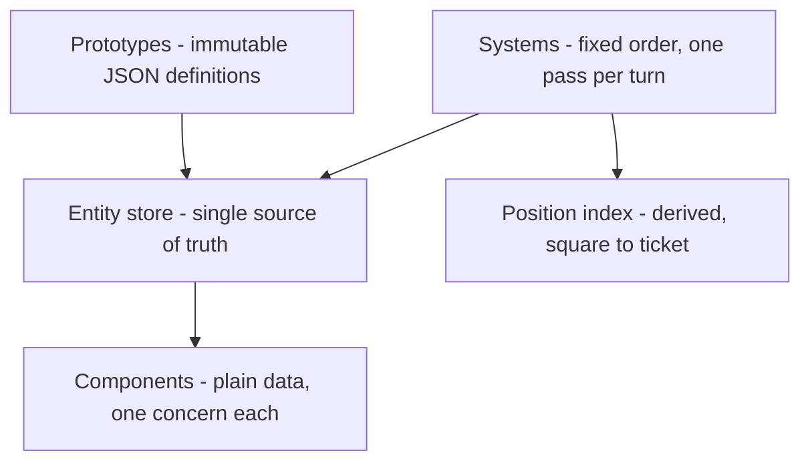

# Simulation Architecture — Design Record

A design for a grid-based, simulation-heavy sandbox roguelike, developed by
studying [Cataclysm: Dark Days Ahead](../references/Cataclysm-DDA) (CDDA) as the
reference implementation and deciding what to keep and what to change.

**Status:** design locked. No implementation started.

**Reference baseline:** `references/Cataclysm-DDA` is pinned to release tag **`0.I-1`**
("Ito-1", published 2026-09-20), commit `7b2efa5cea38e4d4d97dd0e63b28b9148623da59`
(2026-09-19). All line citations in these documents refer to that commit, not to
`master`. Source scale at that commit: 840 files / 565,083 LOC in `src/`
(excluding vendored third-party), plus 6,220 JSON files and 218 test files /
86,016 LOC.

---

## The design in one page

1. **One entity store is the source of truth.** Terrain, furniture, fields, items,
   creatures, vehicles and projectiles are all entities. There is no second class
   of thing.
2. **One derived position index** answers "what is at this square?" It holds either
   nothing or a ticket to an entity. It is rebuilt from the store, never
   authoritative.
3. **Components decide behaviour, not storage.** A wall has opacity and hardness; a
   dog has action points and a brain. "Scenery" is simply the entities that no
   system queries for action points.
4. **Systems are the only logic**, and a system is exactly: query, read, write,
   queue structural changes. Their order is data, not code.
5. **Structural changes land at sync points.** A turn is already atomic, so this
   costs almost nothing.
6. **Everything is an ID, never a pointer.** No ownership graph, no cross-references.
7. **JSON stays the content layer.** Prototypes are immutable shared definitions;
   entities hold a reference plus only the values that differ.
8. **Rust, with an ECS crate, not a game engine.** Chosen for refactor safety and a
   future multi-core path — not for raw speed.



---

## Documents

**Design**

| Document | Contents |
|---|---|
| [01-architecture.md](01-architecture.md) | Storage, index, components, prototypes, scheduling, persistence |
| [02-turn-loop.md](02-turn-loop.md) | One turn as a system order, plus worked traces |
| [03-decisions.md](03-decisions.md) | Why these choices, what was rejected, the evidence behind each |
| [04-validation.md](04-validation.md) | Differential replay, invariants, fuzzing, visual testing, perf gate |

**Plan**

| Document | Contents |
|---|---|
| [05-roadmap.md](05-roadmap.md) | Porting order: 12 phases, milestones, gates, hard blockers |
| [06-inventory.md](06-inventory.md) | Every content type, registry, behaviour hook and interface surface (generated) |
| [07-entity-component-map.md](07-entity-component-map.md) | What is an entity, a component, a prototype, a cache |
| [08-workflow.md](08-workflow.md) | How work proceeds: recipe, gates, review rules, decisions |
| [09-testing-plan.md](09-testing-plan.md) | Every test tier, corpus sizes, coverage targets, CI budgets |
| [10-task-breakdown.md](10-task-breakdown.md) | Every phase expanded into ordered, provable tasks |
| [11-oracle-harness.md](11-oracle-harness.md) | Recording and replay instrumentation for the C++ reference |
| [12-platforms.md](12-platforms.md) | All five platforms: measured cost, what each one actually needs |
| [parity.md](parity.md) | Live status: one row per system, with the gate that proves it |

**Reference material** (generated or collected, not hand-maintained)

| Document | Contents |
|---|---|
| [appendix-file-map.md](appendix-file-map.md) | Every file in `src/` assigned to exactly one phase (100% coverage) |
| [parts/](parts/) | Full tables behind docs 06, 07 and 09: per-class state maps, the 116-screen inventory, and the per-file triage of all 218 reference tests |
| [external-evidence.md](external-evidence.md) | Research on Rust ports, ECS benchmarks, prior art (47 sources) |

Two scripts keep the machine-checked parts honest:
`python3 tools/gen_inventory.py` regenerates doc 06, and
`python3 tools/check_docs.py` verifies links, citations and phase totals.


The validation pipeline is implemented as
[.github/workflows/port-validation.yml](../.github/workflows/port-validation.yml).
Every job treats the C++ reference as a permanent oracle; nothing is considered
correct because a test was written, only because both builds agreed.

## What this is not

- Not a plan to modify CDDA. It is a from-scratch design informed by CDDA, and
  [05-roadmap.md](05-roadmap.md) describes building a new implementation that must
  reproduce the reference's observable behaviour.
- Not an argument that CDDA should be rewritten. That question is settled
  separately in [03-decisions.md](03-decisions.md).
- Not complete. 120+ game mechanics are out of scope; see the open questions at the
  end of [03-decisions.md](03-decisions.md).

## Building with `bevy_ecs`

The workspace depends on `bevy_ecs`, the first third-party dependency. Under the current
sandbox `~/.cargo` is not writable, so the registry lives inside the repo:

```sh
export CARGO_HOME="$PWD/.cargo-home"   # git-ignored
cargo test --workspace
```

Without it, cargo fails with "Operation not permitted" while unpacking a crate, which reads
like a network error and is not one.
