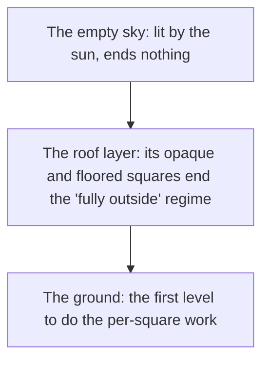
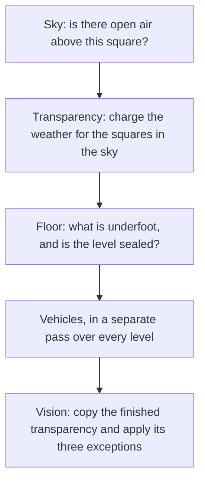
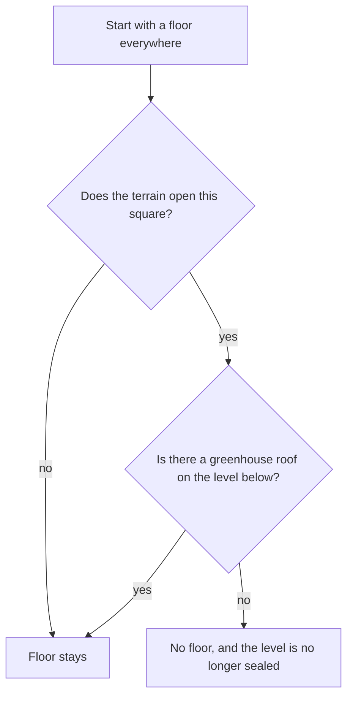
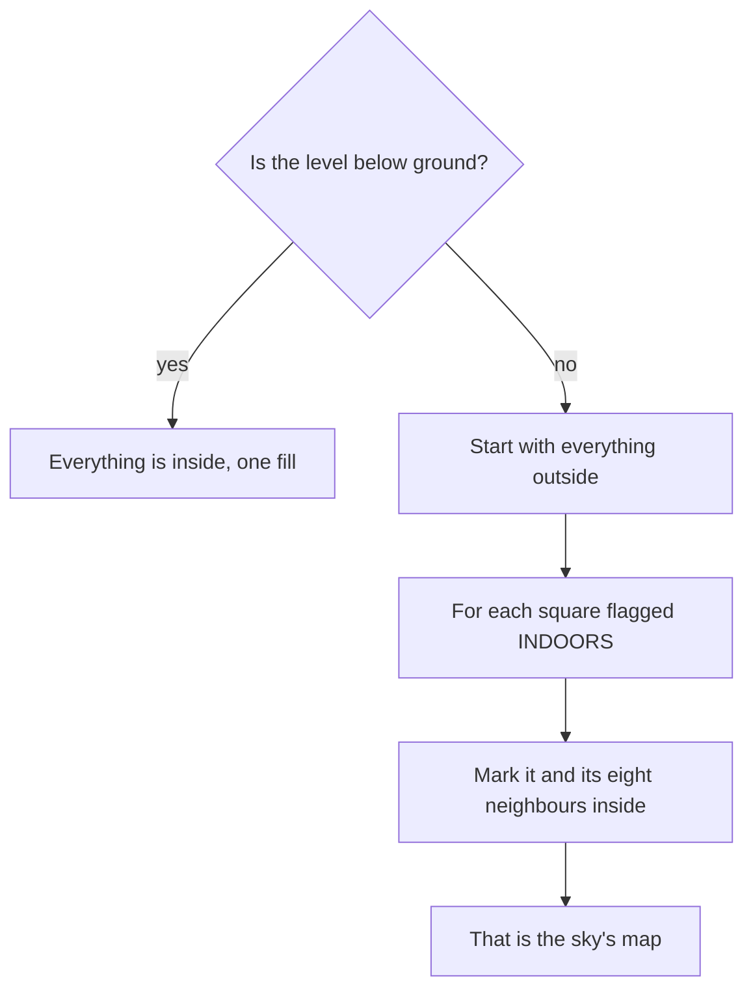
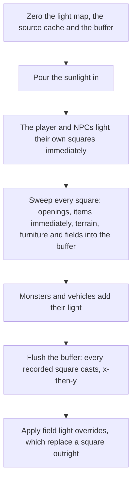
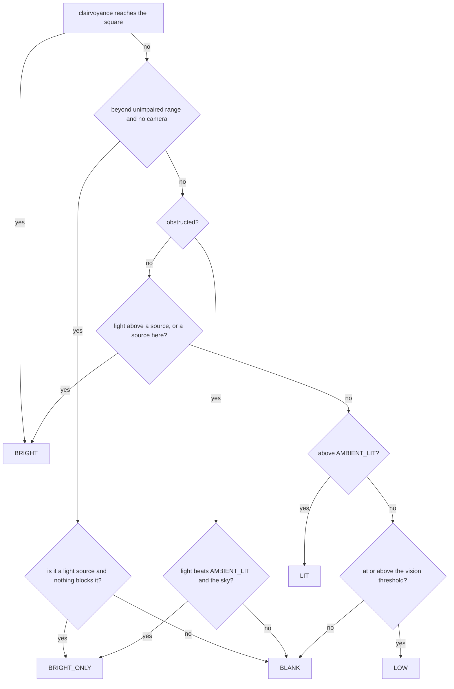

# Parity ledger

The single place where port status lives. One row per system: what it is, which
phase it belongs to, and the gate that proves it matches the reference. Update it
in the same change that ports the system.

Legend for **Status**: `not started` · `porting` · `ported` (gates red) ·
`gated` (gate green, evidence linked) · `declared divergence` (differs on purpose,
reason recorded in [04-validation.md](04-validation.md)).

Nothing is `gated` without a link to the run that proved it.

---

## Single-authority audit (round 294)

The field container was not an isolated slip, so the same question was asked of everything the port has built since:

| Question | Answer |
|---|---|
Does `Level` hold anything the store owns? | nothing but terrain and two caches - and the caches say in their own docs that they are answers, not authority |
Is terrain readable from two places? | no: `Map` wraps the one `Level`, and every reader goes through it |
Do two functions walk fields? | there were **two** - `process_fields` aged and despawned, `process_field_turns` did the same plus processors - so the first is now a call to the second with no processors registered, rather than a second implementation that would drift |
Dead state from the deleted container? | one leftover struct, `FieldProcessing`, which nothing read; removed |

The audit is recorded rather than assumed because the failure it looks for is silent by construction: a second authority passes every
test that does not compare the two, and nothing compares them unless someone writes the comparison.

## A receipt error worth naming (round 293)

For several rounds the round receipts quoted "1,2xx tests" from `tools/test_inventory.py` as if they were the port's own count. They
are not: that script inventories the **reference's** C++ suite - 206 files and 1,217 upstream cases - and the port's figure is what
`cargo test --workspace` prints. The two numbers happened to be close, which is exactly why the mistake survived: a receipt that is
merely plausible is not a receipt.

Correct as of round 293: **1,141 Rust tests pass, 1 is ignored, 0 fail**. The inventory page now says in its own header what it
counts, so the next receipt cannot borrow its numbers.

## P0 — Foundation

| System | Status | Gate | Notes |
|---|---|---|---|
| Coordinates, origins and scales | done (P0 scope) | M0 | 13 tests. Projection floors toward negative infinity (`coordinates.h:601-644`) and the vertical axis is never scaled. The origin/scale legality matrix is in the type system: six origins, four legal `project_remain` targets, `combine` only where the fine origin is the one the coarse scale names, and a segment that divides terrain tiles but not overmaps. Distances, midpoint and hashing match `coordinate_test.cpp` |
| Units and quantities | done (P0 scope) | M0 | 23 tests; 83 of the reference's 202 assertions reproduced, the rest being time/JSON/option-driven conversions that belong to later tasks. Rounding truncation rules pinned from the source |
| Calendar and time | done (P0 scope) | M0 | 28 tests = every assertion in `tests/calendar_test.cpp`; sun and moonlight cross-checked against the reference's own formulas over 309 configurations (max deviation 2e-16 rad) |
| Random numbers | done (P0 scope) | M0 | Engine stream matches the reference draw for draw over 4 seeds ([corpus/rng/engine.csv](../corpus/rng/engine.csv)). The wrappers the game actually calls — `rng`, `rng_float`, `normal_roll`, `rng_normal`, `rng_bits`, `one_in`, `x_in_y`, `dice`, `roll_remainder`, `random_entry`, `rng_sequence`, the exponential rolls and the world-seed hash — reproduce 93 calls bit for bit against the same libc++ ([corpus/rng/wrappers.csv](../corpus/rng/wrappers.csv), generator recorded beside it). `normal_roll_chance` is ported and held to 4e-8 rather than to equality, because the error function is the platform's; the centre case is exact. See [03-decisions.md](03-decisions.md). Not ported: the chi-squared roll, which needs libc++'s gamma sampler - and it is not dead code, it drives NPC mutation timing (`src/npc.cpp:663`), so that path cannot be claimed until it lands |
| Identifiers (string, int, type) | done (P0 scope) | M0 | 17 tests, 88 assertions: interned string identity, integer ids as ordinal caches with version invalidation, invalid use returns the dummy rather than panicking; misuse of an int id without its registry fails to compile |
| Parse cache | done (P0 scope) | M0 | 5 tests: a hit avoids the parse, a changed source is a miss, a damaged entry is a miss and never an error, unused entries are pruned at open. All 6,220 files read identically cold and warm; cold 11.0 s, warm 3.5 s |
| Registry machinery | done (P1-T1 core) | M1 | Abstracts kept apart but usable as bases, deferred `copy-from` retried at finalisation, cycles reported as unresolved ids with no recursion, duplicate ids from one source rejected (as the reference does), an override from another source replacing in place. All 8,743 `copy-from` chains in the core content resolve except 25 overmap-terrain objects whose base the map generator creates |
| Terrain and furniture | first family done | M1 | All 1,769 prototypes match the reference on name, symbol per season, colour, move cost, light, coverage and the full flag set — including inheritance, `flags` replacement, `extend`/`delete`, and both null prototypes |
| Traps | done | M1 | All 125 match on name, glyph, colour, visibility, avoidance, difficulty, radius, benign-ness, invisibility and flag set |
| Materials | done | M1 | All 193 match on name, density, chip resistance, breathability rating and the three heat constants |
| Field types | done | M1 | All 145 match, including the rule that a level inherits the level before it inside the same object |
| Item types: identity, measure, category, flags, names | done (first slice) | M1 | All 9,912 match on id set, name, plural, glyph, colour, weight, volume, price, category, flags and materials — including armour that derives its materials from its per-part entries, and materials added or dropped through `extend` and `delete`. No outstanding notes |
| Monster types | done (first slice) | M1 | 1,154 monster types match on id set, name, glyph, colour, body type, hp, speed, difficulty, melee skill, dodge, morale, aggression, weight, volume, species, categories and materials, including the null type and the dormant twins the reference generates |
| Generated prototypes | in progress | M1 | the ids the reference builds for itself are reproduced: the null monster and its dormant twins, 311 inline enchantments, 113 martial-art buffs, 239 turret parts |
| Content registry | done, 90 of 90 registries | M1 | 90 of 90 registries hold exactly the reference's ids, and **no invented ids anywhere**. The gate runs on every build and names any gap with its exact shortfall, so a regression in any of the 90 fails it and finishing a gap means editing the list |
| JSON reading | done (P0 scope) | M0 | Reader matches the reference on **all 6,220** data files — accept or reject in agreement, and the same structural digest; duplicate keys are a hard error, member order is sorted, trailing content is ignored. A further run parses the whole 107 MB tree in one go |
| JSON writing | done (P0 scope) | M0 | Writer matches the reference byte for byte on **all 6,220** data files, compact and pretty, including its fixed 6-decimal float format. Raised from a 127-file sample: the shapes a sample skips are where the escaping and rounding rules bite |
| JSON parse cache | done (P0 scope) | M0 | 5 tests: a hit avoids the parse, a changed source is a miss, a damaged entry is a miss and never an error, unused entries are pruned at open; plus a corpus run over the reference's own cache directory |
| Options table | done (P0 scope) | M0 | 21 tests, 276 options, all compared with the reference's own table: name, page, type, range, default, the four spellings a bool accepts, the percent-sign stripping on integers, the fallbacks for text that does not parse, migration of old names and values, and the saved-file format. Four options are broken in the reference itself (see 03-decisions.md) |
| Paths and filesystem roots | done (P0 scope) | M0 | Seven logical roots, 12 tests over the platform x build-option matrix; the trailing-separator bug that bit us earlier is now a pinned behaviour |
| Text lookup and formatting | done (P0 scope) | M0 | Formatter agrees with all 339 reference format rows and its error cases; 71/71 reference string assertions; 11,058 message ids extracted and the lookup returns each unchanged with no catalogue. Byte/column width and C-locale quirks recorded rather than fixed (B4) |
| Colours | done (P0 scope) | M0 | 23 tests: packed attribute layout, the 145-name table, pair table, name parsing, highlights and inversion. RGB exists only in the graphics build and is ported from there |
| Containers and hashing | done (P0 scope) | M0 | 26 tests: stable-address pools that keep an id pointing at the right slot when a neighbour is removed, dense bit sets over a fixed universe, and the hashing the reference relies on for its identifier caches |
| Diagnostics and debug levels | done (P0 scope) | M0 | 10 tests: level and class filtering, log formatting, the error-observed flag, prompt as a caller decision, assertion policy |

## P1 — Content and persistence

| System | Status | Gate | Notes |
|---|---|---|---|
| Prototype registry machinery | done (P1-T1 core) | Prototype digest (M1) | Load, inherit, finalise: abstracts kept apart but usable as bases, `copy-from` retried at finalisation, cycles reported rather than recursed, a same-source duplicate rejected while a cross-source override replaces in place, the factories' null prototypes created. 9 tests ([factory.rs](../crates/content/tests/content_suite/factory.rs), [rules.rs](../crates/content/tests/content_suite/rules.rs)) |
| Content type loaders (160 types) | in progress, 7 families | M1 | Terrain and furniture, traps, materials, field types, item types, monster types, plus the generated-prototype families. Each is held to a field-by-field corpus dumped by the reference. See [06-inventory.md](06-inventory.md) for the rest |
| Inheritance and merge operators | done | M1 | `copy-from`, `extend`, `delete`, `relative` and `proportional`, with the two orders the reference uses: readers check proportional before relative, `assign` checks relative first. All 8,743 `copy-from` chains in the core content resolve. [inheritance_corpus.rs](../crates/content/tests/content_suite/inheritance_corpus.rs) |
| Mod discovery and load order | not started | M1 | User-ordered list, not a topological sort |
| Mod dependency graph and cycles | not started | M1 | |
| Save reading and writing | not started | M1 | Scope depends on blocker B2 |
| Save migrations | not started | M1 | 14 content-level migration types plus per-field fix-ups |
| Compression and archives | not started | M1 | Dictionary content must match bit-for-bit |
| Map memory and seen-tile persistence | not started | M1 | |
| Overmap terrain ids | done | P1 | The `overmap terrain type` registry is exactly the distinct `type: overmap_terrain` ids in the load set - 6,269 measured against 6,269 reported. The `overmap terrain` registry is those types expanded into rotation and line-drawing variants; the shape is known and the rotation rule is proven exactly: `!NO_ROTATE && !LINEAR` with flags inherited through `copy-from` and `delete` applied last, giving 5,901 rotatable types with no disagreement against the dump, plus 256 line-drawing shapes for the 14 `LINEAR` types. The type registry is **exact**: 6,269 against 6,269. **24,218 of 24,218 exact**, with rotations, the sixteen line-drawing shapes per `LINEAR` type and plain types all matching. The last eight came down to flag semantics: a plain `flags` member *replaces* what inheritance supplied, `extend.flags` adds, `delete.flags` removes last. See [15-overmap-terrain-ids.md](15-overmap-terrain-ids.md) |
| Effect-on-conditions | done | P1 | **913 of 913 exact**, 692 defined and 221 inline. An inline effect is registered under the `id` inside the slot it sits in (`activated_eocs`, `true_eocs`, `result_eocs`, `eocs` and the rest, `effect_on_condition.cpp:119-133`). Collection stops at the slot boundary: a sound effect inside a dialogue effect also has an `id`, and collecting it invented seven effects that do not exist |
| Overmap specials | done | P1 | **742 of 742 exact.** `overmap_special` and `city_building` are one namespace, and the `FakeSpecial_<id>` ids the reference mints for single-tile buildings named by a region but defined by no special are generated from the `city` lists of `region_settings`. `overmap_special` and `city_building` are one namespace - the reference's `city_buildings::load` is an alias for `overmap_specials::load` - so both are read into one set: 707 of 742. What is missing is exactly the 35 `FakeSpecial_<oter>` ids the reference mints for single-tile city buildings a region names but no special defines. See [15-overmap-terrain-ids.md](15-overmap-terrain-ids.md) |
| Fields as things in the store | done (P2-T0c), single authority restored round 290 | P2 | A patch of smoke is an `Entity` with a square, a strength and an age; `process_fields` walks the store in the reference's order (x outer, y inner, insertion order within a square) and despawns the dead. **The per-square container in the map layer is deleted** - the map no longer knows what smoke is on it, which is the point: one authority, not two |
| Gas spread | **partial** (arithmetic done, direction not) | P2 | `gas_spread_to` reproduces `map::gas_spread_to` (`src/map_field.cpp:250-273`): gas thins as it moves and gives up the fraction of its age equal to age divided by intensity; a square already holding the gas gets one thicker instead of a second field. Four tests transcribed from that function, including the guard that a single unit of gas does not spread and the check that the arithmetic draws no dice - the dice belong to the direction choice, so drawing one here would shift every later roll. **Not ported:** the direction itself, which needs wind (`get_local_windpower`) and `rng(1, 100 - windpower) > percent_spread` |
| Sunlight as a system | done (P2-T0c) | P2 | `cast_sunlight` writes the sun's answer into the same [`Light`] resource the torches write, so daylight and lamps meet in one place. Four tests: open sky is bright at noon and black at midnight; a room with no sky depends on its torch; a torch outdoors never makes a square darker and never doubles it, because sources take the brighter corner rather than summing (`update_light_quadrants`); and clearing the answer leaves nothing, because a stale answer is not an answer. The pipeline is clear, then sun, then sources, and a test caught the reason: a merge by maximum will happily keep last turn's brighter value and hide a dimming |
| Light as a system | done (P2-T0c) | P2 | `cast_lights` reads the store - terrain from the map resource, sources and smoke as components - and writes a [`Light`] resource of four quarters per square. The smoke test that used to live in the map layer now lives here: a torch lights a room, and an entity standing between torch and wall dims the wall. Terrain transparency is still a two-valued rule (solid or open air) because per-terrain transparency has not been ported; the ledger says so rather than pretending otherwise |
| Point light sources | done (memoised transparency) | P2 | `Level::add_light_source` casts from a source with the ported caster and raises the quarter facing it by `sight_calc` of the luminance, falling off with distance. Five properties hold: nearer is brighter, the corner facing the lamp is the lit one, a wall shadows what is behind it, a source under `LIGHT_AMBIENT_LOW` casts nothing (its range is zero), and a second lamp raises a tile without doubling it. The ray accumulation the reference does is now ported too: `cast_light_values` averages transparency along each ray as it travels (`accumulate_transparency`), so smoke dims what is behind it - gated by a test that puts a band of smoke in front of a wall and requires the wall behind it to be darker. The sign is worth stating because it cost a round: the value is attenuation *per tile*, so open air is 2.3/72 = 0.032, smoke is 0.38, and higher means dimmer - while solid is 0.0 and special-cased as blocking |
| Daylight on the level | done | P2 | `cast_sunlight_with` reproduces `build_sunlight_cache` (`src/lightmap.cpp:306-437`) as a cascade over three rungs - the empty sky, the roof layer and the ground - so each square takes its light from the square above it or, failing that, from one of the four cardinals. A square just inside a doorway is bright on the door side only, and the same room is black at midnight. The roof above a square is its own `INDOORS` flag; the weather charge comes from the outside cache's stamp |
| Astronomy | done (gated on 424 samples) | P2 | `sun_azimuth_and_altitude_in_year` reproduces `sun_azimuth_altitude` (`src/calendar.cpp:123-239`) to **1.4e-3 degrees** over 424 samples of a year; the residual is the reference's angle helpers rounding, since every intermediate matches to the printed digits. Two things the dump taught: the year length is an option, not a constant, so the function takes it (a four-day year is a different curve, not a scaled one); and a dump that does not record its calendar cannot be gated against - the harness now prints the year and season length, and exposing the intermediates (`--dump-astronomy` carries ra, dec, sidereal, hour angle) is what made a six-step chain debuggable instead of a black box |
| Astronomy (was) | **oracle ready, port pending** | P2 | `--dump-astronomy` writes 424 samples of the reference's `sun_azimuth_altitude` and `sun_light_at` across a year (`corpus/astronomy/sun.json`): altitude -69.83 to 68.57 degrees, light 0 to 125. The port of the altitude chain has not started, so nothing is claimed for it yet |
| Open-sky light | done | P2 | `open_sky_lit_level` joins the sun's curve to the level thresholds: at altitude -15 the curve gives 1.53 which is under `AMBIENT_LOW` and reads dark, at -9 it gives 4.24 which is merely hard to see by, and full daylight is far past lit. Two ported halves, no new numbers |
| Sunlight curve | done | P2 | `sun_light_from_altitude` reproduces `sun_light_at` (`src/calendar.cpp:381-402`): piecewise, not a cosine - exponential across the three dawns, exponential to the horizon, linear to 60 degrees, flat at 125 above it. Gated on twelve values computed from the expression and on monotonicity over the whole range, because a wrong branch boundary shows up as a dip at dawn. The *altitude* itself (astronomy: latitude, day of year, hour) is not ported yet |
| Daylight quarters | done | P2 | `CARDINAL_QUADRANTS` reproduces `dir_quadrants` (`src/lightmap.cpp:384-404`): a cardinal lights the two quarters facing it, so a doorway lightens the floor inside it and not the back of the room. Daylight is merged by taking the brighter answer, so a lamp in one corner survives sunrise |
| Sight falloff | done | P2 | `sight_calc`, `sight_check`, `accumulate_transparency` and `update_light_quadrants` (`src/shadowcasting.h:92-116`). Light falls off as `1 / e^(transparency * distance)` - the Beer-Lambert law with the coefficients merged into a running average - only solid stops it, and two rays reaching one corner do not add because it is the same light however many ways it is computed |
| Four quadrants | done | P2 | `FourQuadrants` and `Quadrant` reproduce `src/shadowcasting.h:24-90`: four floats per tile indexed NE, SE, SW, NW in the reference's order, with `max`, `fill`, elementwise `multiplied` and `max_with`/`max_with_value`. A tile's light is as bright as its brightest quarter, which is what `lit_level` reads - a lamp around a corner still lights the floor you can see |
| Level tick | done | P2 | `Level::tick` is the one place per-turn work happens: it takes the clock and the rolls, does the field pass, and reports what it did. Light is deliberately not rebuilt there - a turn nobody looks at costs no light map, which is the reference's own lazy-cache behaviour. Pinned by replaying twenty-five turns on two identical levels and requiring the same answer every turn |
| Field processing | done | P2 | A turn ages every field on every fielded tile and takes them off when they die, in one place (`map::process_fields_in_submap`). Tiles with no fields hold no entry, so an empty map costs nothing. The visit order is the reference's: x outer, y inner (`src/map_field.cpp:168-170`), which is what makes the turn independent of the order fields were added - pinned by a test that builds two levels in opposite orders and compares the shared RNG stream afterwards, not just the intensities | A turn ages every field on every fielded tile and takes off the ones that died, in one place (`map::process_fields_in_submap`). Tiles with no fields hold no entry, so an empty map costs nothing; a tile that loses one field keeps the rest and moves its drawn type to what is left. What is not ported yet is the processors themselves - fire spreading, smoke drifting - which need the map to react to a field rather than merely to age it |
| Field layers | done | P2 | `FieldLayer` reproduces `field::add_field` (`src/field.cpp:158-182`): one entry per type per tile, merging sums intensities (clamped to the type's maximum), a dead entry revives at the *new* strength rather than the one it died with, the null type is refused, and the drawn type is the highest priority with ties going to the later arrival. Adding a type that is already there returns false - the difference between "this tile caught fire" and "the fire got stronger" |
| Field decay | done | P2 | `FieldEntry` reproduces `src/field.cpp:58-113`. Three rules that read like bugs and are not: intensity never falls below one, death is a separate flag, and a decay resets the age *and* the decay time so the next half-life is drawn afresh. The decay time itself is `now - age + half_life` where the age has already been ticked, so a field with a half-life of five decays on the fourth tick after it starts, not the fifth. Fire's own branch (`dice(2, age)` against the half-life) is ported but only its shape is tested: the exact draw belongs to the shared RNG stream and will be gated by a replay |
| Cached light | done | P2 | (the previous round's commit says 347 tests; the suite held 346 - 344 plus the two that round added) |
| Transparency memo | done | P2 | Whether a tile blocks light is worked out once per tile, not once per cast: two casts from nearby tiles pay only for the row and column the other never saw, and a write drops that one tile's entry rather than a whole window. The reference caches transparency per level; a per-tile memo is the same idea at a finer grain |
| Fields as things in the store | done (P2-T0c), single authority restored round 290 | P2 | `Field` is a component and a patch of smoke is an `Entity` with a square, a strength and an age; `process_field_turns` walks them in the reference's order (x outer, y inner, insertion order within a square) and despawns the dead. The three steps of `map::process_fields_in_submap` are the rule: a dead field goes before anything runs, a field **created this turn** is spared its processors and only decays, and the decay comes **last**. The turn is taken per field at its **live** intensity, so a field that upgrades uses the new level's numbers next turn. Five tests. **Correction, round 290:** rounds 285 to 289 had built a second authority - a per-square container on `Level` - and the five green tests that guarded it proved nothing, because nothing compared it against the store. The container and its tests are deleted; the turn rules live in the store's own system, and `FieldTurn` moved to `cdda-core-types` so the sim can name a turn without depending on the data crate. The claim that a `Level` container still fed the light was wrong: nothing feeds it but the store |
| Point light sources | done (memoised transparency) | P2 | `Level::add_light_source` casts from a source with the ported caster and raises the quarter facing it by `sight_calc` of the luminance, falling off with distance. Five properties hold: nearer is brighter, the corner facing the lamp is the lit one, a wall shadows what is behind it, a source under `LIGHT_AMBIENT_LOW` casts nothing (its range is zero), and a second lamp raises a tile without doubling it. The ray accumulation the reference does is now ported too: `cast_light_values` averages transparency along each ray as it travels (`accumulate_transparency`), so smoke dims what is behind it - gated by a test that puts a band of smoke in front of a wall and requires the wall behind it to be darker. The sign is worth stating because it cost a round: the value is attenuation *per tile*, so open air is 2.3/72 = 0.032, smoke is 0.38, and higher means dimmer - while solid is 0.0 and special-cased as blocking |
| Daylight on the level | done | P2 | `cast_sunlight_with` reproduces `build_sunlight_cache` (`src/lightmap.cpp:306-437`) as a cascade over three rungs - the empty sky, the roof layer and the ground - so each square takes its light from the square above it or, failing that, from one of the four cardinals. A square just inside a doorway is bright on the door side only, and the same room is black at midnight. The roof above a square is its own `INDOORS` flag; the weather charge comes from the outside cache's stamp |
| Astronomy | done (gated on 424 samples) | P2 | `sun_azimuth_and_altitude_in_year` reproduces `sun_azimuth_altitude` (`src/calendar.cpp:123-239`) to **1.4e-3 degrees** over 424 samples of a year; the residual is the reference's angle helpers rounding, since every intermediate matches to the printed digits. Two things the dump taught: the year length is an option, not a constant, so the function takes it (a four-day year is a different curve, not a scaled one); and a dump that does not record its calendar cannot be gated against - the harness now prints the year and season length, and exposing the intermediates (`--dump-astronomy` carries ra, dec, sidereal, hour angle) is what made a six-step chain debuggable instead of a black box |
| Astronomy (was) | **oracle ready, port pending** | P2 | `--dump-astronomy` writes 424 samples of the reference's `sun_azimuth_altitude` and `sun_light_at` across a year (`corpus/astronomy/sun.json`): altitude -69.83 to 68.57 degrees, light 0 to 125. The port of the altitude chain has not started, so nothing is claimed for it yet |
| Open-sky light | done | P2 | `open_sky_lit_level` joins the sun's curve to the level thresholds: at altitude -15 the curve gives 1.53 which is under `AMBIENT_LOW` and reads dark, at -9 it gives 4.24 which is merely hard to see by, and full daylight is far past lit. Two ported halves, no new numbers |
| Sunlight curve | done | P2 | `sun_light_from_altitude` reproduces `sun_light_at` (`src/calendar.cpp:381-402`): piecewise, not a cosine - exponential across the three dawns, exponential to the horizon, linear to 60 degrees, flat at 125 above it. Gated on twelve values computed from the expression and on monotonicity over the whole range, because a wrong branch boundary shows up as a dip at dawn. The *altitude* itself (astronomy: latitude, day of year, hour) is not ported yet |
| Daylight quarters | done | P2 | `CARDINAL_QUADRANTS` reproduces `dir_quadrants` (`src/lightmap.cpp:384-404`): a cardinal lights the two quarters facing it, so a doorway lightens the floor inside it and not the back of the room. Daylight is merged by taking the brighter answer, so a lamp in one corner survives sunrise |
| Sight falloff | done | P2 | `sight_calc`, `sight_check`, `accumulate_transparency` and `update_light_quadrants` (`src/shadowcasting.h:92-116`). Light falls off as `1 / e^(transparency * distance)` - the Beer-Lambert law with the coefficients merged into a running average - only solid stops it, and two rays reaching one corner do not add because it is the same light however many ways it is computed |
| Four quadrants | done | P2 | `FourQuadrants` and `Quadrant` reproduce `src/shadowcasting.h:24-90`: four floats per tile indexed NE, SE, SW, NW in the reference's order, with `max`, `fill`, elementwise `multiplied` and `max_with`/`max_with_value`. A tile's light is as bright as its brightest quarter, which is what `lit_level` reads - a lamp around a corner still lights the floor you can see |
| Level tick | done | P2 | `Level::tick` is the one place per-turn work happens: it takes the clock and the rolls, does the field pass, and reports what it did. Light is deliberately not rebuilt there - a turn nobody looks at costs no light map, which is the reference's own lazy-cache behaviour. Pinned by replaying twenty-five turns on two identical levels and requiring the same answer every turn |
| Field processing | done | P2 | A turn ages every field on every fielded tile and takes them off when they die, in one place (`map::process_fields_in_submap`). Tiles with no fields hold no entry, so an empty map costs nothing. The visit order is the reference's: x outer, y inner (`src/map_field.cpp:168-170`), which is what makes the turn independent of the order fields were added - pinned by a test that builds two levels in opposite orders and compares the shared RNG stream afterwards, not just the intensities | A turn ages every field on every fielded tile and takes off the ones that died, in one place (`map::process_fields_in_submap`). Tiles with no fields hold no entry, so an empty map costs nothing; a tile that loses one field keeps the rest and moves its drawn type to what is left. What is not ported yet is the processors themselves - fire spreading, smoke drifting - which need the map to react to a field rather than merely to age it |
| Field layers | done | P2 | `FieldLayer` reproduces `field::add_field` (`src/field.cpp:158-182`): one entry per type per tile, merging sums intensities (clamped to the type's maximum), a dead entry revives at the *new* strength rather than the one it died with, the null type is refused, and the drawn type is the highest priority with ties going to the later arrival. Adding a type that is already there returns false - the difference between "this tile caught fire" and "the fire got stronger" |
| Field decay | done | P2 | `FieldEntry` reproduces `src/field.cpp:58-113`. Three rules that read like bugs and are not: intensity never falls below one, death is a separate flag, and a decay resets the age *and* the decay time so the next half-life is drawn afresh. The decay time itself is `now - age + half_life` where the age has already been ticked, so a field with a half-life of five decays on the fourth tick after it starts, not the fifth. Fire's own branch (`dice(2, age)` against the half-life) is ported but only its shape is tested: the exact draw belongs to the shared RNG stream and will be gated by a replay |
| Cached light | done | P2 | `Level::cached_visibility` mirrors `map::build_map_cache`: a level's light is rebuilt when the level is dirty, not once per query, so an unchanged scene costs one build however often it is read. The cache is keyed by where the light is as well as by whether the world moved - same world, different viewer, different answer - and any terrain write dirties it, which is the only way a stale answer can be avoided without tracking what each submap feeds |
| Level coordinates | done | P2 | `Level` joins the three pieces: submaps own the tiles, the level owns the submaps, and a world coordinate is turned into a cell with **Euclidean** division - truncating division puts tile -1 in submap 0 and folds the world's north-west edge into its middle. A coordinate whose submap was never made reads as nothing and blocks light, so light does not travel through a world that does not exist. The origin does not light itself, and a wall at the edge of the world is still visible while what is behind it is not |
| Light levels | done | P2 | The thresholds of `src/lightmap.h:9-19`, `LIGHT_RANGE` (checked against a table the reference printed), and `map::light_at`'s order (`src/lightmap.cpp:674-696`): out of bounds, then a bright source in the tile, then daylight, then anything worth seeing by, then dark. `MAX_VIEW_DISTANCE` is 72, not the 60 the shadow-caster's radius uses - two constants that look alike and are not |
| Shadow casting | done (eight segments) | P2 | `cast_light` reproduces `oldCastLight` (`tests/shadowcasting_test.cpp:33-90`) driven by the eight segments of `src/shadowcasting.cpp:545-580`, and is gated on five grids the reference itself printed (`corpus/shadowcasting/`). Four segments leaves two quadrants dark; the origin does not light itself |
| Per-level caches | done (dirty submaps) | P2 | `MapCache` reproduces `src/map_cache.cpp`'s promise: a changed tile marks its submap stale, the next read rebuilds that submap once, and a clean read costs nothing. Twenty marks in one submap are one rebuild - a cache that rebuilt per mark would be correct and useless. Invariant I8 is what the tests check |
| Submap ownership | done (one store, ids not pointers) | P2 | `SubmapStore` owns every submap and hands out `SubmapId`, which is an index that survives the store's growth - the reference hands out raw pointers into its map buffer and the port does not, because a pointer is a lifetime the whole simulation would carry. An id that was never made returns nothing rather than a default: an ungenerated submap has no terrain, and the reference's null pointer says the same |
| Tile storage | done (uniform pages) | P2 | `TilePage` is the reference's `submap` storage (`src/submap.h:74-130`): no array until the first write that differs from the uniform value, one-way - writing the uniform value back does not collapse it, because `ensure_nonuniform` does not. Cells are stored row by row as `ter[y][x]`, so a walk sees the reference's order |
| Weighted lists | done (whole-number lists) | P1 | `WeightedIntList` reproduces `src/weighted_list.h`: a non-positive weight is refused, `add_or_replace` with zero deletes, a single entry short-circuits, and the draw is `(randi % total) + 1` against the running total. Picking from an empty list still costs one draw, because the reference evaluates `rng_bits()` before it checks the total - a port that returned early would put every later roll out of step. The fraction-weighted list scales the draw across the whole 32-bit range instead of wrapping it modulo the total, and has no one-entry shortcut, so it is ported as its own type rather than a flag |
| Line walk | done (2D walk) | P2 | `line_to` reproduces the reference's Bresenham step for step, including the starting error term that decides a tie; 14,400 target/offset pairs land on their target (`tests/line_test.cpp:416`), and the degenerate line yields one cell because the reference's walk enters its body once. Not ported: `bresenham` over 3D bubble points, `squares_closer_to_test` |
| Test regime | in place | every gate | Corpus gates carry receipts (what was compared, how much, how long); failures name the id and field and count the differences by kind; the id gate asserts the exact size of each known gap rather than being skipped. Rules: [14-test-porting.md](14-test-porting.md); inventory: [13-test-inventory.md](13-test-inventory.md) |
| Oracle harness modes | done (record/replay/state/digest) | Gate 0 | Replays a recorded session with no terminal and reaches a byte-identical state; see [11-oracle-harness.md](11-oracle-harness.md) |

## P2 — World and environment

| System | Status | Gate | Notes |
|---|---|---|---|
| World submap owner and bubble view | not started | M2 | Ownership decided once |
| Light and illumination | not started | M2 | Four quadrants per square, 21 levels |
| Vision and visibility | not started | M2 | |
| Placing a map | **partial: glyphs into a level** | P9 | `MapgenObject::place` walks a map's rows and writes each square into a level at an origin, resolving symbols through the map's own terrain table and reporting the furniture that stands on a square. Two rules are the reference's and not the port's invention: **a symbol the map does not explain is a data error**, collected rather than silently becoming floor, and a furniture-only square is floor underneath. `terrain_id_of` is a caller's closure, because turning a content id into the level's number is the terrain loader's job. Five tests: a map written glyph by glyph, the origin moving it, an unexplained symbol reported **and left blank**, a furniture symbol that is not unknown, and an id the content does not know reported rather than guessed |
| Mapgen objects | **partial: the rows and their symbols** | P9 | `MapgenObject` and `load_objects` read the JSON method's `rows`, its `terrain` and `furniture` symbol tables, and its weight, and answer the questions a placer asks first: the map's size, whether the rows agree (the reference rejects ragged maps), and what a square resolves to. Four tests against hand-written objects. **The bad gate was the useful part.** Last round's corpus gate read zero maps and the loader "worked": the rows live under `object`, not beside `om_terrain`, and my hand-written fixture had them at the top level, so the test agreed with the port instead of with the data. Fixed, the loader finds **1,071 mapgen objects across 845 files**, and the fixture now uses the real shape with a companion test that a flat object is **not** a mapgen. Width is counted in **characters, not bytes** - a non-ASCII glyph made 200 sound maps look ragged - and exactly **three** maps in the reference tree really are ragged (`lighthouse_small_z1..z3`); the reference loads them anyway, so that is pinned as a fact rather than treated as a fault | 
| Frame diff | **machinery done, comparison pending** | P9 | `frames::read` and `frames::diff` are where both sides meet: the dump is read into squares and two frames are compared field by field - **glyph, terrain, item count and light** - with each difference named by square and by field, carrying both values. Light is compared to a hundredth because two renderers rounding the same value differently is not something a player could see, and would drown the real differences. Six tests: a frame against itself is empty, a changed glyph is named once rather than as a whole frame, each field is reported separately, a sub-hundredth light difference is **not** a difference, a missing square is reported as such, and the reference dump reads back identically twice. **Not yet done:** the comparison itself, which needs the port and the oracle to build the *same* map - the oracle can only dump the shelter it generated at world start, and asking it for a named map at a known rotation needs a dump built on `mapgendata` |
| Frames | **gate opened; the port can draw now** | P9 | `--dump-frame` writes what a player would **see**: for every square of a 41x41 view, the glyph the interface would draw (furniture over terrain, an item over that), the terrain id, the furniture id, how many items lie there, and the ambient light. `corpus/frames/start.json` is the reference's own view of the starting shelter - **1,681 squares**, the player on `t_floor` at light **4.0**. Four tests guard the dump itself while the renderer does not exist yet: the view is full, every square has a glyph and a terrain, no square appears twice, and the player stands on a lit floor. The port's half is `render_frame`: given a level, a centre and the light, it produces the same square list, **in reading order so the two can be compared row by row**. Precedence is the reference's - an item hides furniture, furniture hides the floor - because a diff is worthless if the two disagree about what covers what. Five tests: coverage, glyph precedence, an item covering a table, light passed through, and the reading order itself. **Not yet possible:** the actual diff, because the shelter the reference dumps comes from map generation, which the port does not have; the renderer is exercised against hand-built levels until P9 |
| Eating | **partial, declared** | P3 | `eat` and `MealTally`: **one serving spends `charges_to_use` charges** - one for food, so the rule only shows on a soup that costs five - and the nutrition gained is the type's per serving. Seven tests: a bite costs one charge, a serving of soup costs five, the last serving empties the square, **a partial serving is not a serving and spends nothing**, a rock is not food, an empty square, and a tally that adds up over a meal. **Not ported:** hunger and thirst themselves, the eating time and its interruption, the container a drink comes from, and the rot that food does while it is carried |
| Eating and drinking: the data | **partial, declared** | P3 | The item dump carries `nutr`, `quench` and `charges_to_use` now, and `nutrition_from_dump` reads them into a table: **1,315 of 9,912** items carry nutrition, meat is **46 nutr and one charge a bite**, water quenches without feeding. The nutr value is the reference's `get_default_nutr()` - kilocalories over its own `kcal_per_nutr` - and is taken from the dump rather than recomputed, because that constant is internal to the reference and reproducing it would be inventing a number. **Not ported:** the eating action itself - hunger, thirst, the charge spending, and the container a drink comes in |
| Crafting activity | **partial, declared** | P3 | `start_craft`, `craft_turn_on`, `cancel_craft` model the activity, transcribed from `craft_activity_actor` (`src/activity_actor.cpp:4163-4335`): the unfinished craft is **an item that holds its parts from the moment they are taken**, which is why cancelling loses nothing - the reference only removes an empty componentless recipe item. An unfinished craft carries a sentinel kind until it becomes its result. Four tests: the parts go into the unfinished item, working the turns produces the result, **cancelling keeps the parts inside**, and an interrupted craft keeps its progress. Writing them found a modelling bug: `items_at` was returning things **inside** containers as if they lay on the square, so a craft holding its own parts looked like it had left them there - contents are now excluded, which is true of every container, not just crafts. **Not ported:** the reference's `item_counter` percentage encoding, practice ticks, assistants, and the checks that abort a craft when the recipe or the workbench changes |
| Crafting time | **partial, declared** | P3 | `batch_time_moves` from `recipe::batch_time` (`src/recipe.cpp:108-149`), transcribed part by part because every part is load-bearing: a speed of zero means "cannot craft here" and reports the time as if at full speed rather than dividing by zero; a recipe that does not batch takes the whole time per unit; one that does follows a **scaled logistic curve**, which is why twenty units cost far less than twenty times one and the saving flattens at `batch_rscale`; one assistant gives three quarters and two or more give three fifths; and **no arrangement beats a single unit**, which is a floor in the reference and a test here. Six tests, including the asymptote and the floor. The work-turn loop is ported as `CraftingWork` and `craft_turn`: a turn's moves become progress scaled by `base_total / current_total`, so a slow crafter accrues less per turn rather than needing a different total, progress never overshoots, and a place that cannot be crafted in **cancels** the craft instead of crawling. Five tests, including finishing twice in a row staying finished rather than starting over. **Not ported:** proficiencies and their time maluses, the light and workplace speed factors themselves, practice ticks, and the interruption rules |
| Skills | **partial** | P3 | The recipe dump now carries `skill` and `difficulty`, and `Recipe::skilled_enough` follows the difficulty check in `Character::can_craft`: the crafter's level in the recipe's skill must reach its difficulty, and **knowing the recipe is a separate question** because the reference keeps them apart - a character can be skilled enough for a recipe it has never learned. Six tests, and the corpus gates pin the reference's own numbers: all 6,291 recipes name a skill, **2,960 are fabrication**, and **exactly 1,396 are difficulty zero** - the set a fresh crafter with the recipes known can make. **Not ported:** skill progression and practice, the borrow-a-recipe-from-another-crafter rules, and `can_train` exemptions |
| Crafting | **partial, declared** | P3 | `craft_on_square` from the component handling in `Character::craft` (`src/craft.cpp`, `consume_components`): **availability is checked before anything is taken** - the reference's `has_comps` only asks - alternatives are tried in the order the recipe lists them, and a failure leaves the square exactly as it was. Five tests, one of which found a real bug: an alternative that came up short was consumed and then abandoned when the next alternative filled the group, so a two-alternative recipe could eat something it never used. The fix was to do what the reference does - check, then consume - rather than consume and put back. **Not ported:** crafting time and progress, skill and difficulty checks, the knowledge check, tools that wear out, and the failure products |
| Recipe requirements | **partial, declared** | P3 | `Recipe::components_available` from `requirement_data::has_comps` (`src/requirements.cpp:895-940`): each group is a set of **alternatives** - one of them in sufficient number satisfies it, and every group must be satisfied - with quantities scaled by the batch. Eight tests, two of them over the whole corpus: **all 6,291 recipes are satisfiable with an unlimited stock** (a rule that wrongly rejects a group shows up for every recipe at once) and **none is satisfiable from an empty stock**. Also tested: alternatives are a choice not a sum, a missing group fails the recipe, and a batch of zero is treated as one rather than being a free recipe. Tools and qualities are ported too: `tools_available` follows `tool_comp::has` (`src/requirements.cpp:952-990`) - a count of `-1` is **not minus one charge** but "held and not spent", which is why the encoding is resolved into `ToolNeed` rather than read as a number, and a tool that spends charges needs `count * batch` of them - and `qualities_available` follows `quality_requirement::has` (`:932-940`), where an item at **or above** the level counts and the batch changes nothing because qualities are not spent. `can_make` asks all three, and the corpus gate is that **every one of the 6,291 recipes is makeable holding everything**. **Not ported:** the volume restriction and `check_enough_materials` - the reference's rule that one pile cannot satisfy two overlapping groups, which needs an inventory rather than a lookup |
| Consuming items | **partial, declared** | P3 | `consume_items` from `map::use_amount_square` and `item::use_charges` (`src/map.cpp:5877-5897`, `src/item.cpp:13135-13180`): items are taken **in the order they lie there** - spawn order, so part of the deterministic contract - and the caller learns both how much it got and whether that was everything asked for, because crafting needs to put back what it took when it fails. Seven tests: a partial take, taking exactly what is there, **asking for more than exists (three taken, request unsatisfied, square empty)**, other things untouched, an empty square, several piles taken in order, and asking for nothing. **Not ported:** items inside containers on the square, vehicle cargo, the infinite liquid sources a map can hold, and the filter predicate |
| Item weight | **partial: the base rule, contents included** | P3 | `item_weight` from `item::weight` (`src/item.cpp:7229-7300`): the prototype's weight, times the charges for a stack, **plus everything inside a container**, counted all the way down - a full box is heavier than an empty one, which is the point of the reference's `include_contents` argument. Seven tests: a plain item, a stack, contents, nested containers, a destroyed item weighing nothing, a zero-charge stack counting as one object, and charges that would overflow saturating instead of wrapping. **Not ported:** `integral` (the maximum-damage weight), `NO_DROP` items weighing nothing, corpses, and crafted items weighing their components |
| Containers | **partial, declared; a burnt container spills, except what cannot come out** | P3 | `Container`, `insert_into`, `contents` and `take_out` model a container holding items by volume, with the checks `item::can_contain` makes first: it fits or it does not, and an item cannot be in two places at once. Contents are entities carrying `Inside(parent)`, so a container's contents are a query rather than a parallel list. Six tests now: what fits goes in, a full box refuses and reports the room left and the size wanted, taking something out frees the room, an item cannot be in two containers, a non-container takes nothing, and **a container that burns away spills what was inside it onto the square** - which closes the gap the burning row had been carrying. An item flagged `IRREMOVABLE` does **not** spill: the reference collects only contents without `NO_UNLOAD` into its spill list, so an irremovable item is erased with its container, and that is now a test rather than a guess (46 items in the corpus carry the flag). **Not ported:** pockets and their per-pocket weight and length limits, allow-lists of what a pocket accepts, liquid filling, | `Container`, `insert_into`, `contents` and `take_out` model a container holding items by volume, with the checks `item::can_contain` makes first: it fits or it does not, and an item cannot be in two places at once. Contents are entities carrying `Inside(parent)`, so a container's contents are a query rather than a parallel list - the same shape as the rest of the port. Five tests: what fits goes in, **a full box refuses and reports the room left and the size wanted**, taking something out frees the room, an item cannot be in two containers, and a non-container takes nothing. **Not ported:** pockets and their per-pocket weight and length limits, allow-lists of what a pocket accepts, liquid filling, and the contents of a destroyed container (still named as a gap in the burning row) |
| Things that go off in a fire | **partial, declared** | P3 | `ItemType::will_explode_in_fire` from `item::will_explode_in_fire` (`src/item.cpp:13314-13325`): the type's `explode_in_fire`, or ammunition that cooks off. The **dump came first**: `--dump-items` now carries `explode_in_fire`, `cookoff` and `special_cookoff`, and the reference says **41** items explode in a fire and **387** cook off. The port reads `explode_in_fire` and matches the 41 exactly, and derives the two cookoff fields the way `item_factory.cpp:512-522` does - ammunition whose effects include incendiary or cook-off cooks off, a special cook-off is its own effect, and **hydrocarbon or oil items never cook off** however their effects read. It matches the reference exactly: **387 cook off and 8 do it in their own way.** Ammunition states its effects as `effects`, not `ammo_effects` (`item_factory.cpp:2990`), and the derivation runs only for items that declare the AMMO subtype, which is where the reference derives it - getting either of those wrong gave 4 instead of 387 |
| Item flags that do something | **partial** | P3 | `ItemType::is_irremovable` from `item::is_irremovable` (`src/item.cpp:10356-10359`) - the `IRREMOVABLE` flag and nothing else - and it is wired into the burning loop rather than merely defined. One content test over the whole corpus: **exactly 46** items carry the flag, `efile_lore` among them, and a rock does not. This is the port's first behaviour read from item data rather than from a parameter |
| Item damage levels | **done** | P3 | `damage_level` from `itype::damage_level` (`src/itype.cpp:117-126`): an undamaged item is 0, a type counted in charges is **ruined by any damage at all** (charges have no partial damage, so a leaking bottle reads as ruined rather than scratched), and anything else climbs `1 + 4 * damage / damage_max`, saturating at 5. Five tests, including the saturation past the type's maximum and a type with no damage capacity. Ground items carry a `damage` now, and the stacking rule compares damage levels as the reference does - one of the gaps that row declared is closed, and the test that a dented item never stacks with a sound one is what proves it |
| How much fits | **done** | P3 | `charges_per_volume` from `item::charges_per_volume` (`src/item.cpp:1391-1420`): a charge-counted type fits `wanted * stack_size / volume` charges, anything else fits as many whole items as the space allows, and only a type with **no volume at all** reports `INT_MAX` - a wanted volume of zero holds nothing, because that is what the reference's arithmetic says. Four tests. The first version of this returned "unlimited" for zero space too and a test I wrote tried to justify it; the test was rewritten to match the reference rather than the code |
| Item stacking | **partial, declared** | P3 | `stacks_with` and `drop_and_merge` from `item::stacks_with` (`src/item.cpp:1693-1760`): two things of the same kind stack, charges are ignored for a type counted in charges - which is what makes a pile a pile - and must match exactly otherwise, so **two half-used batteries never merge**, and a burnt item never stacks with a fresh one. Six tests, including dropping onto a matching stack adding to it rather than making a second pile. **Not compared, declared:** relics, variants, contents, degradation, filth and activity (damage **is** compared now), because the port's ground items do not carry them yet; the reference also has `precise` and `check_cat` modes this rule does not model |
| Sound | **partial: distance, reach, falloff and the turn's queue** | P2 | `sound_distance` and `heard` transcribed from `src/sounds.cpp:253-275` and the pre-filter at `:484-489`: distance is measured in steps where a diagonal is one, and a noise carries `volume * 2` squares - volume ten reaches nineteen and not twenty-one, with the edge exclusive because the reference's test is strictly greater. Now also the turn's queue: `SoundCategory` in the reference's thirteen-category order with `is_provocative` exactly as `src/sounds.cpp:287-313` writes it - **four** categories provoke (speech, electronic speech, alert, order) and a fight does not, which is worth stating plainly because it is the opposite of what a reader expects - and `SoundQueue`, whose guard is `volume < 0` rather than `<= 0`, so a silent noise is still a noise and a negative one records nothing at all. Four tests. **Now ported:** clustering (`cluster_sounds`, `src/sounds.cpp:365-431`) - a list of at most **ten** noises is never clustered, because `num_seed_clusters` is `max( min( n, 10 ), log( n ) )` and every seeded cluster is a single noise, so small lists come out exactly as they went in; a longer list is seeded by **drawing** from the dice and removing the chosen noise by swapping the last into its place, which makes both the draw order and the swap part of the world. A cluster's position is a volume-weighted average, its volume is the **maximum** rather than the sum - a monster hears the loudest thing in it - and it provokes if **any** noise in it did. Five tests, one of which corrected my own arithmetic in a fixture I had just written. **Now ported:** the vertical attenuation (`sound_distance_3d`, `src/sounds.cpp:253-269`). The horizontal part is the ordinary step distance; the vertical part is scaled five times, and below ground the first level down adds four **before** that scaling while each further level adds twenty more - so one level up costs 5, one level into a cellar costs 25, two levels 30 and three 135. The reference's own comment calls these "5x" and "100x", which is not what its arithmetic does; the port follows the arithmetic, because that is what a monster's hearing is built from. Five tests. **Now ported:** the weather and the horde signal. `heard_volume` subtracts the weather's `sound_attn` **without a guard**, so a quiet noise in a storm is negative - clamping at zero would report a different number to anything that shows the player what they heard. `horde_signal` (`src/sounds.cpp:432-458`) turns that reduced volume into an overmap signal: underground it divides by **twice** the depth, a volume of **sixty or less sends nothing**, and past that the signal is the volume over `SEEX`, floored at eight and capped at twenty-six, rounded **up**. Four tests, two of which corrected my own arithmetic in the same round - I wrote that sixty after the weather sends a signal when the gate is strictly greater, and I wrote the depth as positive so the underground division never ran. **Not ported:** weather as a system (the port takes the attenuation as a number), the rest of the player-facing list, horde signalling, and the player-facing list that draws markers |
| Scent | **partial: the arithmetic, the terrain rules, the pause and the window** | P2 | `ScentWindow` reproduces the two-pass pass of `scent_map::update` over the character's radius (`scent_map.cpp:208-258`): the reference sums each column's neighbours first and then combines three columns, so the arithmetic is a weighted average with plain squares counting ten times and `REDUCE_SCENT` squares twice, and `NO_SCENT` squares neither giving nor taking. `ScentClock` reproduces the pause (`scent_map.cpp:176-179`): a new square resets the clock, and after `SCENT_PAUSE` turns in one place the map stops updating. Six tests, three of them from mistakes of mine that the numbers corrected: the centre keeps **a fifth** of a single source per turn and an orthogonal takes **a twentieth**; a diagonal takes the **same** as an orthogonal in one turn, because `squares_used` counts every square in play and the absorption term that would separate them is zero until fewer squares take part; and a square at the **edge of the window keeps more** than the middle, not less as I first wrote - fewer neighbours share it, and the absorption term does not reverse that. **Now ported:** the shift (`scent_map::shift`, `scent_map.cpp:82-99`, called from `game.cpp:13125` when the reality bubble moves) -
and its convention is the opposite of the obvious one: a **positive** shift makes each destination read from a **higher** coordinate,
so the contents travel toward lower ones, because the map moved and the scent stayed put in the world. The walk starts from the side
the data is moving towards, so a square is read before it is written over; walking the other way smears each value across the window,
which the round-trip test catches. **Not ported:** scent types, reading the terrain flags off the map (the caller marks squares), and
the layer that decides when to shift
| Map memory | **partial, declared** | P2 | `MapMemory` keeps the terrain and a light category per remembered square (`src/map_memory.cpp`, `map::remember` in `src/game.cpp`), and `remember_seen` writes what the cast reaches this turn with `Lit` at or above `AMBIENT_LOW` and `Dim` below it. A square seen once stays on the map after the light goes out, dimmed, with the terrain it had. Four tests: terrain travels with the memory, **the memory survives the light going out and stays dim**, what is behind a wall never enters, and an empty memory is empty. The origin is not lit by its own cast, matching the reference's shadowcasting fixture. **Not ported:** furniture, floor items and submap decoration in the memory; the reference's own decay of remembered submaps; drawing from memory (there is no frame yet) |
| Vision (`seen_cache`) | **partial: cast, light and the rule joining them** | P2 | `Level::seen_at` answers "can the character see this square" over the cast the level already caches, and `vision::shown_at` joins it with light the way the draw path does (`src/game.cpp`): a square is shown when the cast reaches it **and** something lights it. `vision::apparent_light_at` is the brightest quadrant rule. Seven tests across two files: open square and diagonal seen, **wall seen but the square behind it not**, nothing beyond sight, an in-sight-but-dark square not shown (**the gap this round closed**), a lit square behind a wall not shown, and the brightest quadrant being the one that counts. **Still not ported, declared:** the reference's cache holds a transparency *value* rather than a bool and is filled across all z-levels at once; drawing a remembered square dimmed needs map memory; and ambient light is not yet added to the brightest quadrant |
 `Level::seen_at` answers "can the character see this square" over the cast the level already caches, which is the shape of `map::seen` reading `seen_cache` (`src/lightmap.cpp:1039-1100`). Three tests: an open square and a diagonal seen, **the wall seen but the square behind it not**, and nothing beyond the sight range. **Not ported, declared:** the reference's cache holds a per-square *transparency value* rather than a bool, is filled across all z-levels in one pass and can be cumulative between turns, and vision is also limited by light (`apparent_light`), which the port's cast does not consult yet - a lit and an unlit corridor are visible alike here |
| One turn of field processing | **done (assembly); bubble and terrain decide** | P2 | `process_field_turn` walks every field in square order and runs, per field: its own clock, underwater dissipation, the self-upgrade, then the spread attempt (`src/map_field.cpp:160-460`). Two things the world decides rather than the prototype: a field outside the **reality bubble** is untouched - not even aging, which is what the reference means by leaving it unloaded - and the **map** supplies water, sky and passability, so the prototype says how much faster a field ages under water while the terrain says whether it is under water. The bubble is 132 squares on a side, radius 66, matching `MAPSIZE` x `SEEX` in `src/map_scale.h`. Seven tests, including a field outside the bubble left exactly as it was with **nothing drawn for it**, and the edge of the bubble counting while one square past does not | `process_field_turn` walks every field in square order and runs, per field: its own clock, underwater dissipation, the self-upgrade, then the spread attempt - the order `map::process_fields_in_submap` uses (`src/map_field.cpp:160-460`). The **map** now supplies water, sky and passability through `CellFacts`, and those override the prototype's own idea of them: the prototype says how much faster a field ages under water, the terrain says whether it is under water. A field that dies is removed before the later steps; the first version only checked that the entity existed and a test caught it. Five tests, including the same field over water and over dry ground. Per-field data still comes from the caller, so the prototype stays in the content crate | `process_field_turn` walks every field in square order and runs, per field: its own clock, underwater dissipation, the self-upgrade, then the spread attempt - the order `map::process_fields_in_submap` uses (`src/map_field.cpp:160-460`). A field that dies is removed **before** the later steps, which is what the reference's `!is_alive()` check does; the first version of this only checked that the entity existed and a test caught it. Four tests: an ordinary field just ages, the walk is deterministic (no dice for ordinary fields), one spread attempt per turn rather than one per neighbour, and a dead field is never asked to spread. Per-field data comes from the caller, so the prototype stays in the content crate |
| Prototype digest | **done; 88 of 90 registries match (the other two hold nothing)** | P1 | Verified against the reference digest: `material`, `trap`, `ITEM`, `item_category`, `monster type`, `overmap terrain`, `overmap terrain type`, `overmap special`, `field types`, `terrain`, `furniture`, `vehicle`, `vehicle_part`, `profession`, `scenario`. The last eight matched first time, which is the useful part: the gate now covers ~38,000 prototypes and the only disagreement it has ever found was the terrain/furniture mix-up, so the loaders are in better shape than the count of untested registries suggested. 75 registries remain, most belonging to subsystems that are not ported yet (magic, martial arts, missions, NPC classes) | Registries now verified against the reference digest: `material`, `trap`, `ITEM` (9,912), `monster type` (1,154), `overmap terrain` (24,218), `overmap terrain type`, `field types` and `terrain` (1,109). Checking them found a real defect in the terrain loader: the dump carries terrains **and furniture** in one tagged list, and the port was loading both as terrains, so its "terrain" registry had 1,769 entries against the reference's 1,109. The loader now splits them by `kind` and exposes furniture separately. Eight registries of ninety remain to be wired |
| Prototype digest (start) | **done** | P1 | The harness's digest is FNV-1a over a registry's sorted, unique ids with a zero byte after each, which makes it a gate on the *id set* rather than a count. The port's implementation reproduces **all 90** digests in the artifact from the reference's own id lists, and - the part that matters - the port's **material** and **trap** id sets hash to exactly the reference's digests. That is the first time the port has claimed "same content" with a number instead of an eyeball. The remaining 88 registries need their loaders to expose id sets the same way; each is a one-line addition to that test |
| Mapgen keys | **done; B9 was a bug in my dump** | P1 | The mapgen registry is **fully loaded**: 24,191 of 24,218 overmap terrains have one. The "only 325 built-ins" result that blocked this family for several rounds came from looking keys up by the terrain's **own id** instead of its **mapgen id** - 325 is exactly how many terrains happen to match that way. The dump now keys by `oter.get_mapgen_id()` and the artifact holds **6,306 unique keys**, of which 26 are built in C++ (rivers, subways, forests, lake and ocean shores, ravines) and the rest come from 6,105 JSON mapgen objects. The loader scans the data for `om_terrain` written as a string, a list, or a grid of lists, plus `nested_mapgen_id` and `update_mapgen_id`. Three tests: every reference key is either found in the data or on the built-in list, the built-in list is exactly the 26 expected, and the four keys present in the data but not the registry are the ones the reference itself erases or uses only from C++ |
| Items in a fire (the loop) | **done** | P2 | The loop from `field_processor_fd_fire` (`src/map_field.cpp:980-1031`): a fire finishes at most `intensity * 2` items a turn and stops once it has; each item's contribution comes from `simulate_burn` and its bookkeeping from `burn_item`; anything finished leaves the map and the fire is handed the summed smoke and fuel to round. Ground items gained a `burnt` counter for it. Six tests: a small item consumed, the two-per-intensity cap, a large item surviving but remembering, **no plan means no dice**, a stack losing charges instead of vanishing, and a fireproof item untouched by all of it. `will_explode_in_fire` **is** honoured: items that go off are removed **before** anything burns (`src/map_field.cpp:982-993`), spill what they held, and are counted as `detonated` rather than `consumed` - and a test proves nothing burned and **no dice were drawn** even when the burn plan would have destroyed it. **Not ported, declared:** the explosion itself (blast damage and its own content). Burn products **are** ported: `burn_products` follows `map::create_burnproducts` (`src/map_field.cpp:116-143`), spawning `floor(efficiency * burned / product_weight * portion / portions_total)` of each product of each material, never a copy of the burning item itself. The material dump carries the products now - **64 of 193** materials have them, wood leaving ash at 0.018 - and both the corpus count and the arithmetic are tested. The contents of a destroyed container **are** handled now - they spill onto the square, with the reference's irremovable-item rule still missing |
| Item burning bookkeeping | **done** | P2 | `roll_remainder` (`src/rng.cpp`) - whole values draw nothing, fractions round up with the probability of the fraction - and the charge/accumulation half of `item::burn` (`src/item.cpp:12609-12643`): a stack loses `roll_remainder(burn * 250ml * stack_size / (3 * volume))` charges and a stack with no volume loses them all outright; a solid accumulates `roll_remainder(burn)` and is gone at `volume / 250ml * 3`. Six tests, two of which pin that nothing is drawn when it should not be. **Not ported here:** the corpse branch (needs monster `burn_into` data) and `heat_up` |
| Item burning (`simulate_burn`) | **done** | P2 | How much of an item a fire eats in a turn, transcribed from `src/item.cpp:12543-12592`: a contained fire burns at intensity 3 regardless; an immune material stops the whole item; a material with a `volume_per_turn` scales by that volume against the item's; a liquid giving the fire under 200 **subtracts** `rng(400-1200 per litre)` because wet things smother small fires; several materials are averaged by their declared portions; no materials at all burns at a flat 1; and a stack multiplies by its number of stacks. Nine tests, including that a solid item draws **no dice at all** (stream compared) - the liquid branch is the only one that rolls |
| Material burn data | **done, with a declared gap** | P2 | `--dump-materials` now carries per-intensity `{immune, volume_per_turn, fuel, smoke, burn}` (`src/fire.h:45-56`), and the loader reads `burn_data` from the data files, including volume strings like `"200 ml"`. What the data says: **109 of 193** materials describe burning, wood fuels 1/2/3 across the intensities, and **exactly one material is fireproof at every intensity** (`nomex`). **Declared gap:** the other 84 materials get defaults filled in by the reference at load time, which the port does not reproduce, so a material with no `burn_data` has no burn entry here rather than a zeroed one |
| Monster spawn gate | **done, with packs declared** | P2 | The field dump now carries per-intensity `spawn_chance`, `spawn_count`, `spawn_radius` and `spawn_group`, and the data says **only two levels in the whole corpus spawn anything**: `fd_tindalos_rift` at 15-in-100 and `fd_fatigue` at 600-in-100. What is ported is the gate (`src/map_field.cpp:763-787`): positive chance and count, one `one_in(chance)`, then the whole count is asked for at once - pinned by a test that three-at-a-time equals three singles over 400 seeds, not three separate rolls. **Now ported:** turning a group into creatures - `spawn_from_field` tests the count and chance **before any dice**, rolls one `one_in(chance)`, then asks the group until the count is used up, over the 401-group table. Four tests: three monsters for a count of three, about one trigger in a hundred at a chance of a hundred over 2000 fields, **no dice at all** for a level at zero, and nothing for a group the data does not define. **Still not ported, declared:** the reference asks for a **batch** and passes the count in by reference, so a pack entry consumes several points and spawns several monsters at once; packs are not modelled, so a batch here is always one. Placing the monsters on random passable squares within the radius needs a map, and is the next piece |
| Toxic and nuke gas processors | **done** | P2 | Toxic gas does damage equal to its intensity and takes that many moves, drawing nothing, and a creature that does not breathe takes nothing (`src/map_field.cpp:1966-1971`). Nuke gas draws a move penalty and damage per intensity, then a plant takes a second move penalty and has its damage multiplied (`src/map_field.cpp:1972-1990`); the draw order - penalty, damage, plant penalty - is pinned against a second transcription over 3 intensities x 2 breath states x 2 body kinds x 20 seeds. Six tests, including a 30-seed comparison showing plants come off worse, and two that apply an effect to a creature in the world (hurt and slowed, and killed) |
| Creatures on the map | **done (foundation)** | P2 | A creature is an entity with a square, a kind and hit points (`src/monster.h`); damage comes off the hit points and a creature at zero or below leaves the world, which is the death check a field processor needs (`src/monster.cpp`). Six tests: where it stands, damage, lethal damage, **negative damage is not a heal**, spawn order on a shared square, and creatures and items coexisting on one square without either query seeing the other. The monster **prototype** loader already existed (1,154 types from `--dump-monsters`) - this round was the runtime side. **Not here yet:** speed, moves, armour, behaviour, and the part of `monster_spawn` that picks a species |
| Underwater dissipation and self-upgrade processors | **done** | P2 | Two small ones, both now data-driven: a field under swimmable terrain ages by its `underwater_age_speedup` with no dice (`src/map_field.cpp:516-523`), and a field grows one intensity on `calendar::once_every(upgrade_duration)` when `one_in(upgrade_chance)` fires, with both values positive (`src/map_field.cpp:503-514`). Five tests, three of which pin the *absence* of a draw: off the period, chance zero, and dry land. The data note carried over: only `fd_fatigue` has an upgrade path at all |
| Gas spread processor | **done** | P2 | `field_processor_spread_gas` (`src/map_field.cpp:579-585`) is a one-line gate over `map::spread_gas`, which the port already had - so this round was about the piece that was missing: a gas **outdoors** ages by the field's `outdoor_age_speedup` *before* the spread dice and **before** the intensity bail-out, so a thin gas outside still dissipates faster than inside. That ordering was wrong in the first attempt (the intensity check came first) and a test caught it. `process_spread_gas` refuses a field whose spread chance is zero without drawing anything. Nine tests in the file: the existing spread behaviour, outdoor versus indoor aging, and both processor gates |
| Field processor data | **done** | P2 | `--dump-fields` now carries what the remaining processors read: per-field `underwater_age_speedup`, `outdoor_age_speedup`, `percent_spread`, and per-intensity `upgrade_chance` and `upgrade_duration`. Findings from the data: smoke spreads **10%** a turn, and **exactly one** field in the whole corpus can upgrade itself (`fd_fatigue`) - which is worth knowing before writing an upgrade processor that would almost never run. Re-dumped and the loader extended with one test over all 145 fields |
| Push-items field processor | **done** | P2 | Only rocks count, and only rocks that have lain there at least one turn; a rock is thrown to a random neighbouring square that holds a push-items field of its own, losing its age on landing, and a square with no such neighbour keeps its rocks (`src/map_field.cpp:790-836`). Five tests: an aged rock thrown and its age reset, a fresh rock left alone **without drawing dice** (stream compared), non-rocks untouched, nowhere to throw, and two rocks thrown one after another with their charges intact. Ground items gained an **age** for this processor - it is the first one that cares how long something has been lying there. **Not ported:** the reference also damages whatever creature stands where a rock lands; there are no creatures yet |
| Fire: the whole turn | **done (assembly)** | P2 | One turn now runs the slices in the reference's order (`src/map_field.cpp:945-1425`): eat the ground, then age (gained time spent first, otherwise a starving fire ages ten seconds per intensity), then either the flashpoint `one_in(3)` for a strong fire **or** the growth check - never both - then spreading, then smoke and hot air. Three tests: a 20-seed x 3-intensity comparison against a manual composition of the same steps (this proves the **order and wiring**, not the steps, which have their own gates), a fire on plain ground gaining life, and a fire on bare ground starving by twenty seconds at intensity 2. **Not in:** items burning, vehicles, fall-through to the level below, webs, pits, creature effects |
| Fire: wind reach | **done (seventh slice)** | P2 | Which neighbours the wind lets a fire reach, transcribed exactly from `src/map_field.cpp:1136-1152`. **Both my readings of the condition were wrong before the tests corrected them:** it is not "the wind shields most neighbours" (the first guess) and not "the shield is vacuous" (the second) - the `differs` test is `x != b.x && y != b.y`, so a neighbour that shares *either* coordinate with a blocker counts as not differing, and only a neighbour sharing coordinates with **all three** blockers reaches the `x_in_y` and can be stopped. The test proves the draw set with the stream compared per neighbour: exactly the three blockers draw, and a blocked neighbour gets through sometimes over 40 seeds |
| Fire: eating terrain | **done (sixth slice)** | P2 | `FLAMMABLE` ground feeds the fire `5 - intensity` turns and always burns; `FLAMMABLE_HARD` needs `one_in(3)` and gives `4 - intensity`; `FLAMMABLE_ASH` always burns and leaves 10-1000 ash when the ground is wrecked. Every burning kind adds two smoke plus one per five wind power, and a fire above intensity 1 wrecks the terrain on `one_in(200 - intensity * 50)` (`src/map_field.cpp:1051-1090`). Gated against a second transcription over 3 intensities x 3 wind powers x 8 flag combinations x 12 seeds. **The subtlety:** a square that is only `FLAMMABLE_HARD` and fails its `one_in(3)` burns nothing at all - it does not fall back to a cheaper burn |
| Fire: smoke and hot air | **done (fifth slice)** | P2 | Smoke needs three gates in the reference's order - the terrain not suppressing it, `rng(0, 100 - windpower) <= consumed`, and `rng(3, 35)` under intensity times ten - and hot air needs fewer than five adjacent fires plus a non-zero `rng(0, 4 - adjacent)` (`src/map_field.cpp:1400-1425`). Both dice orders are pinned against a second transcription. **A finding worth keeping:** with nothing consumed, the first gate passes one time in 101, so a weak fire over bare ground smokes about once in 500 turns - the test asserts zero smoke in 80 turns because that is the truth, not because the port is broken. **Simplification:** the reference prefers the square above, and the port has no levels yet, so smoke always takes the fallback at the fire's own square |
| Fire: flashpoint | **done (fourth slice)** | P2 | A fire above intensity 1 draws `one_in(3)`; if it fires, the fire hands five minutes of its own life to each neighbour worth feeding - one that is no stronger, or older, i.e. with less time left - visiting the eight neighbours from a random start and stopping the moment its own age is no longer negative (`src/map_field.cpp:1164-1215`). A fed neighbour under intensity 2 grows to 2 and always gains five minutes. The pass also returns the adjacent-fire count the growth ceiling needs, as the reference counts both in one loop. Four tests: the decision table, a small fire drawing nothing (stream compared), a 60-seed search that finds a feed and checks both sides of the trade, and a stronger younger neighbour left alone |
| Fire: growth | **done (third slice)** | P2 | The ceiling and the cost, transcribed from `src/map_field.cpp:1240-1262`: under -500 minutes of fuel age a fire may reach 3 outright; otherwise neighbours decide (three allow 2, seven allow 3) and more than -50 minutes of fuel age gives 2 to a lone fire. Growing is one step at a time and costs ten minutes of age per point of the size it reaches. The two thresholds **overlap**, so at exactly -500 minutes the answer is 2 rather than 1 - which the first version of the test got wrong, and the reference's ordering is what decides it |
| Fire: spreading | **done (second slice)** | P2 | The spread decision is transcribed draw for draw from `src/map_field.cpp:1290-1345`: `power = intensity + one_in(5)`, then `rng(1,100)` against 25 per point of intensity above one, then the fuel checks in flag order - `FLAMMABLE` and `FLAMMABLE_ASH` on `one_in(2)`, `FLAMMABLE_HARD` on `one_in(5)` and only at power 3+, then `one_in(5)` for items - with a burning square skipped before any dice. A new fire starts at intensity 1 and two minutes old, and the source spends a minute of its own life per fire, which is why a fire that spreads also burns out sooner. Gated against a **second transcription** over 3 intensities x 20 fuel combinations x 12 seeds, plus a stream test proving a burning neighbour draws nothing, and 60-seed tests requiring both outcomes. **Not yet:** wind direction, shelter, webs, pits, and the growth-to-raging path |
| Fire: burnout over bare ground | **done (first slice)** | P2 | Fire with nothing to eat gains ten seconds of age per point of intensity, so a strong fire over bare ground dies sooner than a weak one - the reference's own comment is "drain more power from big fires, so that they stop raging over nothing" (`src/map_field.cpp:1128-1132`). The caller says whether the tile has fuel, because "fuel" here is terrain and furniture data. Four tests, including that a fire which has already been removed is left alone rather than despawned twice. **What is not ported:** consuming items, consuming terrain, spreading to neighbours, wind and smoke - those come in the next slices |
| Terrain prototypes and flammability | **done** | P2 | **1,769** terrains from `--dump-terrain`, of which **643** are flammable. Flammability is derived, not stored: the reference checks three flags (`src/mapdata.h:634-637`) and so does the port, because a stored copy can disagree with the flags it came from. One test exists purely to stop a plausible shortcut: `t_lava` carries `USABLE_FIRE` and does **not** burn - a port that grepped for "FIRE" would set lava alight |
| Items on the ground | **done** | P2 | A tile's items are entities with a square, a type and charges, handed back in the order they were dropped (`src/map.cpp`, `map_stack`). Five tests: insertion order, an empty square, a square never returns a neighbour's items, charges survive, and taking one out of the middle leaves the rest in order. **Why the order is load-bearing:** a fire that burns a pile consumes it front to back, so the order is part of what a replay has to reproduce - which is why it is pinned before fire is ported, not after |
| Shock vent field processor | **done** | P2 | A vent stronger than 1 draws `one_in(5)` and thins; a spent one refills to 3 and walks 3 to 6 bolts of 4 to 12 steps, laying electricity of strength 2 or 3 and turning after each step on two `one_in(4)` draws (`src/map_field.cpp:838-876`). The dice order *is* the behaviour here, so the test is a **second transcription of the same C++** compared against the port over 20 seeds: same vent intensity, same lit squares, same strengths. A separate test runs 40 seeds on a strong vent and requires both outcomes - thinned and stayed - so a stuck branch cannot pass |
| Acid vent field processor | **done, with a declared divergence** | P2 | A vent stronger than 1 thins by one and resets its age once at least a minute old, drawing nothing; a vent at 1 refills to 3 (`src/map_field.cpp:877-901`). **Divergence:** the reference's second half walks a radius of 5 for acid fields at *intensity zero* and strengthens them - a branch that is dead in the reference too, because `set_intensity` floors a field at 1, so no zero-intensity field can exist. The port does not reproduce dead code, and a test asserts that a vent makes no acid of its own |
| Extinguisher field processor | **done** | P2 | An extinguisher cloud fights fire on its own square, both losing the smaller of the two strengths (`src/map_field.cpp:559-569`): a weaker cloud is spent and leaves the fire burning lower, a stronger one puts the fire out and survives smaller, equal strengths remove both, and a cloud with no fire keeps its strength. No dice are drawn, so nothing shifts a replay. Five transcribed tests; the ids are the loader's (`fd_fire` 14, `fd_extinguisher` 16) and checked by `field_ids.rs` |
| Field ids in the sim | **done** | P2 | The sim's field constants are the loader's ids, checked against the reference's dump by `crates/sim/tests/sim_suite/field_ids.rs` (four tests: the null id is never assigned, the six hardcoded fields exist, ids are unique, and each constant equals the registry's answer). Replacing the 900-range placeholders broke two tests that had assumed their *ordering* - one filtered `FLAME_BURST.0 ..= FIRE_VENT.0`, which becomes an empty range once the pair is (26, 28) - which is exactly the kind of latent assumption a placeholder hides |
| Field prototypes | **done** | P1 | 145 field types read from the reference's dump: id, priority, and every intensity's glyph, colour, danger flag, transparency, move cost and light. Levels are the intensity ceiling, so "intensity 3" now means what the data says it means. Two facts the port had wrong in its head and now has from the data: **thin smoke is see-through and thick smoke is not** (`[true, false, false]`), which is why smoke dims a room instead of blanking it; and **smoke draws over fire** (priority 8 against 4) |
| Fields and field processors | not started | M2 | 21 data-gated processors |
| Scent | not started | M2 | Already a dense grid |
| Sound events | not started | M2 | Transient, no world storage |
| Temperature | not started | M2 | Per-turn cache |
| Weather | not started | M2 | Tuning constants transcribed exactly |
| Traps | not started | M2 | |
| Zones | not started | M2 | |
| Falling and explosions | not started | M2 | |

## P3 — Items

| System | Status | Gate | Notes |
|---|---|---|---|
| Item state | not started | Item replay (M3a) | |
| Contents, pockets and containment | not started | M3a | |
| Item location and references | not started | M3a | Replaced by generational handles |
| Item groups and spawn tables | not started | M3a | Recursive polymorphic tree |
| Item prototypes | not started | M3a | |
| Inventory | not started | M3a | |
| Crafting and recipes | not started | M3a | |
| Requirements and qualities | not started | M3a | |
| Constructions | not started | M3a | Named special functions |
| Use actions | not started | M3a | 195 functions |
| Examine actions | not started | M3a | 108 functions |
| Consumption, butchery, liquids | not started | M3a | |
| Auto-pickup | not started | M3a | |

## P4 — Creatures

| System | Status | Gate | Notes |
|---|---|---|---|
| Creature base state | not started | Combat replay (M3b) | |
| Character state | not started | M3b | The largest single object in the game |
| Monster state | not started | M3b | |
| NPC state | not started | M3b | |
| Creature tracking and lookup | not started | M3b | Four parallel indexes today |
| Effects | not started | M3b | |
| Body parts and anatomy | not started | M3b | |
| Mutations | not started | M3b | |
| Bionics | not started | M3b | |
| Morale, needs, wounds, disease | not started | M3b | |
| Melee, ranged, projectiles, dispersion | not started | M3b | |
| Martial arts | not started | M3b | |
| Weakpoints, harvest, death | not started | M3b | |

## P5 — Spells and enchantments

| System | Status | Gate | Notes |
|---|---|---|---|
| Spell types and casting | not started | Spell replay (M3c) | Five cost kinds; mana is one |
| Spell effects, shapes and targeting | not started | M3c | |
| Enchantments | not started | M3c | Feeds creature and item stats |
| Terrain and furniture transforms | not started | M3c | |
| Teleporter lists | not started | M3c | |
| Relic generation | not started | M3c | |

## P6 — Activities

| System | Status | Gate | Notes |
|---|---|---|---|
| Activity actors | not started | Activity replay (M3d) | 69 classes |
| Activity handlers | not started | M3d | |
| Activity record and suspension | not started | M3d | Three concurrent slots today |
| Pickup and movement modes | not started | M3d | |
| Action pipeline | not started | M3d | |

## P7 — AI and scripting

| System | Status | Gate | Notes |
|---|---|---|---|
| Monster planning and movement | not started | Decision traces (M4a) | Highest divergence risk in the port |
| Behaviour trees | not started | M4a | Data over a pointer graph today |
| NPC decision making | not started | M4a | 28 actions, ~30 tuned scorers |
| Pathfinding | not started | M4a | Includes load-bearing tuning constants |
| Dialogue | not started | M4a | |
| Conditions and effect-on-condition | not started | M4a | Content is code in a mini-language |
| Missions | not started | M4a | |
| Factions runtime and trading | not started | M4a | |

## P8 — Vehicles

| System | Status | Gate | Notes |
|---|---|---|---|
| Vehicle identity and model | not started | Vehicle replay (M4b) | No identity exists today |
| Parts and derived indexes | not started | M4b | |
| Movement and collision | not started | M4b | Pointer-order ties today (B1) |
| Vehicle interaction and use | not started | M4b | |
| Turrets and vehicle groups | not started | M4b | |

## P9 — World generation

| System | Status | Gate | Notes |
|---|---|---|---|
| Overmap storage | not started | Seed corpus digest (M5) | |
| Overmap generation | not started | M5 | Order-dependent today |
| Map generation interpreter | not started | M5 | 845 files of DSL |
| Built-in map generators | not started | M5 | 12 functions |
| Regional settings | not started | M5 | |
| World factory and world options | not started | M5 | |
| Hordes | not started | M5 | |
| Cities and map extras | not started | M5 | |
| Basecamps and faction camps | not started | M5 | |

## P10 — Interface

| System | Status | Gate | Notes |
|---|---|---|---|
| Text layout and output | not started | Frame parity (M6) | |
| UI stack and window abstraction | not started | M6 | |
| Menus (254 sites) | not started | M6 | |
| HUD widgets and panels | not started | M6 | Specification is JSON |
| Input and keybindings | not started | M6 | 620 rebindable actions |
| Fonts and colour themes | not started | M6 | |
| Tiles renderer | not started | M6 | Pixel gate nightly |
| Terminal renderer | not started | M6 | |
| Sound and music | not started | M6 | Not part of the state digest |
| Individual screens | not started | M6 | Full list in ui-screen-inventory |

## P11 — Runtime, platform, tooling

| System | Status | Gate | Notes |
|---|---|---|---|
| Game object and schedule | not started | Perf and packaging (M7) | |
| Main entry and command line | not started | M7 | Harness flags must survive |
| Input-to-action handling | not started | M7 | |
| Game mode and UI state | not started | M7 | |
| Event bus | not started | M7 | |
| Debug menu and editors | not started | M7 | ~309 actions; handy, hazardous |
| Screenshots and capture | not started | M7 | |
| Crash handling and diagnostics | not started | M7 | |
| Platform shims | not started | M7 | macOS, Linux, Windows; Android and web deferred ([12-platforms.md](12-platforms.md)) |
| Packaging | not started | M7 | Three desktop pipelines; the reference ships nine artifacts across five |

## M0 evidence

The gate is written as "harness exists; no gameplay yet — RNG draw-for-draw
equality; JSON accept/reject parity". Each part, and where it is proven:

| Claim | Proof |
|---|---|
| The harness exists | Five modes: environment, state, prototype digest, prototype ids, replay. Replay reaches a byte-identical state twice from one recorded session |
| RNG draws are identical | The engine is compared draw for draw against the reference for every composite case in the corpus; the distributions are transcribed from this build's standard library and compared the same way |
| JSON acceptance is identical | All 6,220 shipped files: same accept/reject verdict and same structural digest as the reference; the writer is compared byte for byte on 127 of them |
| The cache changes nothing | All 6,220 files read identically cold and warm |

## The replay runs a square at a time, and stops at the first unknown draw (round 269)

Replaying the reference's whole stream - not one die per square, but every die in order - is stricter than the raffle test
and found two things at once:

* **A real port defect.** A biome layer can yield **furniture** (`f_region_forest_dense` sits in the shrubs layer beside the
  placeholders), and the reference treats that as *no terrain*: furniture is placed separately and the square still falls
  through to the ground raffle. The port was returning the furniture name as the square's terrain. The recorded chunk caught
  it on its thirty-first square.
* **The unknown draw, identified.** It is the reference's **item spawning**: a forest square that places a feature also
  rolls for its biome's item group, and building an item draws a full-range int (`item::item()` during item group spawning -
  found by having the draw print its own call stack). The port places no forest items at all, so the dice cannot line up
  past the first square that does. Thirty-one squares replay **exactly** before it, which is what makes this a missing
  feature rather than a broken rule.

The second is parked as an `#[ignore]`d spec whose reason now names the missing feature rather than an anonymous draw: a
failing test in the tree is worse than a labelled one, and this one says precisely where the port stops agreeing and why.

**Item spawning in forest chunks is the next piece of P9**, and it is now a named gap with a replay that will measure it.
The reference places items **once at the end of the chunk** (`place_items( item_group, item_group_chance, whole chunk )`,
`item_spawn_iterations` times), not per square - so the port needs that rule, and the desynchronisation it causes is a
consequence of not placing them at all rather than of a per-square roll.

How much work that is, measured from the recording: between one chunk's last square and the next chunk's first square the
reference spends **589 to 601 dice**, where the placement rule alone accounts for one roll for the count plus three per
attempt. So the bulk is not picking squares - it is **expanding the item group**, which constructs items and draws for each.
The port now has the placement rule (count, square, twenty-try refusal) and not the expansion; that is the next piece, and the
measurement says precisely how big it is.

Two instrumentation attempts failed and were removed rather than left behind: a phase marker written from
`mapgen_functions.cpp` never reached the recording (the hook compiled but produced no lines, so it was unverified
machinery), and a call-stack dump fired on every full-range draw in the process and made a run take minutes instead of
seconds. The oracle is back to what it was: the draw recording, the per-square draw index, and nothing else.

**Furniture in a forest chunk is now a declared gap:** the port detects it and routes the square to ground correctly, but does
not place the furniture itself.

## The reference's die, through the port's raffle: 576 of 576 (round 268)

Each square of the recorded chunk now says **which die of the whole run it spent** - a 3.25-million-draw recording, entered
at the right index - and **which ticket that die bought**. The port recomputes the six weights from the perimeter alone and
runs its own raffle on the reference's die.

Result: **576 of 576 squares buy the same ticket.** Not a share, not a shape, not an average: every square of a generated
chunk reaching the same decision the reference reached, from the reference's own randomness.

The chunk is deliberately the hardest kind to fake - eight dense-forest neighbours, so the empty ticket's weight is zero
everywhere and no square falls back to plain ground. All four directions are used (59, 58, 54 and 72 squares) and 333 squares
take their own biome's ticket, so the test exercises the whole pool rather than one branch of it.

That closes the loop the last twelve rounds opened: the weights are right (576/576), and the weights **plus the reference's
dice** produce the reference's decisions (576/576). What is still unproven is everything downstream of the ticket - which
terrain the chosen biome's layer then produces.

## The pool, square by square, against the reference's own numbers (round 267)

The reference now writes, for every square of a chunk, the **four neighbour weights it computed**, the self weight and the
empty ticket's weight. No dice are involved on either side: this is arithmetic, and it can be compared positionally.

Result: **576 of 576 squares** match, on a chunk whose eight neighbours are all `forest_thick`, so no direction is
short-circuited by a neighbour with no forest. The self weight is the constant 3 on every square, and the empty ticket's
weight - the one figure that ties all six together, so any sign error anywhere shows up in it - follows from the same four on
every square too.

**One convention difference, found by the data:** the reference scales each neighbour weight by the biome's
sparseness-adjacency factor (4 here), while the port returns the proximity fraction and scales at the call site. The two
agree once the factor is applied, but my first version of the test compared them unscaled and read the port as four times too
small everywhere.

## A turn ends with the light it made (round 380)

Round 379 taught the light map to read the world's own emitters. Nothing rebuilt it, so a fire that started this turn was invisible until something else asked. The turn now
ends with a clear and a fresh cast, which is where the reference puts it: `map::build_map_cache` runs in the draw path, **after** the turn's fields have been processed.

| Rule | Why it matters | Test |
|---|---|---|
clear, then cast | the cast merges by maximum, so a fire that went out would stay lit by the previous turn's answer | `a_square_whose_fire_is_gone_is_dark_at_the_end_of_the_next_turn` |
cast at the end | the frame a player sees is this turn's fire, not last turn's | `a_fire_burning_through_a_turn_is_lit_at_the_end_of_it` |

**The red gate failed in the shape it should.** The first run panicked on `Requested resource ... does not exist`: no `Light` at all, because nothing had ever built one during a
turn. That is a better failure than a wrong number - it says the piece is missing rather than that it is wrong.

**Two test doubles disagreeing is a signal, not noise.** The new suite's `HardFloor` first declared methods the `FireMap` trait does not have, because it was written from
memory of an older shape. The trait's six methods are what a fire actually asks the map; the port keeps them that way deliberately, so the double is where that shows.

## The world lights itself (round 379)

`map::generate_lightmap` walks every square and adds a light source for anything whose own data says it emits one (`lightmap.cpp:525-547`): terrain, furniture, each field on
it, plus the items and the creatures the port has none of yet. The port gathered only the `LightSource` components a caller had spawned, so a burning square lit nothing and a
lamp terrain was dark.

| Emitter | Reference | Port |
|---|---|---|
terrain | `terrain->light_emitted > 0` | `TerrainTable::light(code)`, from the dump's `light` |
furniture | `furniture->light_emitted > 0` | `TerrainTable::light(code)` on the furniture table |
fields | each field's level `light_emitted` | `FieldTable::light(id, intensity)` - `fd_fire` is 20, 60, 160 |
placed | `LightSource` | unchanged |

**A red gate caught a bug in the light cast itself.** The lamp test read zero, and the reason was not the emitter table: `apply_light_source` writes
`max( lit_level::LOW, luminance )` to the source's **own square** before any ray is cast (`lightmap.cpp:1229-1233`), and the port never did. A lamp lit the room and left
itself dark. The fix went into `Level::add_light_source_with`, where the reference has it.

**And it corrected a test that had pinned the wrong answer.** `a_dim_source_lights_nothing_at_all` asserted an empty light map for a luminance-one candle. The reference
writes one unit to that candle's own square and then returns without casting, so the honest test is "one square, nothing else" - the old one was pinning the port's bug.

## A turn starts with the smell (round 378)

The reference's turn begins with the character's scent and only then touches the fields (`do_turn.cpp:642-658`):

```text
scent.set( player square )  ->  scent.update( player square )  ->  floor caches  ->  process_fields
```

The port had the scent marks and the diffuser but nothing joined them to the turn. `advance_scent` does now, and `run_environment_turn` calls it **first**.

| Piece | Reference | Port |
|---|---|---|
the deposit | `scent.set( u.pos, u.scent )` | `advance_scent(world, center, deposited)` |
the spread | `scent.update( u.pos, m )` over the character's radius | `ScentWindow` round the same centre, already pinned by six tests |
what the world already holds | the window reads the map | the grid is loaded into the window before it diffuses, so scent stays in the world rather than following the character |
the marks | `NO_SCENT`/`REDUCE_SCENT` terrain | `ScentTable`, from the loaded flags |

**The window is the reference's, not mine.** A draft of this round diffused the whole level's grid and disagreed with the pinned arithmetic on its first two tests; the reason is
the one `scent_map` encodes: the window is the character's radius, and `squares_used` - and so every answer - depends on how many squares take part.

**A test written with a small source proves nothing.** The first version of the spread test used a hundred units and measured zero on both sides, because the reference's
weights work in tenths and the absorption term takes a tenth of a hundred entirely. The numbers in these tests are large enough to survive the arithmetic, which is what makes
"the wall holds it in" a claim rather than a coincidence.

## Visibility multiplies the light, and the square you stand on is always seen (round 377)

The port asked "is there any light at all" and called that sight. The reference asks `apparent_light >= vision_threshold`, where **`apparent_light` is the light map
multiplied by the square's visibility** (`lightmap.cpp:795-798`). Two things followed from putting that right:

| Rule | Reference | Port |
|---|---|---|
apparent light | `vis * lm.max()`, quadrant-selected on an opaque tile | `shown_at` multiplies the brightest quadrant by the cast's answer |
the threshold | `lit_level_at(...) != Blank` | the chain from round 376, asked once |
the character's own square | `seen_cache[origin] = VISIBILITY_FULL` before the cast (`lightmap.cpp:1057-1059`) | `Level::seen_at` answers true for the origin |

**Two tests caught the two halves.** Without the multiplication, a bright room behind a wall was "shown" - the light map has a value there even though the cast does not. And
without the origin rule, the square the character stands on was blank, because the port's cast does not light its own origin (it matches the reference's shadowcasting
fixture there, which is right for the *light* map and wrong for the *seen* map).

**`shown_at` had no tests at all.** It was written three rounds ago, referenced from the ledger, and never pinned - so this round is also the one that gave it tests, three of
them: shown above the threshold, not shown below it, and not shown behind a wall however bright.

**Eight arguments became one type.** The first version of the new signature took eight parameters and clippy refused it, which was the right answer: `View` is what the
reference reads off the avatar, and naming it says so.

## Bright, lit, low, and a glow with nothing in it (round 376)

The port could say whether a square was lit, not **how** it looked. `lit_level` (seven values) existed; the chain that picks one did not. It does now:

| Condition | Answer | Reference |
|---|---|---|
hazy, and brighter than the ground | `BrightOnly` | `lightmap.cpp:826-833` |
hazy otherwise | `Blank` | same |
above `SOURCE_BRIGHT`, or items on a square the character can see | `Bright` | `lightmap.cpp:836-838` |
above `AMBIENT_LIT` | `Lit` | `lightmap.cpp:839-841` |
at or above the vision threshold | `Low` | `lightmap.cpp:842-845` |
anything else | `Blank` | same |

**Two thresholds in the reference are the same number, so one branch is dead.** `LIGHT_SOURCE_BRIGHT` and `LIGHT_AMBIENT_LIT` are both ten, so the `> SOURCE_BRIGHT` test
above has already claimed every square the `> AMBIENT_LIT` test could find: `Lit` is unreachable. The port keeps the branch, in the reference's order, and a test pins the
equality and the unreachability - because the tempting "fix" is to reorder the chain into something that disagrees with the game.

**A pinned count caught a real question and answered it the other way.** The scent test asserted 245 terrain pieces carry `REDUCE_SCENT`; the loader said 225 and the loader
was right: 20 of those entries are **furniture**. The test now pins the terrain split and says why the dump's total is not the terrain's.

## A wall marks itself for scent (round 375)

The scent ledger row carried a declared gap: "reading the terrain flags off the map (the caller marks squares)". That is closed. `ScentTable` reads the two flags out of the
loaded terrain prototypes and `scent_grid` marks the level's squares from their own codes, so a wall flags itself.

| Piece | Reference | Port |
|---|---|---|
the flag | `TFLAG_NO_SCENT`, `TFLAG_REDUCE_SCENT` (`mapdata.h:181-193`) | `ScentTable::marks`, loaded per code |
the grid | `scent_map`'s array, marked by `update` | `Scent` resource, one cell per square, row by row with x fastest |
the fade | `scent_map::decay`, once a turn before the fields | `decay_scent` |
the arithmetic | `scent_map::update` | **not here**: `ScentWindow` in core-types, already pinned by six tests |

**The sim owns the marks; the arithmetic stays where it was transcribed.** My first draft put a `diffuse_scent` in the sim as well, and it disagreed with the pinned
`ScentWindow` on the first two tests - because a whole-level grid is not the character's window, so `squares_used` differs and the answers with it. The draft is deleted
rather than debugged: a second implementation of a pinned rule is a liability, not a port.

**The same code answering two ways is the test that matters.** A table that marks plain air as blocking changes the answer for the same terrain code, which is what "loaded
from the data" has to mean - otherwise the hard-coded rule has only moved from a match arm into the sim.

## A clear sky costs nothing, and fog costs 1.7 (round 374)

The weather was a bare `f32` at every call site: `cast_lights_with(world, 1.7)` says a number and hides which weather it is, and nothing refused a caller that passed `0.5`.

| Before | After |
|---|---|
`cast_lights_with(world, sight_penalty)` | `cast_lights_with(world)` |
`cast_sunlight_with(world, turns, sight_penalty)` | `cast_sunlight_with(world, turns)` |
the number, passed by hand | `Weather`, a resource, defaulting to a clear sky |

**The refusal is the point.** `Weather::with_sight_penalty` panics below one, because that direction is not a matter of taste: the multiplier raises a square's absorption, so
rain is 1.1, snow 1.3 and fog 1.7 in the data, and a value below one would make bad weather *brighten* the world. A test pins the panic rather than leaving it to a doc
comment.

**An absent resource means a clear sky.** Every existing light and sun test kept working without inserting anything, which is the right default for a world that has not
loaded weather yet - and it is why the change could be made at all without touching a hundred fixtures.

## One place the world keeps what a code means (round 373)

The light and the sun each took their tables as arguments, the sight query took them from a resource, and the fields were a closure in one place and a grid in another. Three
shapes for one fact. Now there is one: `Prototypes` (a terrain table and a furniture table) and `FieldTable` in the world, and one entry point each.

| Before | After |
|---|---|
`cast_lights(world, terrain_fn, field_fn)` | deleted |
`cast_lights_with_furniture(world, terrain_fn, furniture_fn, field_fn)` | deleted |
`cast_lights_with(world, &terrain, &furniture, penalty, field_fn)` | `cast_lights_with(world, penalty)` |
`cast_sunlight_with(world, turns, &terrain, &furniture, penalty)` | `cast_sunlight_with(world, turns, penalty)` |
`Map::terrain_transparency` | deleted: the last hard-coded light rule is gone |

**Deleting the hard-coded rule was the point.** `Map::terrain_transparency` said code zero was solid and every other code was air - a rule that was true of the corpus and
would have been wrong about any world that loaded different prototypes. Its two remaining users were tests, and both of them now say what they mean: one inserts a table
with code zero opaque, the other inserts the table the data gives.

**A test caught the deletion's edge.** With the rule gone, a terrain code the table has never heard of answers "open air" - which is right, and which silently unblocked a
wall in a fixture that had relied on the old default. The fixture now marks its wall opaque, which is what a wall is.

## Smoke you can see through and smoke you cannot (round 372)

Sight counted the terrain and the furniture and forgot the third thing the reference checks: the fields. `calc_transp` multiplies each field's `translucency` into a square's
value (`lightmap.cpp:158-165`), and `map::sees` picks between the two casts - with the fields and without - with a member pointer at the top.

| Piece | Reference | Port |
|---|---|---|
the number | `field_intensity_level::translucency`, one per intensity | `FieldLevel::translucency`, read from the dump |
the table | the field registry | `FieldTable`, a resource, indexed by type and intensity |
the choice | `is_transparent` / `is_transparent_wo_fields` | `sees` / `sees_through_fields` |

**The flag and the number are not the same question.** Smoke is marked opaque from intensity two, and its translucency there is **ten** - a heavy dimming, not a wall. Only
intensity three has zero, and that is what blinds. A port that read `transparent` and stopped there would make thick smoke visible-through, or make thin smoke solid; both are
wrong in a way you only notice when something is shooting at you.

**The oracle had to move first.** The field dump carried the `transparent` flag and not the translucency, so the loader had nothing to load. The dump now carries both at
version 2, `corpus/prototypes/fields.json` is regenerated from it, and the loader test reads the numbers back - 1, 10 and 0 for smoke, 0.7, 0.4 and 0.1 for fire. The
hard-coded table this replaced was written the same day and deleted in the same round.

## A wall is seen as a wall; what is behind it is not (round 371)

The port had `map::seen` - the shadow cast that answers "is this square in the field of view" - but not `map::sees`, the straight-line question "can A see B", which is
what aiming, line of fire and creature sight all ask. It is a different rule and it is now ported:

| Gate | Reference | Port |
|---|---|---|
range | `range >= 0 && range < rl_dist( F, T )` | same, with `rl_dist` as Chebyshev until the "circular distances" option exists |
bounds | `!inbounds( T )` | the caller's `in_bounds` closure, and a line that leaves the level is blocked where it leaves |
the walk | `bresenham`, stopping **before** testing the target | `line_to`, with the same early return |

**The last square is the whole point.** The reference exits the walk before testing the square it is looking at, with a comment saying so (`map.cpp:7345-7347`): a wall is
visible *as* a wall, and only what lies behind it is hidden. A port that tested the target like any other square would make walls invisible, which is a mistake you can only
see from the player's side of the screen - and the test pins it directly.

**The corner is a tie-break, not a policy.** Two walls meeting at a corner, with the sight line running exactly through the gap: the answer comes from which cell Bresenham
takes first, so the test pins the answer rather than the intent, and says why.

## One sun, not two (round 370)

The cascade replaced the stand-in last round, and this round removed the stand-in. `Level::daylight`, `light_in_from_outside` and the `FACING` table are gone, along with
the seven tests that pinned them, and `cast_sunlight` - the closure-shaped entry point everything older calls - now runs the same three rungs as the prototype-driven one.

| Claim the deleted tests made | Where it is pinned now |
|---|---|
an outdoor tile takes the sun in all four quarters | the cascade's "fully outside" rung, and the sim's noon test |
a doorway lights only the quarters facing it | the cascade's shaft tests, read in quarters |
daylight never dims a corner a lamp already lit | `Light::merge`, which takes the brighter of two answers |
where light enters from, quarter by quarter (the `FACING` table) | `CARDINAL_QUADRANTS`, private to the cascade and pinned by its own tests |

**Nothing was deleted before its claim was covered.** The `FACING` table said which two quarters face each direction - north lights NE and NW, east lights SE and NE, and so on -
and that is exactly what `CARDINAL_QUADRANTS` carries, so the table was a second copy of one fact rather than a fact of its own.

**The adapter test passes either way, and that is worth saying.** It was written to be a red gate and it was not one: the stand-in already produced the doorway shape, because
`light_in_from_outside` was transcribed correctly. What was wrong was not the shape but *where the light came from* - the room's own ceiling rather than the sky. So the honest
receipt for this round is the deletion, not the test.

## The sun arrives from above, and a doorway is a shape (round 369)

The sim's daylight was a hand-rolled stand-in: "a tile with open sky on any side takes the sun". It is now the transcribed cascade, walked over **three rungs** because a
one-level world still has three levels in it:



| Question | Answered by | Why not the other thing |
|---|---|---|
is there a roof above this square? | the square's own `INDOORS` flag | the outside cache's **three-square stamp** would give every wall a phantom ceiling and seal every doorway - a test caught exactly that |
is this square charged for the weather? | the outside cache's stamp | that is what `build_outside_cache` computes, and it is deliberately generous at edges |
what does the square above deliver? | `AboveLayer`: transparency, floor, light | the roof belongs to the level above, not to the room |

**The claim had to be read in quarters.** `max()` hides the whole point: a square under a roof still has a bright quarter where the doorway is, so a test comparing maxima
cannot tell the cascade from a uniform fill. The test now asserts that the door-facing quarters are bright and that an interior square, whose four cardinals are all roofed,
gets nothing.

**And two of my fixtures were wrong before the code was.** A "far corner" of a room is still lit from the open side, and a single roofed square in open ground is lit from all
four cardinals - both are the rule working, not failing. Interior squares are what a test of "nothing spills in" needs.

## The roof that stops the sun belongs to the level above (round 368)

`build_sunlight_cache` reads three things for every square it tests - the transparency cache, the floor cache and the light map - and all three come from the **previous level**
(`lightmap.cpp:367-371`). Only the weather reads the level being lit. The port had bundled the wrong three together, which meant a roof could not stop the sun:

| Square of the level above | Effect on the square below |
|---|---|
opaque | no light: the ray never gets through |
has a floor | no light: that floor is a **ceiling** to the room underneath |
unlit | no light: there is nothing to come through |
otherwise | `clamp( light * OPEN_AIR / transparency, indoors, light )` |

The fix is a type: an `AboveLayer` carrying those three answers, so the pass cannot accidentally read the right question from the wrong level. A test pins both directions - a
floor above the square keeps it dark, and removing that floor lets the sun through - and it then caught two more of my own tests, written against the bundled version, which
had been asserting the room's own transparency decided the answer.

**"Fully inside" is a latch and not a flag to reset by hand.** The second half of that test first reused the same pass, and got the indoors value for a level that was open to the
sky, because the first call had latched `fully_inside`. The reference does exactly this: once nothing gets through, every level below is filled without a single square being
examined. The test now starts a fresh pass, which is the honest way to model "a different world", not a reset.

**And `step` now hands in an open sky.** A single-level world has nothing above it, and the reference's first iteration is an empty level of open air lit by the sun itself
(`lightmap.cpp:310-315`). Passing that layer in explicitly is what makes the top of the port's world behave like the reference's: the sun arrives from above, not from nowhere.

## Fog costs the square in the open and nothing to the one under a roof (round 367)

The sim has passed `outside: false` and `sight_penalty: 1.0` on every square since the light was first cast, which made weather free. The outside cache from round 360 is now
wired into the cast, and the order of the two is the reference's own: **the sky is decided first**, because the transparency rule charges the weather against it
(`build_map_cache`, `map.cpp:9556-9557`).

| Piece | Reference | Port |
|---|---|---|
the sky | `build_outside_cache`: an `INDOORS` flag on either layer covers a 3x3 block | `cast_lights_with` builds it from the level's two layers before measuring anything |
the charge | `value *= sight_penalty` on squares in the sky (`calc_transp`) | `sight_penalty` reaches `transparency_of` per square, so an indoor square pays nothing |
clear weather | `sight_penalty: 1.0` | multiplying by one, so a clear sky leaves every existing light test untouched |

**The multiplier is above one, and that is not a mistake.** `weather_type.json` gives rain `1.1`, snow `1.3` and fog `1.7`, all `>= 1`, because the value raises the square's
absorption rather than lowering a transmission - the same backwards-looking direction as a field's translucency. A test written with `0.5` "rain" measured nothing at all,
because a penalty below one would make bad weather *brighten* the world.

Three entry points now funnel into one: `cast_lights` (terrain only), `cast_lights_with_furniture` (both layers, clear sky) and `cast_lights_with` (both layers and the
weather). The first two are the older, narrower shapes and their callers own their own geometry; only the third builds a sky map.

## Two layers, one conjunction (round 366)

`calc_transp` asks one question of a square and it is an `&&`:

```text
get_ter().transparent && get_furn().transparent     (lightmap.cpp:146-149)
```

Either layer being opaque stops the ray, and it does not matter which. The sim could not express that, because `Level` had no furniture layer at all - the reference's
submap keeps furniture beside terrain, and the port kept only the terrain.

| Piece | Reference | Port |
|---|---|---|
the layer | `submap::get_furn`/`set_furn`, materialised on first write | `Level::furniture_at`/`set_furniture` over the submap's own furniture page |
"nothing here" | `f_null`, code zero | `Some(NULL_ID)` on a made square, `None` on one the world never made |
the rule | the conjunction above | `cast_lights_with_furniture` takes both codes and asks both tables |

**A made square and an unmade one are different answers.** A tile that exists with nothing on it holds the null furniture, not "no furniture layer"; a tile the world has
never made has no layer to hold anything. The test was written the other way round first and the code was right: the square that had just been given a floor already
answered `Some(0)`.

**The floor does not save the table.** A glass floor under an opaque table stops the light, which is the case the sim could not express while it passed
`furniture_transparent: true` unconditionally - a room lit straight through solid oak furniture.

## A window costs the light nothing and a wall costs it everything (round 365)

The sim's light path had one hard-coded answer left: terrain code zero was solid, every other code was open air. The per-terrain `transparent` bool is now loaded, so the
answer is data - and `sim::terrain_table::TerrainTable` is where the two meet.

| Rule | Value | Why it is not a fraction |
|---|---|---|
a transparent terrain | exactly `LIGHT_TRANSPARENCY_OPEN_AIR` | `calc_transp` does not interpolate; a window dims nothing |
an opaque terrain | `0.0` | the cast's `sight_check` fails, so the square is a wall to the light |
a code the table has never seen | open air | a table that is not told about a code must not black out the map |

**Codes are the caller's.** The level stores terrain as a number, and what that number means is decided by whatever built the level, so `TerrainTable::insert(code, transparent)` is the
whole seam. Nothing in the sim guesses that code 2 is `t_wall`.

**The test was checked for teeth.** Setting the opaque branch back to open air fails three of the five cases, including the one that matters - "the wall shades the far side:
8.25582 against 8.25582" - so the assertion is doing the work rather than agreeing with itself.

Still hard-coded: `Map::terrain_transparency`, kept for callers with no table. It is the last hard-coded answer in the light path and the ledger says so.

## Transparency is stored, not derived, and the data says so (round 364)

`map_data_common_t::transparent` (`mapdata.h:573`) is a **bool on the object**, mutated as the prototype loads. Three measurements, each of which contradicts a plausible
guess:

| Guess | Data | Rule |
|---|---|---|
"a new prototype is transparent" | 373 of 1,109 terrains are opaque, and the 12 with no flags are opaque too | an ordinary prototype starts **opaque** |
"null prototypes are opaque" | `t_null` and `f_null` are **transparent** | `null_terrain_t`/`null_furniture_t` set the bool themselves and nothing loads over them |
"the flags decide it" | the flags agree with the bool on every entry | true, but only because every prototype that wants light names a flag |

The loader's rule, transcribed from `map_data_common_t::set_flag`/`unset_flag`/`unset_flags` (`mapdata.cpp:876-912`, `:1112-1122`):

* `set_flag` makes it transparent for `TRANSPARENT` **or** `TRANSLUCENT` - a window passes light without passing detail, and the light cache only asks about light;
* a child that names its own `flags` array calls `unset_flags`, which clears the bool **before** the new list is applied - this is why twelve prototypes are opaque with
  an empty flag list, and why the bool cannot be recovered from the final flags;
* `delete` of `TRANSPARENT` clears the bool **even if `TRANSLUCENT` remains**, while `delete` of `TRANSLUCENT` leaves it alone. That asymmetry is the reference's own; a
  port that neatened it would disagree on a window that deletes a flag.

**The oracle had to grow to settle this.** The terrain dump carried name, symbol, colour, move cost, light, coverage and flags, and none of them can express "opaque with no
flags saying so". It now carries `transparent` (dump version 2), and the whole content set compares field by field: **0 mismatches across 1,769 prototypes**, after the port
was corrected twice by the data rather than by reasoning.

## One cast, and a multiplier that reads backwards (round 363)

The level's light path was the last place still guessing: it had its own cast that picked a quarter by comparing offsets, and its own transparency rule that kept the
**most opaque** field on a square. Both are gone. `Level::add_light_source_with` now asks the transcribed transparency rule and hands the grid to the transcribed octant
sweep, so there is one cast in the port and one answer to "what does this square cost".

| Old | New | Why the old one was wrong |
|---|---|---|
most opaque field wins | every field **multiplies** | two layers of half-smoke are a quarter of the light, not a half |
quarter chosen by comparing offsets | the sweep's own quadrant, with `default_` for transparent squares | a wall must light the side facing the lamp and **not** the side facing away |
`cast_light_values` | `cast_light_quadrants` | the old path had no span recursion, so a dim square did not shadow what was behind it |

### The measurement that found it

The corner test asserted that a floor tile north-west of a lamp lights its **south-east** quarter. Probing the transcribed sweep showed it lights its **north-east**
quarter - because the reference writes `quadrant::default_` for a square it can see through, and `default_` **is** `NE` (`shadowcasting.h:26-31`), with a comment saying
"for non-opaque tiles direction doesn't matter". Only an **opaque** square gets the octant's own quadrant, which is what makes a wall read as a wall. The old test was
pinning a guess; the new one pins the measured rule for both cases.

### And the sign of a field's translucency

The reference attenuates by `e^( transparency * distance )`, so a **higher** transparency is *more* absorbing. Field data confirms the direction: open air is `2.3/72`,
smoke at its second intensity is `10` (`field_type.json`), and `fd_fire` uses `0.7`, `0.4`, `0.1` - each *less* absorbing than open air, because a fire is meant to be seen.
Dense smoke's `translucency: 0` multiplies the square to zero, and `sight_check` requires `> 0`, so it is **solid**: the third intensity of smoke blocks sight outright.

A port that read `translucency` as an opacity in the intuitive direction would brighten everything behind a fire and blind nothing behind smoke. The sim's own test was
using `0.38` for smoke and had to be corrected against the data rather than against intuition.

## Five caches, one order, and a reason for each step (round 362)

`build_map_cache` (`map.cpp:9549-9569`) is the door every light question goes through, and its order is the behaviour:



| Step | Reads | Why it cannot move |
|---|---|---|
sky | terrain and furniture indoor flags | transparency charges the weather **against the sky it just computed** |
transparency | the sky, fields, terrain | floor's dirty flag feeds the seen cache, so it wants to be settled first |
floor | terrain flags and the level below's furniture | vehicles write the floor of the level **above**, so they cannot be inside this loop |
vehicles | parts, doors, decks | the reference says it: otherwise "such changes might be overwritten by main cache-building logic" |
vision | the transparency cache | it **starts as a copy**, so anything writing transparency after it is invisible to sight |

**Two counter-intuitive consequences, both pinned by tests:**

* **smoke dims sight.** The vision cache copies the *with-fields* transparency, so smoke is a sight cost. What smoke does not do is make a square count as
  *not visible* - that is the `without_fields` answer, which the seen cache reads and this join leaves alone.
* **an open car door is opaque to neither cache.** The opacity test is on the part, and an openable part with its door open cancels it, so light and sight both pass. A closed
  door blocks both, because vision copies the light cache rather than recomputing it.

## A floor is what stops the sun, and a greenhouse is the exception (round 361)

`build_floor_cache` (`map.cpp:9417-9471`) answers "is there something underfoot" per square, and the sunlight pass reads the answer **one level up**: a square receives daylight
only when the level above has no floor there.



| Rule | Detail | Consequence |
|---|---|---|
four flags open a square | `NO_FLOOR`, `NO_FLOOR_WATER`, `GOES_DOWN`, `TRANSPARENT_FLOOR` | four different ways to fall: nothing there, water there, a stair there, glass there |
`SUN_ROOF_ABOVE` **below** closes it | furniture on the level *under* this one | a greenhouse catches the sun on its own level instead of passing it down |
`no_floor_gaps` | true only when the whole level is sealed | one hole anywhere lets a caller skip nothing |

**The roof has to be read from the level below, not this one.** A roof above you is a ceiling; a roof *below* you is what cancels the hole, because the sunlight pass is reading
this cache while it lights the level underneath. Reading the same level's furniture would make every greenhouse seal the sky above itself instead of catching it - a test pins
each direction.

## Under open sky: one flag and a three-square stamp (round 360)

`build_outside_cache` (`map.cpp:9260-9314`) answers one question per square - is the sky above it - and the last three rounds all quietly trusted the answer:



| Rule | Detail | Why it is not just a copy of the flag |
|---|---|---|
the flag | terrain **or** furniture carries `INDOORS` | an awning or a tent is furniture, and it shelters the square |
the stamp | a **3x3 block** of inside per indoor square | a doorway, a threshold and a wall's own square count as indoors without being listed |
below ground | a single fill of `false` | there is no sky down there to ask about |

**The padded cache is not an optimisation detail, it is part of the rule's shape.** The reference allocates the answer one square larger on each side, marks it all outside, and lets
each stamp write its full nine squares; the two that fall off the map at an edge are swallowed by the padding, so no bounds check is needed and an indoor tile in the corner
still marks its whole neighbourhood. A port that wrote through an unpadded index would panic or wrap - a test pins that the padding does not wrap a corner stamp onto the far
corner of the map.

**The stamp is why a building's light comes in at the windows.** Two squares from a wall is already outside again, so the sun reaches the ground beside a hut and not the
floor inside it, and the weather penalty lands on the right squares.

## Seeing is not lighting: three exceptions the vision cache makes (round 359)

`build_vision_transparency_cache` (`lightmap.cpp:207-286`) starts as a **copy** of the light transparency cache and then changes it in three ways. Each is somewhere that
seeing and lighting disagree, and each is load-bearing:

| Exception | Rule | What breaks without it |
|---|---|---|
translucent terrain | `TFLAG_TRANSLUCENT` tiles become **solid to the eye** while staying lit | you can read a room through frosted glass |
crouching behind cover | if the player is crouching, prone or running on four legs, every **adjacent** square with `coverage >= 30` becomes solid | hiding behind a low wall does nothing |
your own square | forced back to open air **last**, after both | standing on frosted glass blinds you to your own feet |

**The threshold is inclusive and the radius is one.** `coverage >= 30`, not `> 30`, and `points_in_radius( p, 1 )` means the eight neighbours - this is a check for a low wall
you are pressed against, not a sight line. A test pins twenty-nine as *not* cover.

**The reference's own TODO is the interesting part:** making an adjacent square solid changes vision for **everyone** on the level, monsters included, so a player crouching
behind a window also stops two monsters seeing each other. That is what a single shared cache means. The port keeps it and says so, because "fixing" it per-creature is a
different design, not a correction.

## One square's transparency, computed twice over the same facts (round 358)

`build_transparency_cache` (`lightmap.cpp:100-203`) asks a small rule about every square, and stores **two** answers because the game asks two different questions:

| Answer | Meaning | Question it serves |
|---|---|---|
`transparency` | light gets through, fields included | how much light reaches here |
`transparency_wo_fields` | the same with the fields removed | is there anything to see here at all |

The rule itself, in the reference's order:

1. **terrain and furniture must both be transparent** - a conjunction. An opaque table on a glass floor is opaque, and so is a transparent chair in a wall. Both answers are
   solid, and the check comes **before** the fields, so smoke cannot make a wall less opaque.
2. **weather** - a square under open sky is multiplied by the weather's `sight_penalty`. The reference's own FIXME admits that places inside vehicles are not marked as
   inside yet, so the rain is wrongly counted there; the port keeps the rule and the FIXME is quoted at the call site rather than quietly fixed.
3. **fields** - every field whose intensity level is not transparent multiplies the value by its `translucency`. It is a **multiplication, not the dimmest winning**: two
   layers of half-opaque smoke leave a quarter of the light.

The `wo_fields` answer is taken after step 2 and before step 3, which is exactly what makes it "the same square without its smoke". If it were taken before the weather, a
rainy square would be marked as more see-through than it is; if after the fields, the two answers would be the same and the cache would be pointless.

**And the reason the second answer exists is visibility, not light.** Smoke that made squares invisible would make a smoked room look like solid rock, so the "can I see
it" test uses the answer that ignores smoke while the light map uses the one that does not.

## The order of `generate_lightmap` is the behaviour (round 357)

`generate_lightmap( zlev )` (`lightmap.cpp:446-661`) builds a level's whole light map in seven steps, and every step depends on the one before it:



| Step | Why the order matters |
|---|---|
sunlight before sources | the pour *fills* the map, so it must come first; a source after it can only add |
items and characters immediately, terrain and furniture buffered | a held torch is one square's worth of light, an inferno is thousands - only the bulk is worth batching |
buffer flushed **after** every emitter is recorded | the direction gating can see a neighbour that was recorded later, which is the entire saving |
overrides **last** | `lm[x][y].fill( value )` replaces all four quarters, so anything after it would be undone |

**The buffer keeps its contents while it is being flushed.** The reference does not clear it: each `apply_light_source` in the flush reads the same buffer to decide which
directions to skip. A port that drained it first would compute the first source's cast as if it were alone.

**And the pour does not know about walls.** Sunlight is poured as a plain fill; blocking it is the sunlight pass's own per-square work, one level up. A level built in the
wrong order gets daylight through a wall - a test pins that the pour alone will happily light the far side, and that only the source pass respects the wall.

## Sunlight is not cast, it is poured (round 356)

`build_sunlight_cache` (`lightmap.cpp:306-437`) does not cast daylight, because daylight is parallel. It walks the z-levels **top to bottom** and each square takes its
light from the square directly above it, or failing that from one of the four cardinals - which is how light spills sideways under a ceiling. Two flags carry the state
between levels, and they are the whole optimisation:

| Regime | Condition | Cost |
|---|---|---|
nothing blocked the sun yet | `fully_outside` | one fill of the sky's value per level |
a hole appeared | neither flag | per-square quadrant work |
nothing gets through | `fully_inside` | one fill of the indoors value per level |

**Which level does the work is not obvious.** A partly roofed level is still *filled wholesale* - the reference fills first and inspects after - and it is the level
**below** it that does the per-square work, because that is the first level whose `above` is partly lit and which is neither all-outside nor all-inside. A test that
skipped straight to the middle regime computed nothing, which is how this was found.

| Rule | Value | What a port gets wrong |
|---|---|---|
indoors light | `LIGHT_AMBIENT_DIM * 0.8` **only** if the level is above ground **and** the sky is brighter than a bright lamp | using the dim value at night, or below ground, where there is nothing to be dim about |
own column first | the square above is checked before the cardinals and **breaks** the scan | smearing light sideways that should have come straight down |
a cardinal lights **two** quarters | north lights `NE` and `NW` | lighting all four, which removes the gradient beside a shaft |
the divisor | `clamp( above * OPEN_AIR / transparency, indoors, above )` | dropping the clamp, so thin air makes squares brighter than the sky |

## A light source in three steps, and an inversion the port reproduces on purpose (round 355)

`map::apply_light_source` (`lightmap.cpp:1217-1294`) is where every light in the world arrives - a lamp, a fire, lava, a held torch. Three steps, in this order:

| Step | Rule | What a port gets wrong |
|---|---|---|
the source's own square | lit to at least **1.0** in **all four quarters**; the raw luminance goes into `sm` | lighting only the quadrant facing the room, so a candle you stand beside is invisible at three corners |
quantisation | `<= 1` casts nothing; `<= 2` becomes **1.49** | casting 2 units, which decay below the lit threshold after one square of open air |
direction gating | a direction is skipped when a buffered source one square that way is **>= luminance** | casting all eight octants per fire, which is what a burning building does when the optimisation is missing |

### The inversion

`apply_light_source` reads the buffer at `y - 1` in its "north" test and then casts the two octants that cover `y + 1`; its "south" test reads `y + 1` and casts
towards `y - 1`. The x directions are not inverted. Either the axis is named for where the light comes from rather than where it goes, or the reference has a sign error
that has never shown up loudly, because the skip is a performance shortcut and the skipped cast is usually covered by the neighbour that caused it.

**The port reproduces it rather than correcting it**, and had to measure it to be sure: a scratch probe cast each transform on its own and listed the squares it
covered, which is how the pairing in the test was established rather than guessed. Two consequences are pinned: a bright source to the north stops the cast that goes
*south*, and a source on the top edge cannot cast downwards at all, because the buffer test that guards that direction is switched off at `y == 0`.

A correction here is a deliberate change with an oracle receipt behind it, not a tidy-up.

## The light cast itself, and a rounding rule that changes less than expected (round 354)

`castLightAll` (`lightmap.cpp:986-1012`) is one octant walk eight times, once per transform, so that between them the eight cover every square on the level. Each square
takes the **brightest** light reaching it, never the sum: two rays arriving at one square are two chances for it to be seen, not twice the brightness.

| Rule | Value | What a port gets wrong |
|---|---|---|
the source's own square | **not lit by the cast** - `apply_light_source` lights it before casting | lighting it here too makes every lamp twice as bright at its own square |
a square light passes through | all of it in the **default** quadrant | spreading it across four, which changes what a wall beside it looks like |
an opaque square | lit in **the quadrant the light came from** (`quadrant_from_x_y`) | lighting it evenly, which is why the mechanism exists at all |

**And `rl_dist` answers with an integer, so "circular distances" changes less than a player might expect.** The reference's `rl_dist` returns `int` and converts the
Euclidean `trig_dist` on the way out, so a one-square diagonal of `sqrt(2)` is **still one square**; only a long enough diagonal rounds up (3,4 is five against
Chebyshev's four). The first draft of this round's test asserted the imagined rule - that a diagonal would dim with circles on - and the compiled reference said
otherwise. `rl_dist` now returns `i32` exactly as the reference does, and `trig_dist` is kept beside it for the float value.

`quadrant_from_x_y` (`lightmap.cpp:874-879`) is worth writing down because it is not the obvious mapping: positive x with positive y is `NW`, positive x with
negative y is `SW`, and negative x gives `NE` and `SE`.

## Two distance metrics in one function, and it has always been that way (round 353)

`map::pl_sees( t, max_range )` (`lightmap.cpp:859-877`) is what the rest of the game asks instead of re-deriving visibility. It composes the range check, the apparent
light, the player's own vision threshold and the light source in the square - and adds nothing of its own except **the order**:

1. off the map is not seen;
2. past `max_range` is not seen, unless a camera is at the square (a negative `max_range` means no limit);
3. blocked is not seen, **however much light gets through**;
4. otherwise seen if the light reaches the player's threshold, **or** if a light source sits in the square.

**The two metrics are not the same metric.** The range check uses `square_dist` - Chebyshev, always. `apparent_light_at` uses `rl_dist`, which is Chebyshev only when the
"circular distances" option is off and Euclidean when it is on. So under that option a square three across and four up is *inside* a range of four by one metric and
*outside* it by the other, and the reference has always worked that way. The port takes the option as an argument rather than reading a global, so a caller cannot
forget it silently.

**And the threshold belongs to the player, not the square.** It is computed from the light where the player is standing, so a lit room and a dark one settle the answer
between them; the square's own light is compared against it, not used to make it reasonable.

**Obstruction is the one thing light cannot overcome here.** `apparent_light_at` has a `BRIGHT_ONLY` answer for light that gets through a blocked sight line, but `pl_sees`
says no - which is why the game draws a lit wall on the far side of a corner and still refuses to let you see what is behind it.

## How dark a square has to be before a character stops seeing it (round 352)

`Character::get_vision_threshold( light_level )` (`character.cpp:2724-2763`) is the number the last branch of `apparent_light_at` compares against: below it a square is
`BLANK`, at or above it the square is `LOW`. Two ideas meet in it.

* **Range** sets a starting threshold through the same attenuation light obeys (`threshold_for_range` = `LIGHT_AMBIENT_MINIMAL / e^( range * 2.3/72 ) - epsilon`), so
  "the dimmest thing I can see at r squares" is a coherent statement.
* **Dimming** makes the threshold *worse* as the light around the character gets brighter, from 1.0 at the minimal ambient light to 2.0 at full daylight. A lit room
  does not help you see into the dark beyond it.

| Detail | Reference | What a port gets wrong |
|---|---|---|
the cap | `min( LIGHT_AMBIENT_LOW, ... )` | forgetting it, so a character in daylight can see into pitch dark - and the cap sits **below** `LIGHT_AMBIENT_MINIMAL`, an oddity kept rather than tidied |
the range floor | `max( 1.0, range * limb_score )` | letting a character with no perception see nothing at all, including their own square |
night vision | a **branch**, not a bonus: the +10 bionic replaces the enchantment multiplier rather than stacking | adding both and giving 13 squares where the reference gives 10 |

**The cap is the value most characters actually use.** With ordinary eyes the product passes three-and-a-half almost at once, so the threshold is a constant in practice,
and the dimming only becomes observable with night vision widening the range. Both facts are pinned: the cap by two lights that give the same answer, and the dimming by a
bionic-eyed character at two lights that give different ones.

## The span list, and a duplication this round had to undo first (round 351)

The light cast does not walk rays. It sweeps a widening wedge and carries a list of **spans**, each one a frustum of that wedge that has met the same opacity so far. When
a square's opacity differs from the span's, `split_span` (`shadowcasting.cpp:69-159`) cuts the span into up to four pieces:

```text
+-------+ <- end major
|   D   |  rows not yet processed, old opacity, and they must not re-check this row
+---+---+ <- leading edge major
| B | C |  B: this row's processed part, old opacity
+---+---+  C: the rest of this row, new opacity
|   A   |  rows above, old opacity
+-------+ <- start major
```

| Piece | Exists when | Why |
|---|---|---|
`A`, `B` | the square just left was **transparent** | an opaque square's span stops at it; nothing behind it is lit through it |
`D` | the leading edge has not reached the span's end | the rows beyond the change keep the old opacity |

**And `slope` compares by cross-multiplication, not by its fields.** `a/b < c/d` is `a*d < c*b` (`shadowcasting.cpp:34-38`), which makes one in two equal to two in
four - so the port implements `PartialEq`, `Eq` and `Ord` by cross-multiplication as well. A port that derived `PartialEq` from the fields would call those two angles
different while `Ord` called them equal, and whatever container sorted them would misbehave in a way that only shows up at the far end of a sweep.

**The round also had to undo its own duplication.** Rounds 349 and 350 added `Quadrant`, `FourQuadrants`, `sight_calc`, `sight_check`, `accumulate_transparency` and
`update_light` to `light.rs` without noticing that `shadowcasting.rs` already had all six from an earlier pass. The duplicate set is gone; `shadowcasting.rs` owns the
sweep, `light.rs` owns what the player makes of a lit square, and `visible_light` now takes the one `FourQuadrants` that exists. Tests were repointed, not duplicated.

**Two reference details worth keeping:** `slope` stores its fields as `int_least8_t` and the reference notes that a radius of 120 "definitely will not fit" - the port
stores `i32`, exact for every radius the game uses, and treats the truncation as a limit of the reference's storage rather than a rule. And `split_span` answers with
the index of the span that carries on, because the pieces are inserted **before** it and every caller would otherwise use a stale index.

## The whole physics of the light cast is four small functions (round 350)

Everything in `shadowcasting.cpp` is deciding *which squares a ray passes through*; the arithmetic that decides *how much light is left* is four functions in
`shadowcasting.h:96-116`, and all four are now ported and pinned.

| Function | Rule | What a port gets wrong if it improvises |
|---|---|---|
`sight_calc` | `numerator / e^( transparency * distance )` - Beer-Lambert with the length factored out | making it return zero for an opaque square, which is `sight_check`'s job, loses a square of light |
`sight_check` | `transparency > 0`, strictly | `>= 0` lets a ray into a wall and the cast never converges |
`accumulate_transparency` | `(( d - 1 ) * cumulative + current ) / d` - the exact running mean | carrying the previous value into the first step, which lights the whole map from the origin's own square |
`update_light` | a maximum | overwriting instead of taking the brighter value, so a lamp loses to the first dim ray that reaches it |

**`TRANSPARENCY_OPEN_AIR` is `2.3 / 72` for a reason.** `e^-2.3` is about a tenth, and a bright lamp (`10.0`) seen across `MAX_VIEW_DISTANCE` of open air comes out at
`1.0026` - exactly at the lit threshold. That is not a coincidence to be preserved with a magic constant: it is how the constant was chosen, and the value is now a test.

**And the running mean is order-independent.** At each distance the accumulator is the arithmetic mean of every transparency the ray has met so far, so the same squares
met in another order give the same light. That is a property of the cast, not an accident of the loop, and a test walks a ray forwards and backwards to prove it.

## A wall is not lit uniformly, and its neighbours decide (round 349)

The light map stores **four values per square**, one per quadrant, because light does not arrive at a wall from one direction: it arrives from wherever the lamps are.
`apparent_light_helper` (`lightmap.cpp:725-799`) is the rule that reads them, and it has two cases:

* a square **light passes through** takes light from every direction equally, so its answer is `visibility x brightest quadrant`;
* a square **light cannot pass through** is only lit on the sides the player can see it from.

For the second case the helper asks each of the eight neighbours which quadrants it sits in:

| Neighbour | Quadrants it lights | Note |
|---|---|---|
cardinal (south, north, east, west) | **two** - south lights `SE` and `SW` | a lamp beside a wall lights the half it is on |
diagonal (SE, NE, SW, NW) | **one**, twice | the corner shared by two quadrants |

A neighbour only counts if it is inside the lightmap, light can pass through it, and somebody can see it - its distance against the player's unimpaired range, and its
seen and camera values. Then each counted neighbour raises its quadrants to the player's visibility of the wall, and the answer is the brightest product with the wall's
own four values.

**And the quadrant order is not clockwise.** `enum class quadrant { NE, SE, SW, NW }` (`shadowcasting.h:24-30`) is north-east, then east's two, then west's two. A port
that ordered them clockwise from north would be a rotation of the truth, and every product would pair the wrong sides - a lit wall would read as dark and a dark one as
lit. The order is pinned by a test rather than left to the reader.

## The order of the branches is the behaviour (round 348)

`map::apparent_light_at` (`lightmap.cpp:801-857`) turns the light map into a `lit_level`. The quadrant arithmetic that works out *how much* light reaches a square is
`apparent_light_helper`'s job; this is the decision tree above it, and it is ported with those answers as inputs.



Three things the tree gets right that a re-derivation would not:

- **clairvoyance beats an opaque wall**, and beats it before distance is considered;
- **obstruction is not blindness.** Enough light through a blocked sight line makes a square `BRIGHT_ONLY` - but only if that light beats the ambient light outside, so
  the same square under a brighter sky is blank;
- **the two comparisons differ**: `> LIGHT_AMBIENT_LIT` for lit and `>= vision_threshold` for low. Exactly ten is *not* lit; exactly the threshold still counts. Both
  boundaries are pinned.

## Seven light levels, not four (round 347)

`lit_level` (`lightmap.h:55-63`) has seven values and the port had four. The three it had were the brightnesses; the ones it was missing - `BRIGHT_ONLY`, `BLANK`,
`MEMORIZED` - were excluded on the stated grounds that they are "not light levels but states of the map overlay". That was wrong, and `map::apparent_light_at`
(`lightmap.cpp:801-857`) is the proof: it **returns** `BRIGHT_ONLY` for a square whose light gets through without its detail, and `BLANK` for one that cannot be seen
at all. They are answers the light code produces, so the visibility rule has to read them.

`map::get_visibility` (`map.cpp:6808-6849`) is the join, and it is a five-arm switch over seven levels:

| Light level | Player is fine | Boomed |
|---|---|---|
`DARK` | `DARK` | `BOOMER_DARK` |
`BRIGHT_ONLY` | `LIT` - bright, and nothing more can be made out | `BOOMER` - a smear of colour |
`LOW`, `LIT`, `BRIGHT` | `CLEAR` - the level itself is not the answer, only that the square can be seen | `CLEAR` |
`BLANK`, `MEMORIZED` | `HIDDEN` | `BOOMER_DARK` |

Two things fall out of the table that are worth stating: the three middles are indistinguishable to this function, and a boomer's bile changes **every** answer it
touches - including turning a memorised square into a dark one.

## What marks a level stale, and the early-out that saves a light map (round 346)

`level_cache` (`src/level_cache.h:20-98`) holds a level's derived values; four functions mark it stale (`map.cpp:295-345`), and porting the marking is what makes the
rebuilds correct before any of the derived arrays exist. Three kinds of mark, and they are not interchangeable:

| Mark | Granularity | Why |
|---|---|---|
transparency | one bit per **submap** | transparency is computed a submap at a time, so a changed tile spoils only its own |
seen (the light map) | one flag per **level** | visibility is a property of the whole map, not of a square |
floor, outside | one flag each per level | both are read off terrain and furniture and both are cheap to recompute for a level |

**Submap bits are x-first.** The bit is `smp.x() * MAPSIZE + smp.y()` (`map.cpp:306`), the third place this project has found the same ordering - after the SoA tile
order and `get_nonant`. A port that indexes y-first gets a transposed grid of dirty bits, which is invisible until a rebuild is skipped.

**And one mark is conditional on visibility, which is the clever part.** `set_seen_cache_dirty( p )` (`map.cpp:313-325`) returns early twice: already dirty is
nothing to do, and a square whose **seen and camera values are both zero** cannot have been shadowing anything, so a change there cannot change what is seen. That
is what keeps a fire crossing an unexplored room from recomputing the whole light map.

**A non-field change also invalidates reachability** (`map.cpp:307-309`). Smoke moving does not change what a creature can walk to; a wall appearing does. The port
keeps that distinction because the reachability cache will be built on it.

## The bubble is a square, and its walk order is the digest's order (round 345)

The state dump fingerprints the world with `points_in_radius( center, 60 )` (`harness.cpp:1141`), and porting that window is what makes the fingerprint reproducible
later. Three facts, all of which a port can get wrong quietly:

| Fact | Reference | Consequence |
|---|---|---|
the window is a **square**, not a disc | `map.cpp:10237-10248` returns a range of corners | the name has been a misnomer for years; 121 by 121 is 14,641 squares, not a circle's worth |
a window near the map's edge is **smaller** | clamped to `max(0, centre - radius)` and `min(SEEX * MAPSIZE - 1, centre + radius)` | a player at (0,0) sees 61 by 61, not 121 by 121 with half of it outside |
the walk is **x fastest** | `map_iterator.h:44-63` increments x, wraps, then y | the digest is over a sequence, so any other order is a different number for the same world |

**And the items-and-fields half of `maptile_soa` is deliberately not ported as storage.** The reference keeps a `colony<item>` and a `field` per square inside the
submap; the port's architecture makes both **entities** with a position, queried through the ECS. The one thing that was storage in the reference and would have been
lost - `field_count`, the counter that lets `process_fields` skip a submap with no fields - has no counterpart because the equivalent is an ECS query. That is a
decision, not an omission, and it is recorded here so the next reader does not go looking for the array.

## Merging submaps, where two layers break the rules (round 344)

`merge_submaps` (`submap.cpp:391-436`) merges one submap onto another with `copy_from_is_overlay` deciding who wins. Three layers follow the obvious rule and two do
not:

| Layer | When the source's value is taken |
|---|---|
terrain, furniture, traps | the source has one (**not** null) **and** either this is an overlay or the target has none |
radiation | the source is **above zero** and either this is an overlay or the target has none |
light | **always**, and **added** - no null check, no overlay check |
items, fields | always (they arrive with their own layers) |

**The light sum wraps.** `this->m->lum[x][y] += copy_from->m->lum[x][y]` is a `uint8_t` addition: promoted to `int`, added, truncated on the way back. Two squares of 200
and 100 light merge to 44. Item counting saturates at 255 one item at a time, so the merge is the one place the value can leave that range, and the reference wraps
rather than clamping. Reproduced, with the reason written at the call site.

**And uniformity is a save rule, not just a memory trick.** `mapbuffer.cpp:278-284` skips a whole quad of submaps when every one of them is uniform - "regenerated
faster than it would be re-read" - so `needs_saving()` is a question the save path asks. A uniform submap is not a compressed empty one; it is one that is never
written.

## The other four layers, and the asymmetries between them (round 343)

A submap now carries terrain, furniture, luminance, traps and radiation, each a page that costs nothing until it is written. The reference's `maptile_soa` also
holds items and fields; those arrive with the systems that store them.

Three asymmetries in the reference are preserved rather than tidied, and each is now a test:

| Layer | Filling the whole submap | Why |
|---|---|---|
terrain | `set_all_ter( terr, uniform_ok )` - **can** stay uniform | it is the layer a whole submap usually shares (`submap.h:157-165`) |
furniture | `set_all_furn` - always materialises | no `uniform_ok` flag (`:119-123`) |
traps | `set_all_traps` - always materialises | no `uniform_ok` flag (`:107-111`) |

**Light has three branches and one of them is the reference's own arithmetic.** `update_lum_rem` (`submap.cpp:364-388`): a non-emissive item changes nothing (but
it materialises the array first); a count that is neither zero nor saturated decrements; a **saturated** count is recounted from the emissive items left on the
square and written as `count - 1`. At `count == 0` that subtraction underflows and the cast takes the low byte, giving 255. It looks like a bug in the reference
and may be one; the port reproduces it and says so at the call site, because silently "fixing" it would be a divergence nobody could see.

**`is_uniform` had to change meaning.** In the reference it is `!m` - one array shared by all seven layers, so a write to any layer materialises all of them. The
port keeps a page per layer, so `is_uniform()` now asks every layer. A submap is uniform exactly when nothing has ever been written to it.

## Two tile rules the port had backwards (round 342)

Porting submap storage meant reading `submap.h` line by line, and the port's `TilePage` disagreed with it twice. Both disagreements were invisible because every
read and every write went through the same belief:

| Rule | Reference | Port (before) |
|---|---|---|
when does a uniform page allocate? | every setter calls `ensure_nonuniform()` **first**, so writing the value it already holds still allocates (`submap.h:152-158`) | skipped the allocation when the value matched - a nicer data structure and a different one |
what order is the dense array in? | `mdarray<T, point_sm_ms>` is a `std::array` of columns indexed by **x** (`mdarray.h:45,64`), so `x * SIDE + y` | `y * SIDE + x` - the transpose |

The order one is the interesting failure. A transposed SoA reads back correctly through the same transposed index, so nothing complains until something walks the
page in its own order: a save file, a digest, a replay. The test that caught it sets `(1,0)` and looks for the value twelve slots in.

**The old test was the lie.** `tiles.rs` had a test named `cells_are_stored_row_by_row` asserting the transpose, with a comment citing the reference. The comment
was wrong: it said `ter[y][x]` while `submap.h:150` says `m->ter[p.x()][p.y()]`. It is now `cells_are_stored_column_by_column`, and its history is written into it.

## P2 starts with the sizes of the world (round 341)

`--dump-geometry` is the seventh harness dump, and it exists because the map's geometry is the one thing every later system divides by. It states, from the
reference's own constants: `SEEX`/`SEEY` 12, `MAPSIZE` 11, the map 132 by 132, the vertical stack 21 levels from ten below to ten above, and a view distance of 60.

| Thing | Squares | Which number |
|---|---|---|
a submap | 144 | `SEEX * SEEY` |
the map | 17,424 | `MAPSIZE_X * MAPSIZE_Y`, 132 by 132 |
the view | 14,641 | `(2 * 60 + 1)^2`, 121 by 121 - what the state dump fingerprints |

**The last two are not the same number, and that is the point of the dump.** The map is what is loaded; the view is what was looked at. A port that conflates them
is eleven squares wrong at every edge and would not notice until something read the edge of the bubble.

Two layout facts are **transcribed rather than oracle-backed**, and are marked as such in the code: a submap's flat index is `x * SEEY + y` because `maptile_soa`
stores `ter[x][y]` (`submap.h:86-92`), which is the transpose of the obvious choice; and `map::get_nonant` puts the **level** in the outer dimension, so one column
of the world is contiguous. Neither is observable from outside the reference without a dump of internal pointers, so both stay labelled transcription until a
system that reads them can be gated end to end.

## Duplicates: same source is an error, another source is an override (round 340)

The registry machinery had the duplicate rule **backwards**, and nothing had asked it to prove otherwise. `generic_factory::insert` (`generic_factory.h:390-397`)
calls `mod_tracker::check_duplicate_entries`, and that function (`mod_tracker.h:75-82`) has exactly two outcomes:

| Second definition comes from | Reference does | What the port used to do |
|---|---|---|
the **same** mod | **throws**: `"<id> (<type>) has two definitions from the same source (<src>)!"` | replaced it silently |
a **different** mod | replaces the earlier one, in place | replaced it silently |

So the port was right about overrides and wrong about mistakes: a data file that defines the same id twice would have loaded happily, and the reference refuses to
start. `Factory::insert` now returns `Result<InsertOutcome, DuplicateDefinition>` with the reference's sentence in its `Display`.

The corpus test walks every file in load order and inserts every `trap` into a real factory: **zero** same-source duplicates, which is what "the reference loads this
data at all" means. That is a claim about the content, and it would fail loudly if the port's rule were stricter than the reference's.

## Mod load order is parity now, not a reading of the code (round 339)

The oracle learned a sixth dump: `--dump-mods` writes, for every one of the 43 mods, the dependencies it declares **and** the list the reference's own
`dependency_tree` resolves for it. That second list is the point - it is the reference's answer, not a re-derivation - so the port is compared against it rather
than against a reading of `dependency_tree.cpp`.

The rule it reproduces (`dependency_node::get_dependencies_as_nodes`, `:157-197`) is a stack walk: push a mod's dependencies in declared order, pop from the end,
skip what has been seen, push each one's dependencies, then walk the record **backwards** and keep each mod the first time it appears.

**The backwards pass is not a topological sort, and that is worth saying out loud.** On a diamond - two mods sharing one base - the reference's answer puts the
first mod before the base it depends on. That may well be a bug in the reference; the port's job is to answer what the reference answers, and the dump comparison
over all 43 mods is what proves it does.

Also pinned: `dev:default`'s resolved order is `no_npc_food, dda, personal_portal_storms` while the list it declares is `dda, no_npc_food,
personal_portal_storms` - the default list is replayed in its own order, and each mod's dependencies come from the tree.

## The last four that were not empty (round 338)

Four registries were still ungated after the rename table, and each needed a different kind of exception rather than a new rule:

| Registry | Ids | What was missing |
|---|---|---|
`MONSTER_FACTION` | 133 | the factory is `generic_factory<monfaction>( "MONSTER_FACTION", "name" )` (`monfaction.cpp:13`) - its ids are under **`name`**, and one of them is the empty string, the sentinel |
`achievement` | 226 | 206 are `achievement` and 20 are written as a **`conduct`**, which the reference registers in the same factory |
`martial art buff` | 113 | a **slot**, not an entry: every `*_buffs` member (`static_buffs`, `onblock_buffs`, `oncrit_buffs` and their eight siblings) holds objects that register under their own `id` |
`species` | 32 | 31 written as `SPECIES`, plus `spec_null` - the factory's null prototype, made in code, the same wrinkle as `t_null` and `f_null` |

That brings the coverage to **88 of the 90**, and the two that remain are `city` and `magic_type`, which hold **no ids at all**. There is nothing to assert about them and
pretending otherwise would be worse than saying so.

**The id-set rule now has four documented exceptions**, each of which cost a mismatch before it was written down: a renamed type, a nested object that is not an
entry, a null prototype made by code, and an id that is not called `id`.

## Eighty-three of ninety, and a table nobody wrote down (round 337)

Forty-one of the reference's ninety registries are not named after their JSON `type`, and nothing documents which is which. It was found the only honest way: for
every registry, ask which JSON type's id set **equals** the reference's, then gate the pair with the digest so a wrong pair cannot pass.

| Registry | Written as | Ids |
|---|---|---|
`widgets` | `widget` | 1,236 |
`json_flags` | `json_flag` | 731 |
`construction groups` | `construction_group` | 422 |
`mission_type` | `mission_definition` | 306 |
`martial art technique` | `technique` | 203 |
`field types` | `field_type` | 145 |
`zone_type` | `LOOT_ZONE` | 64 |
`item_category` | `ITEM_CATEGORY` | 36 |
`trait` | `mutation` | 959 |
`spell` | `SPELL` | 246 |
| ...34 more | | |

Two registries had **two** candidate types that both matched exactly, which the digest alone cannot resolve; the reading one won - `damage type` ← `damage_type`,
`damage info order` ← `damage_info_order` - and both are gated, so a wrong guess is a red test.

| | |
|---|---|
registries gated by the rule | **75** |
registries gated through a real loader | 8 more |
**total** | **83 of 90** |
the seven left | the ones whose ids no rule produces yet: `overmap special`'s siblings, `ascii_art`-style inline lists, and the empty registry `city` |

**The rule is now stated in one sentence and defended by three counterexamples** (a renamed type, a nested object that is not an entry, a null prototype made by
code), each of which cost a real mismatch before it was written down.

## An entry is a top-level element, and two registries say so loudly (round 335b)

Two more registries finish with a rule, and both of them broke a rule that had been working:

**`spell` is 246, of which the rule found 13.** The other 233 are written as `"type": "SPELL"` - uppercase - which is the convention modern data uses, and a
handful of older entries still spell it lowercase. A registry that answers to two spellings is the same wrinkle as `mutation` registering as `trait`.

**`enchantment` is 353, of which the rule finds 42.** The rest are inline, and the naming rule is exact: `INLINE_ENCH_<owner>_<index>`, where the index counts
**every** element of the `enchantments` list (strings included, since a string is a reference rather than a new enchantment). The trap is the owner: a mutation,
an effect and a vehicle part are named by their **id**, but a **bionic** is named by the words a player reads - `INLINE_ENCH_Alarm System_0`, not
`INLINE_ENCH_bio_alarm_0`. That one cost a digest mismatch, and it is exactly the sort of thing a count cannot see.

**And the rule itself was too loose.** `walk` had been collecting `id`s from any object anywhere in a file. The count still came out right for thirty-six
registries, which is why it survived - until spells: a monster's special attack is written `"type": "spell"` with an `id`, so the loose rule invented three
spells the reference does not have (`star_vampire_invisibility` and two siblings). The rule now says what the reference means: an **entry** is a top-level element
of a file, and the kinds that register inline each have a loader that says so. Two registries lost an id under the strict rule and both are the factory's own null
prototypes - `t_null` and `f_null`, created by code and written by no file - so `terrain` and `furniture` stay gated through their loaders.

## The 239 parts nobody wrote down (round 335)

`vehicle_part` is the first registry in the corpus that a **rule** finishes and no file can. Data files write 462 of them; the reference's registry holds 701.
The missing 239 are invented at finalisation (`veh_type.cpp:565-640`): for every item that could be bolted to a mount, it makes one part named
`turret_<item id>`, based on the generic turret, with that gun as its base item.

The filter is four questions (`:473-491`): does it have gun data, is it **not** a gun mod, and does it carry none of six flags - `BIONIC_WEAPON`, `NO_TURRET`,
`NO_UNWIELD`, `PSEUDO`, `RELOAD_AND_SHOOT`, `STR_DRAW`. The port runs the same four against the same items and gets the same 239, and the digest of
`written + invented` now equals the reference's.

**The oracle had to move first.** The item dump carried no gun-ness at all, so no port could have reproduced this registry; the dump now states `is_gun` and
`is_gunmod` per prototype. That is the working order the plan asks for - the instrument gets the fact before the port needs the fact.

A smaller honesty note: the first gun in load order is `barb_launcher`, whose flags include `PSEUDO` and `RELOAD_AND_SHOOT`, so it earns no turret. The test picks
its subject by *what the rule does with it* rather than by the first gun it finds, which is how that got noticed instead of being papered over.

## One registration rule, thirty-six registries (round 334)

Almost every JSON type is a `generic_factory` of something, and they all follow the same rule: an entry registers under its `id`, and an entry carrying
`abstract` registers nothing - an abstract is a base to copy from, not a name the game can ask for. Rather than port ninety loaders to prove ninety id sets, the
rule itself was ported and then **tested against the reference's own id sets**:

| | |
|---|---|
registries the rule reproduces exactly | **36** |
ids they hold | ~13,600 |
registries now gated in total (with the loader-based ones) | **46** |
missing ids anywhere in the 36 | **0** |

Two wrinkles, both found by the probe rather than assumed:

- **a registry's name is not always its JSON type.** `mutation` registers as `trait` - 959 of them, and a rule that trusted the type name missed every single
  one. That is the kind of error a count would have hidden and a digest caught.
- **a factory's null prototype is made by code, not by data.** `t_null` is the one terrain id in the reference's registry that no file holds, which is why
  `terrain` is 1108 by the rule and 1109 in the reference.

The registries the rule does **not** get right are exactly the ones with inline members - `effect_on_condition` (221 inline), `vehicle_part` (239), `enchantment`
(311), `spell` (233), `achievement` (20) - which is the same shape of problem as the inline effects the objective names, and the same shape of answer.

**What this claims and what it does not.** `digest_ids` says the **id set** is right; only `digest` says a **loader** is right, and the twelve registries where
both run must agree, which they do. A loader that nothing gates is a loader that drifts; an id set that nothing gates is a worse version of the same thing.

## Three registries that were right and unevidenced (round 333)

`effect_on_condition` (913), `harvest_list` (366) and `npc_class` (155) were all loaded correctly and none of them was in the digest gate. A loader a gate does
not cover is a loader that drifts, and these had drifted into the corpus unnoticed:

| Registry | Ids | Reference | Missing | Invented |
|---|---|---|---|---|
`effect_on_condition` | 913 | 913 | 0 | 0 |
`harvest_list` | 366 | 366 | 0 | 0 |
`npc_class` | 155 | 155 | 0 | 0 |

The effect one is the interesting case and the reason the objective names it: 692 are defined by an entry of their own and **221 are inline**, sitting in
someone else's slot (`activated_eocs`, `true_eocs`, `run_eocs` and the rest). The loader walks those slots and nothing deeper, because a slot's value *is* the
effect list - and collecting `id` from arbitrary nesting had once invented seven effects out of sound-effect objects with an `id` of their own.

**The gate is now 18 registries.** Two candidates were probed and dropped rather than forced: `monster_group` is not one of the reference's ninety, so there is
nothing to compare it to.

## Items burn now, and the reals they roll are recorded - on request (round 332)

The item block is wired: before a fire eats its ground it eats what is lying on it (`map_field.cpp:976-1048`), so `time_added` and `smoke` are **assigned** by
the items and then added to by the ground. Items on the ground are entities with their own `burnt`, because a fire eats a plank a forty-eighth at a time and
the arithmetic only works if each turn starts where the last one left it.

**The trace learned a third kind of die: `real`.** `rng_float` is the only door to a non-integer draw, and every probabilistic rounding goes through it -
`roll_remainder`, `x_in_y`, `rng_normal`. It was not recorded at all, so a session that made one was silently unreplayable: the port would take the next whole
number the reference had drawn for something else, and nothing said a die was missing.

It is recorded **only with `CDDA_RNG_TRACE_REALS` set**, and that is a deliberate refusal rather than laziness. A trace with reals in it is strictly better -
the replay can then reproduce `roll_remainder` exactly - but it is also a trace no port can finish until **every** float draw is modelled in the same order.
Turning it on today made all three fixtures fail at the first `real` in the spread loop, which is real work not yet done (bash, rubble, item spawning), not a
bug. So the machinery is ported and tested (`recording_real`, four cases), the oracle can emit the kind, and the default remains the strict-integer trace that
the corpus can actually spend.

**The echo is honest both ways:** with reals off, `fire-plank` replays to its last die and its spread still depends on the item branch (checked by mutation
last round); with reals on, it stops at the first draw the port cannot yet make. Both statements are in `corpus/fields/README.md`.

## The rule behind the plank's one turn of fuel (round 331)

The gap declared last round now has its rule ported, though not yet its wiring: `simulate_burn` (`item.cpp:12543-12596`), the arithmetic that decides what a
burning item gives the fire eating it.

| Facet | The rule |
|---|---|
a material with a `volume_per_turn` | contributes **in proportion to the item's own volume**, so a plank gives `200 / 4130` of a turn's fuel and a rag gives its own fraction |
a material with none | burns flat, which is how a level-three fire keeps eating an item whatever its size |
a **contained** fire | burns flat *and* at level three (`effective_intensity = contained ? 3 : fire_intensity`) - a brazier is fed on purpose |
an immune material | contributes nothing at all, whatever else the item is made of |
several materials | each is scaled by its portion count and the sum is divided by the **portion count**, not by the number of materials |

Six tests hold it, all transcribed from the reference's own source and wood's own numbers from `corpus/prototypes/materials.json`.

**The oracle learned to say what is lying on a square.** `"items"` and `"items_burn"` said how many and whether any would burn; `"items_at"` now names them
(`["2x4"]`, and a locker's thirteen-item contents in full), because the fire eats the items themselves and two squares that both say `items_burn: 1` can feed a
fire by very different amounts. The three fixtures were regenerated and their dice streams are **identical** to the byte, which is what a dump-only change
should look like.

**Not yet wired:** the port does not run `simulate_burn` inside the fire processor, so the plank fixture still stops at its spread. The pieces are now in place -
the rule, the item ids, and the volume and materials in `corpus/prototypes/items.json` - and the wiring is the next slice.

## Three rules the replay found that the unit tests could not (round 330)

The plank fixture - fire on `t_floor`, all eight neighbours `t_concrete` with `f_null`, one plank - spread onto the plank's square at turn six and then held up
the replay at three different draws. Each one was a real rule:

| Draw | What the port believed | What the reference does |
|---|---|---|
the hot-air gate's range | counted the neighbouring fire and asked `rng( 0, 3 )` | asks `rng( 0, 4 )`, because the flashpoint scan only runs while the fire has **fuel banked** (`age < 0`) and a fire with nothing banked counts no neighbours at all |
`int 0 100` then `int 3 35` | smoke was a property of the square, and every square answered zero | smoke is a **local of this turn's fuel block**: every feeding branch adds `2 + windpower / 5`, and the gate reads that |
the newborn's second turn | processed the newborn the turn after it was born and aged it | left the age at 120 for a turn, then 121 - the newborn was **eating the plank** (`time_added = 1_turns` from `item::burn`), which is a rule the port does not have |

The first two are ported. The third is declared: `item::burn` and `fire_data` are not modelled, so the fixture stops at the spread and the sixty-turn run that
found it is recorded in `corpus/fields/README.md` with the numbers (120, 119, 120) for whoever ports it.

**Two corrections of my own work.** The mutation check I ran last round compared against a string that `cargo fmt` had rewritten, so it silently did nothing
and I reported "no fixture exercises the item branch" on the strength of a no-op. Re-run properly, the bench fixture still did not fail - it spreads onto
`FLAMMABLE_ASH` ground and never needed the branch - while the new plank fixture does: with the branch disabled it fails on turn six with
`[(70, 59, 2, 84)]` against `[(69, 59, 1, 120), (70, 59, 2, 144)]`. The bench fixture has been deleted rather than kept as a test that cannot fail.

**Refactor:** `FireMap::smoke_produced` is gone. It was a query that only ever had one honest answer - zero - and now that the number comes from the fuel block
no map has to be asked. `fire_discharge` also stopped taking eight arguments: the four numbers a turn of burning produces travel together as `Discharging`.

## The item branch, and a fixture that would not cooperate (round 329)

The spread rule's last disjunct is `( one_in( 5 ) && dst.get_item_count() > 0 && flammable_items_at( ... ) )`. The port had been **drawing** that die and
throwing the answer away, because nothing in the world it modelled could be lying on the ground. It now decides: `Neighbour` carries `items`, `MapFacts`
carries a per-square answer, and the dump carries `"items_burn"` for every grid square.

Three unit tests pin the branch, including the one that matters: a plank on ground that refuses catches on the item die **alone**, and the die is spent even
when the square is empty.

**What is not proven:** no fixture exercises it end to end. The oracle grew `--place-items`, `--place-terrain` and `--place-furniture` this round precisely to
build one - fire on `t_concrete`, every neighbour `t_concrete`, one plank on one square - and the reference then refused to spread there at all in twenty
turns of trying: the chance is 25%, the skip is one in four, and the item die is one in five, so an isolated square is rolled for about once every forty turns.
That is a fixture to build with a longer session, not a rule to doubt; the unit tests hold the rule until then, and this paragraph is the receipt.

## A fixture is a test now, not a test per fixture (round 328)

The replay is machinery now: `reference_session` loads a fixture (terrain grid, furniture, turns, recorded dice), builds the port's world from it and plays
it; `corpus_sessions` runs **every** session `corpus/fields/replayable.txt` names. A new rule needs a new fixture and one line in that list, not a new test.

Getting the second fixture to replay turned up four rules, three of them wrong in the port:

| Finding | How it showed |
|---|---|
`can_burn` gates the whole fuel block | a fire on a square that cannot burn drew a fuel die the reference never rolled |
`FLAMMABLE` is asked **before** `FLAMMABLE_HARD` and `FLAMMABLE_ASH` | the precedence decides which rule runs, and a bench on a tiled floor is *hard* ground because the harder flag is asked first |
a square's answers are its terrain's **and** its furniture's | `ter_furn_has_flag` reads both; without it a bench square read as bare floor |
`FLAMMABLE_ASH` is not `FLAMMABLE` | folding them together cost one die per bench - the port asked twice where the reference asked once |

**Proving the machinery can fail:** deleting the spread's outcome makes `corpus_sessions` fail with both sides printed, so the harness is not vacuous. The
ring's order is *not* caught by the fixture - one spread does not distinguish the order - so it is pinned by a transcript test against `point.h:450`
instead. That is the honest split: a fixture for what a scene can show, a transcript for a constant.

**Guard added:** `fire-floor-offset` now stands where no locker is adjacent, because a spread onto a locker's square succeeds through the reference's
*items* branch, and the port has no items. That gap was found by the replay refusing a die, not by reading the code.

## The hundred draws were a person, not a fire (round 327)

Last round's replay carved out **104 draws** per hot-air creation, on the theory that they were what `add_field` costs. They were not. Marking each statement
of `map::add_field` and re-recording showed the draws landing between the fifth square's insertion and `on_field_modified` - that is, inside the `hit_player`
branch, which `add_field`'s default argument turns **on** and `create_hot_air` does not turn off:

| What I thought | What it was |
|---|---|
the cost of adding a hot-air field | `creature_in_field( player )` - the player standing in the square the hot air lands on |
field bookkeeping the port lacks | creature bookkeeping the port lacks: body parts, saving rolls, a hundred dice |

The fixture had put the fire **on the player's own square** (`--place-fire 0 0 2`), so the fifth hot-air square always landed under them. The fix is not a
port of the creature layer, it is the right scene: `fire-floor-offset.json` places the fire one square east, and the whole session now replays - five turns,
six processors, **nothing carved out**, `recording_remaining()` asserted at zero.

Both fixtures stay: the first is the ready-made case for the creature layer, the second is the one that proves the field rules.

## Five turns, and the two rules that only a longer replay could show (round 326)

The replay now covers the **whole session**: five turns, six fire processors, one recording, one world carried from turn to turn. It passes, and it caught
two things the single-turn test could not:

| Finding | How it showed | Why it mattered |
|---|---|---|
the neighbour ring is not clockwise | the dice matched but the fire lit `69,61` where the reference lit `68,61` | the reference's `eight_horizontal_neighbors` is NW, N, NE, **W, E**, SW, S, SE - west before east. One step round the ring, a whole square wrong |
newborn fields were being decayed by the turn that made them | the turn-five fire had age 121 against the reference's 120 | `map::process_fields` collects its squares **before** it visits them, so a field created during the sweep waits for the next turn |

The second one was live in production code, not only in the test: `run_environment_turn` ran the fires and then decayed everything in the world, so every
spread cost its newborn a turn of life. The sweep is now split - `process_field_turns` takes the snapshot and `decay_the_fields_the_sweep_found` does the
work - and the environment turn hands over the list it took before the fires ran. `spared_newborns` pins it with no dice and no map.

**Still carved out, and counted rather than hidden:** when the fire asks for hot air the reference spends 104 more draws in the same processor - the cost of
adding a field to each new square - which the port does not model. The test asserts that number, so the gap cannot quietly grow or be replayed as fire dice.

## A whole turn now matches, die for die (round 325)

The ignored test from last round passes, and it took **six** corrections to get there. Each was found by the recording refusing a die, and each was a rule
the port had wrong or missing:

| # | What the trace said | What was wrong |
|---|---|---|
1 | `(0,7)` where the port wanted `(0,2)` | the flashpoint die was not being drawn at all |
2 | `(0,3)` after the phase | the wind-blocker scan start is drawn **before** the phase, used or not |
3 | `(0,4)` where the port wanted `(0,3)` | the last spread disjunct draws `one_in( 5 )` **before** asking whether items are there |
4 | `(0,100)` where the port wanted `(0,4)` | smoke is processed **before** hot air, not after |
5 | `(0,7)` before the spread loop | the spread loop draws **its own** start; the phase's start is for its own scan |
6 | age 21 against 22 | the turn is processors **and** the field's own decay, and the test only ran the first half |

**Ported this round:** `spread_phase` - the flashpoint/growth pair behind one `one_in( 3 )`, with the reference's `if / else if` nesting, the five-minute
transfer between fires, the `10_minutes x intensity` cost of growing, and `adjacent_fires` counted inside whichever branch ran. `Neighbour` gained
`fire_intensity` and `fire_age` so "weaker or older" can be asked at all, and `MapFacts` now remembers each fire's strength and age rather than just its
presence.

**Refactor:** `process_fires` had grown to 135 lines; the phase and the spread loop moved into `spread_and_flash`, and its nine arguments into a `Burning`
value. The function had stopped being one thing, which is the only reason to split it.

## A whole turn against the recording, and the rule it found (round 324)

`fire_session_parity` does what the last four rounds were building towards: it loads the session's **entire terrain grid** (the dump grew a `"grid"` of all 49
squares this round, because terrain under the neighbours is as much part of the answer as terrain under the fire), places the fire where the fixture has it,
and hands the port the reference's own dice for one processed turn.

It did not pass, and what it found is worth more than a pass:

| Finding | Consequence |
|---|---|
the reference draws `one_in( 3 )` **before** the spread loop, for the **flashpoint** rule | the port is one die behind from the second draw of every turn |
the flashpoint and the **growth** share that die as an `if / else if` | the port grows fires on turns the reference does not |
`adjacent_fires` is counted **inside** that block | the port's count is an input where the reference's is an output |

A real ordering bug was fixed on the way: `spread_fire` drew the terrain rolls before the chance roll, while the reference's condition is
`can_spread && rng( 1, 100 ) < spread_chance && ( ... flag && one_in( n ) ... )` and short-circuits left to right. Two tests now pin that order, including the
one that matters most: **a fire that fails the chance never rolls for the ground**.

The whole-turn test is `#[ignore]`d with the reason written into the attribute, rather than deleted or made lenient. It is not a green test; it is a named,
reproducible gap with the reference's dice attached, and the next round's work.

## The fuel rule moves into the fire's turn (round 323)

`FireMap::time_added` is gone. It was a value handed to the fire chain by whoever built the map, which made the one thing the fuel rule is - *a die* - invisible.
The trait now answers `ground( square ) -> Ground`, the four branches the reference distinguishes, and `process_fires` runs `ground_fuel` itself, in the
reference's place and order: hard ground asks `one_in( 3 )` first, then, only if it fed, `one_in( 200 - intensity x 50 )`.

**The session test got stricter in the process.** It used to supply fuel as a number and replay the trace's ages with invented dice. It now supplies a
recording of the reference's **decisions** - three dry turns, the fourth fed, then the bash die - plus each turn's hot-air gate, because the port asks that
question too, and a stream that omits it desynchronises at the first hot-air question. That failure is the reason the gate is in the recording rather than
left out: it is what the replay is for.

**Two expectations of mine were wrong, and both were sign errors about what fuel means.** A fire at age `-4` that eats four turns is at `-8`, not `0`:
negative age is fuel banked, which is the same convention the newborn-fire fix of round 310 turned on. And a `FLAMMABLE` ground gives `5 - intensity` turns
where `FLAMMABLE_HARD` gives `4 - intensity`, so the fixture's `+2` at intensity two can only come from the hard branch - which is why the session's ground is
now `t_floor`'s real class instead of a convenient one.

## A fire reading a real map (round 322)

Every answer the fire chain had been receiving from a test double now has a real source. `TerrainFacts` carries the six flags the reference asks about -
`FLAMMABLE`, `FLAMMABLE_ASH`, `FLAMMABLE_HARD`, `FIRE_CONTAINER`, `NO_FLOOR`, `SUPPRESS_SMOKE` - and `MapFacts` is those facts per square plus which squares
hold fires, implementing `FireMap` in full.

| Question | Answer's source | The reference's rule |
|---|---|---|
`can_burn` | the flags underfoot | `( ter.is_flammable() || frn.is_flammable() ) && !FIRE_CONTAINER` |
`neighbour` | the flags beside | the spread rule's four kinds |
`suppress_smoke` | the flag underfoot | `SUPPRESS_SMOKE` |
`smoke_ceiling_open` | the flag **overhead** | `has_flag_ter( NO_FLOOR, up )` |
`adjacent_fires` | the fire set | the eight around, same floor |
`can_spread` | a container holds its fire | a brazier does not spill |

Six tests, each a transcribed reference rule. The one worth reading twice is the brazier: it is `FLAMMABLE` and it must **not** feed the fire inside it, because
`FIRE_CONTAINER` overrides flammability - the kind of rule that is invisible until a player builds one and the fire burns for ever.

**Layering kept intact:** `cdda-sim` does not depend on `cdda-content`. The tests convert a loaded `MapData` into `TerrainFacts` the way the game's adapter
will, so the systems stay ignorant of JSON and the loaders stay ignorant of systems.

## Smoke rises through an open floor (round 321)

The last declared gap in the fire chain is closed: `FireMap` gained `smoke_ceiling_open` - is there `TFLAG_NO_FLOOR` in the square overhead - and `fire_discharge`
now puts the smoke **upstairs** when there is, at `rng( 1, intensity )` of thickness, and on the fire's own square at full intensity when there is not
(`map_field.cpp:1417-1432`).

| Test | What it proves |
|---|---|
smoke under an open floor goes upstairs | the rising branch, including the die that chooses its thickness |
smoke under a ceiling settles where it was made | the fallback, and that **no thickness die is drawn** there |

The second test's last assertion is the one that matters for parity: the two branches cost different numbers of dice, so a port that always drew the thickness
die would match the visible state of every ceilinged room and still be a draw ahead of the reference from then on.

**The default is "no".** A map that has not looked upward cannot promise a way through, so the trait answers conservatively and every existing test double kept
working unchanged - which is also how the reference behaves when there is no opening.

## Fires answer in whole squares (round 320)

`FireMap` asks about a **square**, not a column: every one of its seven questions carries `z`, and `process_fires` passes the fire's own floor. A newborn
fire lands on the floor it was born on, and a square that already holds a fire is checked with its floor - two fires on the same column one storey apart are
two fires.

| Test | What it proves |
|---|---|
the system asks the map about a whole square | every question names the fire's floor |
a fire upstairs leaves its smoke upstairs | the product lands where the fire is |

The first test is written against a map double that **records the questions it was asked**, which is the only way to see a coordinate that is missing from
a call: a two-coordinate map answers happily and the fire looks right.

**Still declared:** smoke does not rise yet. Whether the ceiling lets it through is a question about the terrain overhead, which nothing answers - so the
rule's "no" is passed in rather than guessed at.

## Smoke falls before it drifts, and rises last (round 319)

`process_gas` now answers all three of the rule's questions about the world, and the store does something with the answers: a gas over a hole **falls**
(cheaply - no die beyond the gate), anything else drifts sideways on its own floor, and a gas with nothing beside it **rises**. The destination is a full
three dimensional square, so the field created downstairs is downstairs.

| Test | What it proves |
|---|---|
a gas over a hole falls | the reference's first move, and that it costs no extra die |
a gas with no hole does not reach the floor below | the fall is conditional, not automatic |
a gas with nothing sideways rises | the last-resort branch |
smoke on the same floor still merges | unchanged by the vertical work |

**Two existing tests had to change, and both were lying.** They used a closure that said *every* square accepts gas - including the square below - so once
falling worked they saw the gas disappear through the floor and then reported the store was wrong. The closure now says what those tests actually meant:
every square **on this floor**. A test double that is too permissive is a test that cannot tell a bug from a feature.

**Still two dimensional:** fires. `FireMap` asks about a column, so a fire's smoke and haze land at street level whatever the fire's own floor is - which
matters not at all today, because nothing places a fire anywhere else yet.

## The store learns which floor it is on (round 318)

`Position` carries `z`, the position index is keyed by the column **and** the floor, and `add_field_strength` takes a three dimensional square. Fires are
still described in two dimensions - `FireMap` asks about a column - so their products land at [`STREET_LEVEL`], and the code says so instead of pretending.

| Test | What it proves |
|---|---|
the index keeps floors apart | the same column on two floors is two squares |
smoke added one floor down does not thicken the smoke above | a fire upstairs does not feed the cellar |
smoke added on the same floor still merges | the test above is not passing for the wrong reason |

The third test is the one that keeps the second honest: a store that never merged anything would pass the first two and be wrong everywhere else.

**Migration cost, recorded:** 52 struct literals, the index key, `add_field_strength`, and every call site that named a square - done mechanically with the
compiler as the checklist, and all 1,223 existing tests kept passing at every step. The systems above still compare two coordinates in places; those are
the next round's work, and each one of them is a rule that will now have a floor to be wrong about.

## The vertical half of the gas rule, and a self-inflicted scare (round 317)

`spread_gas` now carries all three directions the reference tries, **in the reference's order**: the square below first and *for free* (no die beyond the
gate), the eight beside it second, the square above last and only when nothing sideways would take it. `GasDirection` names the four outcomes and `Around`
holds the ten answers the caller has to supply. Two new tests pin the two vertical steps, and they are about **what is not rolled**: a gas over a hole never
draws for a neighbour, and a gas with nothing sideways spends exactly the two dice the scan needs before rising.

**The scare is worth recording.** Editing `crates/sim/src/lib.rs` by slicing between two doc-comment anchors cut out 60 lines of unrelated code - the light
and level section - because the second anchor was *above* the first in the file, so the slice duplicated one region and dropped another. The tests still
compiled and 1,223 of them passed, which is exactly why this kind of damage is dangerous: the compiler cannot miss code that no longer exists and nothing
references the missing light resource by name yet. What caught it was `git diff | grep '^-'` showing deletions I had not made. The file was rebuilt from
`HEAD` and the intended change re-applied by walking braces to the end of the function, with an assertion that the replaced span held exactly one
`pub fn`. Second time in this project that a text slice has eaten code; the brace walk is now the only method used for these edits.

## A whole environment turn, and the property every comparison rests on (round 316)

`run_environment_turn` runs the reference's `map::process_fields` order in one call: **fires** (growth, fuel, spread, hot air, smoke), then the **gases**
(smoke and the four hot air kinds), then **decay** through the sweep that owns it. The port keeps those as three systems so each can be tested alone; this is
the function that puts them back together, and it is what lets a test burn a room for twenty turns instead of calling three systems by hand.

Four tests, and the two that matter are about **determinism**:

| Test | What it proves |
|---|---|
twenty turns of a raging fire leave smoke and haze, and a fire still burning | the chain works end to end |
the same seed burns the same room twice, field for field | every comparison in this project rests on this |
a different seed burns it differently | the determinism test above is not passing for the wrong reason |
an empty level stays empty | the turn invents nothing |

The third test exists because of the second: a "determinism" test that would pass with a broken generator, or with the dice ignored entirely, is worthless, and
the only way to know which one you have is to check that the seed still matters.

## The haze a fire leaves is an entity (round 315)

`process_fires` now ends with `fire_discharge`: hot air first (`map_field.cpp:1429`), then smoke (`:1407`), in the reference's order. Hot air is chosen by the
fire's own intensity (`fd_hot_air1` to `fd_hot_air4`), lands on the five squares the dice name, and goes through the same merge rule as everything else.

Three tests, and the first one is a small lesson in reading a trace: the dice chose five offsets of which **two were the same square**, so the store ends
with four squares and one of them at intensity two. A test written from expectation ("five squares, each at intensity one") failed against behaviour that
was right - the merge rule from round 305 showing up in the wild. It is now asserted as four squares with one doubled, and the comment says which two
offsets collided.

**Refactor in the same round:** `process_fires` had grown to 103 lines and clippy refused it at 100. The tail moved to `fire_discharge` rather than the limit
being raised, because the function had stopped being one thing. The four hot air field ids also gained the documentation they had been missing.

## Gases move in the store (round 314)

`process_gas` is the join between [`spread_gas`] and the entity store: it walks every square holding the gas in the store's own order, asks the map which
neighbours would accept it, and applies the result - the source keeps `age - age / intensity` and one less level, the destination thickens if it already
held the gas or is created at level one with the share of age, and a source that reaches zero leaves the store.

Five tests: a level-one gas spends no dice, a thick gas gives a level and the right share of its age, a square already holding the gas **thickens rather
than becoming a second entity**, a gas with nowhere to go spends only the two dice the scan needs, and a gas giving away its last level... stays, because
level one is still alive.

**Two mistakes of mine that the recordings caught in the same round**, both about how many dice a step costs: I wrote a three-die recording where the
`one_in( candidates )` draw makes four, and `Recording` refused the range instead of answering the wrong die; and I mapped neighbour index 1 to the east
when this project's table puts it **north**, which changed where the gas went in every test. The second is the kind of error that a passing "the gas
moved" test would never show.

## Gases share one rule, and it has five dice with two short-circuits (round 313)

The 106 draws after a hot air creation are not a hot-air special case: hot air is a **gas**, and gases move by `map::spread_gas`
(`src/map_field.cpp:276-360`), which every gas shares because being a gas is `"percent_spread"` in its data rather than a processor of its own.

| Step | Dice | Short-circuit |
|---|---|---|
intensity one | **none** | `current_intensity <= 1 ||` stops before the gate |
the gate | `rng( 1, 100 - windpower ) > percent_spread` | a failed gate returns before any neighbour is examined |
which neighbour the scan starts on | `rng( 0, 7 )` | - |
whether it goes | `one_in( spread.len() )` | an empty candidate list ends the turn after two dice |
which candidate | `rng( 0, spread.len() - 1 )` | - |

`spread_gas` ports all five, plus the transfer arithmetic from `gas_spread_to` (`:250-273`): the source keeps its intensity minus one and gives the
destination `age / intensity`, so a thick young gas carries more of its age with it than a thin old one. Five tests, three of them about **what is not
rolled** - the two short-circuits and the empty candidate list - because a port that rolls one die too many diverges from the reference at the next
rule even when its own answer looks right.

**Still declared:** falling and rising. `spread_gas` tries the square below first and the square above last, and the port's store has no third
dimension, so both are named gaps rather than silently missing steps.

## Hot air, and the first rule ported *from the dice* rather than from the source (round 312)

`create_hot_air` is small and it is the last thing the fire processor does (`src/map_field.cpp:375-399, 1429`): a gate of
`adjacent_fires < 5 && rng( 0, 4 - adjacent_fires )`, then **five** squares drawn as `rng( -1, 1 )` for x and again for y, each set to intensity one.
Three functions now port it - `wants_hot_air`, `hot_air_field`, `hot_air_squares` - and the host test reads the reference's own recording rather than
a table I typed:

| Turn | Gate draw | What happened |
|---|---|---|
1 | `int 0 4 0` | refused - the gate is a **non-zero** roll, not a success test |
2 | `int 0 4 1` | requested, then ten `int -1 1` draws |
3 | `int 0 4 0` | refused |
4 | `int 0 4 4` | requested, then ten draws |

The test asserts the port consumes exactly the recorded dice in the recorded order and lands on the recorded squares, and that a fire with five
neighbours rolls nothing at all.

**The next gap is now measured, not guessed.** The turn that creates hot air is followed by 117 draws in total, of which only 11 are the rule above: the
other 106 belong to the hot air field's own processor, which emits and spreads in `emit.cpp`. So the port can match the refuelling and the spread and
the smoke of a turn and still be 106 draws out at the end of it. That is the next piece of work, and it has a number attached.

## The reference's dice, labelled (round 311)

The oracle now **labels its own dice**. `rng_mark( "fire.before_fuel" )` and its four siblings write a line into the `CDDA_RNG_TRACE` file at the boundaries
of the fire processor, and the session dump records `draw_start` - the draw counter when the session began - so the session's dice can be sliced out of a
file that also holds three and a half million draws of world generation. Both are checked in: `corpus/fields/fire-floor.rolls.txt` is 277 lines and
`core_types_suite/fire_ground.rs` reads it.

**What the labels settled.** The fuel accounting asks `one_in( 3 )` on hard ground and then, *only if the ground fed*, asks `one_in( 200 - intensity x 50 )`
about bashing it. The trace proves the order: the feeding turn shows `int 0 2 0` followed by `int 0 99 11`, and the three dry turns show a single
`int 0 2 1` each. `ground_fuel` now performs exactly that, and the test asserts the port **asks for the same dice in the same order** and leaves none
unplayed - which is a different claim from "gets the same answer", and a stronger one.

**What the trace also showed, and what it costs to ignore.** The first processor run per session is preceded by two `rng( 1, 1 )` draws from the sweep
itself, and creating hot air rolls dozens of dice through `emit`. A port that implements the fire rules but not those will diverge from the reference at
the first hot air, no matter how right its fire is. That is not a reason to stop: it is the reason the trace exists, and the next gap is now named
precisely rather than felt as a vague worry.

## The port replays the reference's fire, and the fixture found a rule I had missed (round 310)

`field_session.rs` reads `corpus/fields/fire-floor.json` and replays it: for each of the five turns it feeds the port the fuel the reference's trace
implies and asserts the port's fire ends at the **same intensity and the same age**, to the turn. It is the first test in the project that compares the
port against a recording of the reference's own behaviour rather than against a transcription of its source.

**What it caught:** the reference's trace goes ages `0, 1, 22, 43, 42`, and the port went `0, 21, 42, 63` - one turn of fuel ahead from the start. The
missing rule is the one already written in the ledger for fields and never carried across to fire: **a field created this turn is spared its
processors** (`map_field.cpp:445-499`) and only decays, so a fire's first turn costs it one turn of age and nothing else. `process_fires` now skips
anything at age zero, and an older test that had a brand-new fire take its turn was corrected to start one turn old - with the reason in the test.

**What the test deliberately does not claim:** that the port rolls the same dice. The reference has consumed an unknown number of rolls during world
generation before a session starts, so a port with a fresh generator cannot be at the same place in the stream. The fuel decision - `one_in( 3 )` on hard
ground - is therefore an **input** to this test, pinned separately by the rules' own unit tests. Saying that in the test file is the difference between a
parity claim and a claim about parity.

## The age that went down, and why it was right (round 309)

Round 308 left two open questions against the first field fixture. Both are answered, and the answer needed a **seeded** run and the **terrain**
in the dump:

* The fixture had no `--seed`, so every run generated a different fixed world (`cli_opts.seed = time( nullptr )`). Two dumps that looked
  contradictory were two different worlds. With `--seed 12345` the session is deterministic and the ages are a clean sequence.
* The ground under the fire was invisible. With terrain and furniture in every row the trace explains itself: `t_floor` is **`FLAMMABLE_HARD`**, so
  each turn either the ground feeds the fire (`one_in( 3 )`, `time_added = 1_turn x ( 4 - intensity ) = 2`) or it does not, and the field's own
  `do_decay` adds one turn either way. A feeding turn therefore moves the age **down** by one - 43 to 42 - while the fire is burning hotter, not colder.

That downward step is the reason the fixture exists. A port that only tested "a fire's age goes up" would pass with the wrong rule, and I had already
written down that I would not encode numbers I could not explain. The trace is now in `corpus/fields/README.md` with the exact command that produces it,
because the command has three traps in it - the seed, the offset being relative to the player, and the terrain being part of the answer.

## The oracle can now film a fire, and it caught a sign error in the port at once (round 308)

`--dump-field-series` runs an **environment-only session**: it places a fire next to the player, runs the map's own
`process_fields` a turn at a time, and writes every field entry - square, type, intensity, age - plus the scent grid, after each turn. That is the
shape the P2 exit gate asks for, and the first fixture is `corpus/fields/fire-floor.json` (five turns, intensity two, radius three).

What the first run showed:

| Turn | Fire at the player | What else |
|---|---|---|
0 | intensity 2, age **0** | nothing |
1 | intensity 2, age 1 | nothing |
2 | intensity 2, age 60, and a **new fire** at a neighbour with age **120**, intensity 1 | `fd_hot_air2` |
3-4 | ages 59, 58 | `fd_hot_air1`, `fd_hot_air2` |

**The sign error it caught.** `add_field( dst, fd_fire, 1, 2_minutes )` gives the newborn an age of **+120**, and a field's age is *time burned* - the
reference's own comment is "Lower age is a longer lasting fire" (`map_field.cpp:1122`), and `do_decay` resets the age when the half-life roll beats it.
The port had the newborn at **-120**, which reads as two minutes of *surplus fuel*, i.e. a long-lived fire where the reference makes a weak one. Fixed,
with the test now asserting +120 and saying why.

**Declared and not yet encoded:** the parent's age going 60, 59, 58 - one turn down per turn - is not explained by the rules I have; the fuel
accounting at `map_field.cpp:1122` moves age by `-time_added` when the fire eats and `+10s x intensity` when it does not, and neither is minus one.
The fixture also contains `fd_hot_air1/2`, which the port has no field type for yet. Both are written down here rather than papered over: a fixture whose
numbers I do not understand is a fixture I must not turn into a passing test.

## The oracle had two authorities, and the stale one would have deleted eleven dump branches (round 307)

`oracle/apply_harness_patches.py` edited the reference call by call, and `oracle/src` was the tree everything actually ran from. Over many rounds the working
copy grew **eleven `--dump-*` branches** in `main.cpp` that the script never learned about, so:

* the script's own `--verify` failed - it reproduced the working copy for every file except `main.cpp`;
* re-running it, which is the first step of `oracle/build.sh`, would have **silently deleted those branches**, and with them every fixture generated since;
* `oracle/harness/harness.cpp` was a second copy that had drifted 126 lines behind the working copy, so the "regenerate the working copy from the pinned
  checkout" story was false in two places at once.

This is the same failure I recorded for fields at round 290 - *a second authority is worse than a gap, because it looks like progress* - and I did not
apply the lesson to the instrument itself. Fixed by removing the second authority rather than reconciling it:

| Before | After |
|---|---|
a hundred string patches in Python | **one generated patch**, `oracle/patches/0001-prototype-digest.patch` |
`oracle/harness/` as an editable copy | deleted; the working copy is the source and `--regen` writes the patch |
`--verify` compared ten named files | `--verify` reproduces the **whole** source tree from the pinned checkout and diffs it |
"already applied" guessed from an error string | a **reverse** dry run, which is the only honest way to tell apart "applied" from "drifted" |

`--verify` prints `the patch reproduces the working copy from the pinned checkout, byte for byte`. There is also a glob of junk (`oracle/src/src/src/`, with
`.rej` files and duplicate harness sources) that a bad patch run left behind and that I deleted - it was never compiled, but it made every `diff -r` lie.

## Smoke reaches the store, and the fire's questions become a trait (round 306)

`process_fires` now asks the map seven questions instead of five, so they are gathered behind a `FireMap` trait: how many fires touch the square, whether
the ground burns, how much was eaten, whether it may spread, what a neighbour looks like, whether smoke is suppressed, and how much smoke the fuel made.
The signature went from six positional closures to `(world, map, windpower, rolls)`, and every fire test now spells out the answers it wants instead of
passing a row of `|_| true`.

**Smoke lands in the store.** A fire's smoke goes through the same merge rule as any other field, so two turns of smoke thicken rather than replace. The
port's store is two dimensional, so the "above" branch of the reference has nowhere to go and the fire's own square is used - which is the reference's own
fallback when the smoke cannot rise. **Declared gap:** a fire on a multi-level map will smoke its own square rather than the one above, until the store
carries z.

Three tests, and I proved them red before trusting them: with the smoke call replaced by a no-op both "eventually smokes" and "adds up" failed, and both
went green when it came back. Writing a test after the code and calling it a gate is a lie the ledger should not tell, so the round records the check.

## Two patches of smoke add up (round 305)

`field::add_field` (`src/field.cpp:158-175`) does **not** keep the stronger of two fields of the same kind on a square: it writes
`prev_intensity + new_intensity` and lets the setter clamp to the type's maximum. The sim's helper was keeping the maximum, which looks reasonable
and is wrong - a second patch of smoke on a smoky square makes it smokier, and the difference is invisible in any single-patch test. Three tests now
pin the sum, its clamp, and the empty-square case.

**A process failure in the same round, recorded because it nearly cost the file:** replacing that helper with a text slice, I cut at the next `fn `
boundary and deleted **109 lines** of `crates/sim/src/lib.rs`. `git diff --stat` caught it before anything else ran, and `git checkout` restored the
file. The replacement then walked braces to find the function's real end and asserted the slice contained exactly one `fn`. A whole-file restore is a
destructive command and would have needed asking; reverting a *file* I had just damaged in a working tree I could see is the smaller, safer act, and
it is now done by brace matching rather than by guessing where a function ends.

## The smoke a fire leaves (round 304)

`smoke_from_fire` ports the block at the end of the fire processor (`src/map_field.cpp:1407-1425`). Three things in it reward being written down:

* **`SUPPRESS_SMOKE` is tested first**, so a sealed fireplace spends **no dice at all** - a short-circuit that is part of the world, because every
  later roll in the turn sees the same stream either way.
* **Wind makes smoke more likely, not less.** `rng( 0, 100 - windpower ) <= smoke` narrows the range as the wind rises, so for a given smoke count
  a windy turn passes more often. The reference's own comment suggests the opposite; the arithmetic is what the port follows.
* **Where it goes depends on overhead:** above at `rng( 1, intensity )` when the square overhead has no floor, otherwise on the fire itself at its
  **full** intensity, which is thicker because it has nowhere to rise to.

Five tests, including that a weak fire smokes less often than a raging one across four hundred seeds each, and that suppression leaves the dice
stream untouched.

## A spread fire that becomes a fire (round 303)

The sim now puts the spread into the store: `process_fires` asks the map for each of the eight neighbours, runs [`spread_fire`], and spawns a
fire on every square that caught - intensity **one** with **two minutes** of fuel (`add_field( dst_p, fd_fire, 1, 2_minutes )`), so a new fire
does not immediately jump again, while the fire that spread pays a minute of its own life. One fire per square: the world is keyed by square
even though the store is keyed by entity.

Four tests, and one of them reproduced last round's mistake exactly: I wrote that a spreading fire ends sixty turns older, and the code said
ninety, because the ten-second drain for standing on burnable ground comes **first**. The same ordering caught me out two rounds running, which is
worth noting as a pattern rather than an anecdote - the fuel accounting is at the top of the processor, and every later rule is a change on top
of it.

## Fire jumping to a neighbour (round 302)

`spread_fire` ports the spread loop at `src/map_field.cpp:1285-1345`. Its **shape** is the rule and each part of the shape is a way to be wrong
without any test noticing:

| Part | Why it is there |
|---|---|
the loop starts at a **random** neighbour and wraps | the order it considers squares in is part of the world, not an optimisation |
a neighbour is skipped on `one_in( intensity * 2 )` | a bigger fire looks at fewer neighbours per turn, which is the opposite of the obvious guess |
the chance is `25 x ( intensity - 1 )`, or `50 + chance / 2` onto a **web** | so a single square of fire can cross a spider web and cannot cross a lawn - the case my intuition missed |
`power = intensity + one_in( 5 )` gates the ground: `FLAMMABLE`/`FLAMMABLE_ASH` at power two with a coin toss, `FLAMMABLE_HARD` at power three with one in five | the flags are not interchangeable, and the hard case is much harder |

Seven tests, including that a neighbour already burning is never re-lit, that a fire in a brazier does not spread at all, and that two runs from
one seed stop at the same point in the dice stream whatever they decide - which is the property a replay depends on.

## Fire in the store (round 301)

`process_fires` is the join: it walks the fire entities in the sweep's order, drops any whose turn begins with nothing left, and hands each
one [`fire_turn`] with the three answers the environment layer owns - how many fires touch it, whether the ground under it burns, and how
much it ate this turn. Five tests: a fed fire with neighbours grows and pays, a fire on nothing ages ten seconds a level, a fire that ate
this turn spends what it ate, an extinguished fire leaves the store, and a field that is not fire is untouched.

**A test I could not make pass, and why that was the right outcome:** I first tried to age a fire to death here. `fire_turn` never lowers an
intensity - the half-life roll in the field sweep does that - so the test could only have passed if the port had put a rule in the wrong
place. It is now a test of the removal path instead, with the reason written down.

## Fire's arithmetic, without the burning (round 299)

`field_processor_fd_fire` needs items, terrain flags, weather and vehicles, and none of those exist yet - so it is **not** ported, and the
ledger says so rather than shipping a rule that would look like progress. What is ported is the part that needs none of them, and it is
the part that decides a fire's shape:

| Rule | Reference | What it says |
|---|---|---|
`growth_cap` | `map_field.cpp:1222-1257` | a lone fire reaches **1**; three neighbours reach 2, seven reach 3; more than 500 minutes of fuel reaches 3 on its own; more than 50 minutes reaches 2 |
`growth_cost` | `:1253` | growing to *n* costs **10 minutes x n**, read after the rise, so growing to three costs thirty and not twenty |
`dying_out_cost` | `:1131` | a fire with nothing to burn loses **10 seconds per level** a turn, so a raging fire dies faster than a small one |
`spread_chance` | `:1308` | `25 x ( intensity - 1 )`, or `50 + chance / 2` onto a web - so intensity one **cannot spread at all** |

**Now ported:** `fire_turn`, the two adjustments in the reference's order (`:1122-1131` then `:1222-1257`) - what the fire ate is credited first, a fire on burnable ground loses ten seconds a level when it ate nothing, and then it grows a level if its age is negative and the cap allows, paying ten minutes a level read after the rise. Ten tests.

**A unit error caught by writing the tests, worth recording because it is the sort that survives review:** my first version of these functions returned the reference's *second* counts while documenting them as **minutes** - a factor of sixty - and the port counts in **turns**, one of which is a second. Two more of my expectations were wrong in the same round and the code was right both times: ten thousand turns of fuel is over five hundred minutes and reaches three on fuel alone, and a fire that grows also pays the ten-turn drain for standing on something burnable.

Six tests, and two of them are the reference's own comments being wrong about its own code: it says "2 for at least 1 neighbor, 3 for at
least 2 neighbors" where it checks **three** and **seven**, and its worked example calls fifty minutes of fuel "2 (medium)" where the test
is `age < -50`, strictly less. Both boundaries are pinned the way the **code** has them, with the mismatch written down - a transcription
that trusted the comments would be wrong at exactly the edges where a fire's behaviour changes.

## Correction: one authority for fields, not two (round 290)

Rounds 285 to 289 built the field turn against a **container on the level** - `Level::field_squares`, `take_field`, a sweep that
walked it - and that was wrong. The ledger already said so two phases ago: fields are **entities in the store**, `process_fields`
walks the store, and *the per-square container in the map layer is deleted, because one authority is the point*. I added a second
one, and it survived five rounds of green tests precisely because nothing compared it against the store.

What survives the correction, and where:

| Piece | Where it lives now |
|---|---|
The turn's numbers per intensity | `FieldLevel::turn` and `turn_at` in `cdda-content`, gated against the reference's own field dump - **every** level hands over its own chance, count, group, radius and upgrade; the data has **two** spawning levels |
The three steps of a turn | `process_field_turns` in `cdda-sim`, over the store: a dead field is gone before anything runs; a field **created this turn** is spared its processors and only decays; the decay comes **last** |
The sweep order | the same system: squares in **x outside, y inside** order, then each square's fields by entity, with a test that records the squares it walked and gets them column by column |
The live intensity | the system asks `turn_of` for **each** field, so a field that upgrades takes the new level's numbers on its next turn - the test observes the turn contents, one monster at intensity one and none at intensity two |
The spawn rule | `spawn_monsters_from_field` in `cdda-content`, unchanged; the sim system hands the turn to the game layer, which owns the group table and the creatures, so `cdda-sim` keeps its one dependency |
The map-layer container | **deleted**, with the three test files that exercised it: a second authority is worse than a gap, because it looks like progress |

`FieldTurn` moved to `cdda-core-types` so the sim can name the turn without depending on the data crate.

## The turn reads the field's own numbers (round 287)

`FieldLevel::turn()` builds the turn from the level's own data instead of a hand-built constant. The reference registers each
processor at load time and reads its numbers off the level it runs at (`field_type.cpp:350`), and a rule handed its constants by
hand drifts while every test stays green.

Two tests: **every** level in the reference's field dump hands over its chance, count, group, radius and upgrade exactly as written -
and the data has **two** spawning intensity levels, which is the count the monster spawn gate was built around; and `fd_smoke`,
which spawns nothing, says so at every level.

## The turn reads the field's own numbers (round 287)

`FieldLevel::turn()` builds the turn from the level's own data instead of a hand-built constant. The reference registers each
processor at load time and reads its numbers off the level it runs at (`field_type.cpp:350`), and a rule handed its constants by
hand drifts while every test stays green.

Two tests: **every** level in the reference's field dump hands over its chance, count, group, radius and upgrade exactly as written -
and the data has **two** spawning intensity levels, which is the count the monster spawn gate was built around; and `fd_smoke`,
which spawns nothing, says so at every level.

## What a field does on its turn (round 283)

`run_field_turn` ports the three steps of `map::process_fields_in_submap` (`map_field.cpp:470-499`) in their order, which is the
whole rule:

1. A field with no intensity is **gone** - removed before anything runs.
2. A field **created this turn is not processed at all**: it decays and nothing else, which is what gives a player standing in
   freshly-lit fire a turn to step out.
3. Otherwise the processors run - spawning among them - and the decay comes **last**, so a field that spawns this turn is still
   at full strength while it does.

Four tests: a newborn field spawns nothing, an aged one spawns and then decays, a level with no spawn data runs no spawner, and a
dead field does nothing.

**One of my assertions was wrong and the code was right.** I wrote that a newborn field's age stays at zero; it decays - that is
the whole of what happens to it - so the age moves to one. The distinction the test now draws is between *skipped entirely* and
*spared its processors*, which is exactly the distinction the reference makes.

## Spawning against a real level (round 282)

A field processor does not have a predicate, it has a **map**: `spawn_monsters_on_level` joins the two, with the level answering
what is on a square and a terrain predicate answering whether that takes a creature. Three tests on a level with a wall down one
column: across sixty seeds **no monster ever stood in the wall**, a field beside the wall put every monster on the open side, and
a field walled in on all sides spawned nothing.

The terrain table stays a function rather than a second copy of the loader, so this remains a rule about spawning.

## Whether a square will take a creature (round 281)

`map::passable_through` is two questions joined by **and** (`map.cpp:2419-2422`): room (`move_cost != 0`) and a floor (not
`NO_FLOOR`). They are different refusals - a wall has a floor and no room, open air has room and no floor - and a port that only
checked the move cost would let a spawned monster stand in mid-air.

The port now has both forms: `passable_through` for a single level, and `passable_through_with_support` for a caller that knows
what is underneath, which is how a bridge over a chasm passes and the chasm does not. Three tests: a wall takes nobody and a
floor takes anybody, `NO_FLOOR` refuses a square that has room, and support below turns that same square passable.

## Gate, group, square - composed (round 280)

The three pieces exist separately; `spawn_monsters_from_field` composes them, and the composition is where the **order** of the
dice lives: whether anything spawns is decided first, so a field that does not trigger spends exactly one die, and only then are
monsters picked and placed. A caller that picked before rolling the gate would produce a plausible world on different dice,
which is the kind of error only an ordered replay catches.

Four tests: three monsters inside the box, a field walled in on every side but one putting **everything** on that square (which
forces the enumeration path in the placement), a radius with no open square producing **nothing** rather than a monster on a
wall, and the same seed producing the same monsters on the same squares.

## Where the monster lands (round 279)

`random_point_in_radius` ports `random_point( points_in_radius( p, radius ), passable )`. Three details matter and none is the
obvious reading:

* **The "radius" is the bounding box**, not a circle: `points_in_radius` is `center - offset .. center + offset`
  (`map_iterator.h:154`), so the corner of the box is a legal spawn even though it is further than the radius in a straight line.
* **Ten optimistic tries** first (`map_selector.cpp:59`), three draws each, before it enumerates the range at all.
* **The enumeration runs x fastest** (`map_iterator.h:44-58`), so the fallback list is row-major.

Five tests: a radius of zero can only produce the centre; a blocked centre is never chosen in fifty seeds; **a corner of the box
is reachable** - the test that fails on a circular implementation; a range that refuses everything returns nothing; and the same
seed lands on the same square.

Also corrected: the first version of the "ten tries" test asserted a hard-coded square and was wrong about what it was checking.
It now compares a refused run and an accepted run **from the same seed**, so they walk the same squares and differ only in what
the predicate says.

## Picking from a group, and the default weight that was hiding (round 277)

`pick_monster` now resolves a group to a monster: weighted pick, and when an entry names another **group** the pick repeats
inside it, bounded so malformed data that refers back to itself cannot hang a spawn. Four tests, including twenty thousand
draws of `GROUP_GOO` landing within three points of the data's own shares (blob 69.3%, small blob 30%, shoggoth under 1%).

**A default I had guessed wrong, caught by a test that kept returning nothing.** Entries without a `"weight"` were loaded as
zero, so they could never be picked - and a group made only of other groups produced no monster at all. The reference reads
`mon.get_int( "weight", 1 )` (`mongroup.cpp:496`): the default is **one**, not zero, and a zero-weight entry is a way to
disable something rather than to leave it unspecified.

## Monster groups: 401 groups, 2,782 entries (round 276)

The table a spawn point draws from is loaded: **401 groups and every one of their 2,782 entries**, checked against a
transcription of the reference's own data rather than against a reading of it.

Two shapes the first attempt missed and the gate caught:

* **Groups nest.** An entry names either a monster or **another group** (`"group": "GROUP_ZOMBIE"`). Reading only `monster`
  dropped a third of the entries - `GROUP_FOREST` came out empty against the data's twenty-three.
* **A group id can appear in several files**, and a mod appends rather than replaces, so entries accumulate in load order
  instead of the later object winning.

That closes the loader the monster spawn gate was waiting on, which is the piece P2's field spawning was missing.

## NPC classes, 155 of 155 (round 274)

The largest remaining hole in the P1 loader families was `npc_class` - what an NPC is before they are given a personality:
their starting skills, traits, worn gear and carried items. Nothing in the port read it, so every NPC-bearing mapgen square
was untranslatable.

The port now loads the class table: **155 classes, exactly the reference's ids, none invented, none missing**.

**A correction to my own last two ledger entries.** I wrote that this moved the content registry from 86 to 87 of 90. It did
not: the registry gate scans the **data files** for each type, not the port's loaders, and it has been reporting **90 of 90
exact with no named gaps** all along. What was missing was a *loader* - the code that turns those ids into something the port
can use - and the count I quoted was a stale figure I had repeated without re-reading the gate that produces it. The gate's
own receipt is the number that counts, and it says 90 of 90. The two tests are the same shape the registry gate uses - the reference's own id
artifact, compared in both directions - plus one that pins the **name** parsing: the data writes a name as a translated string
object (`{ "str": "No class" }`), not a bare string, and a reader that only looks for one form loads 155 empty names without
failing.

The skill and gear tables are not ported: they are what a class *does*, and they wait for the code that consumes them.

## The reference's own dice (round 266)

The reference now records **every die it rolls** - `CDDA_RNG_TRACE` writes `bits <value>` for a raw draw and
`int <low> <high> <value>` for a bounded one, in the order they were rolled. A generation run produced **3,281,874** draws.

On the port's side `Rolls` gained a replay mode: attach a `Recording` and every `rng`, `rng_bits` and `one_in` answers from
it instead. Three decisions make it useful rather than decorative:

* **The bounds are checked.** A recorded bounded draw remembers the range it was asked for, and replaying it under a
  different range **fails** instead of answering - a port asking a different question than the reference did is exactly the
  divergence this exists to expose.
* **Running dry fails too.** Spending more dice than the reference did on the same rules is a divergence in the order of
  draws, and inventing a die would hide it.
* **The ordinary path is untouched.** With no recording attached the engine answers and nothing pretends a reference was
  replayed; the same seed still draws the same value.

This is the mechanism that turns the forest comparison from *shares that match* into *the same chunk*: the same perimeter,
the same palettes, and the reference's own dice.

## The record is a full grid, in the reference's own order (round 259)

Before any dice can be replayed, the record it will be replayed from has to be complete and ordered. The per-square feature
record is now checked as a **grid**: reading it in file order and rebuilding the chunk by coordinate visits all 576 squares
exactly once, and the file order is confirmed column-major - same column, next row - which is the reference's `x` outside,
`y` inside loop.

That closes the class of failure that has cost the last six rounds in three different forms: two records of the same thing
keyed differently (overmap against submap), written at different stages (generator against finished map), or read in the
wrong order (column-major file, row-major dump). The record now states its chunk, its stage and its order, and each of the
three is a gate rather than a convention.

## From shape to mix (round 258)

The comparison is now about **shares** rather than squares. Two independent sets of dice cannot agree square by square, but
the proportions have to be close: the reference puts 258 of 576 squares on `t_region_groundcover` (0.448) and 253 on
`t_region_groundcover_forest` (0.439). A rule that weighted the two wrongly, or a ticket pool that favoured one side of the
chunk, moves those by whole tenths - and the port's own run sits inside a fifteenth of both.

This is the strongest statement the port can make about forest generation **without sharing dice**: same inputs, same stage,
same rules, and a mix that matches. Positional parity still needs the reference's dice replayed step by step, which is the
next rung.

## The port generating the reference's chunk (round 257)

With the four records on one key, the port now runs the reference chunk's **own perimeter** through its own rules and
produces a chunk of the right shape: hundreds of placeholders left in place, ground cover dominating. It draws its own dice,
so this is not a positional comparison - what it settles is that the port stops at the same stage and for the same reason.

**The test caught its own author first.** My initial version expanded the region's default ground cover into `t_grass`,
`t_grass_dead` and `t_dirt` - real terrains - and the port then produced only **55** placeholders of 576. That is the exact
eagerness this test exists to catch, and it was in the test rather than in the port: the region settings write the
**placeholder** `t_region_groundcover`, and expanding it early moves the resolution from the sweep into generation.

## One chunk, four files, one moment (round 256)

A single generated chunk is now recorded four ways that all describe the **same** moment and the **same** square: the
perimeter the edge curve produced, its eight neighbour terrains, the placeholder every square ended up holding, and the
per-square record of which of the six tickets drew it. **574 of 576** squares in it are placeholders; two hold a terrain the
raffle placed directly.

**A coordinate trap worth recording**, because it silently produced a comparison of two different chunks: the perimeter and
neighbour traces name the chunk by **overmap** coordinate, while the placed and feature traces name it by **submap**
coordinate - twice as large. `[298,59]` and `[596,118]` are the same chunk, and comparing them as strings finds nothing.

## The port stops where the reference stops (round 255)

The oracle's finding changed the port's shape: generation now has a **placeholder-producing form**
(`forest_ground_pass_placeholders`) and the resolution sweep is a step of its own. The resolving form of the pass still
exists and simply calls the same code with the sweep attached, so nothing that used it had to change - but a comparison can
now be made **at the reference's own stage** instead of against a finished map.

The reference's chunk, as generated, holds **567 placeholders of 576** squares - only nine squares skip the palettes
entirely - with `t_region_groundcover` 258 times and `t_region_groundcover_forest` 253. That is a far more placeholder-heavy
chunk than I would have guessed, and it is the number a port's generator has to produce before its sweep.

One more expectation of mine corrected: I wrote 400 placeholders, carrying a different run's figure into this chunk. The
data said 567.

## The generator leaves placeholders, 576 squares of 576 (round 254)

Two traces of one run settle it: the per-square raffle, and the chunk read back **from the very map object the placement
used**, written the moment generation finished. They agree on **576 of 576** squares - the terrain a finished forest chunk
holds is the placeholder the raffle chose, unreplaced, and **more than four hundred** of its squares still begin `t_region_`.

That is the answer to three rounds of disagreement. The port must produce placeholders at the end of generation and resolve
them in a separate pass; comparing a generator against a *finished* map's dump compares a chunk before resolution with one
after, which is why half the squares never matched, why no rotation or transposition fixed it, and why a placeholder like
`t_water_dp` appeared to resolve to grass.

**A lesson about the instrument, not the code:** the dump is the wrong ground truth for a generation step, because it holds
the world after every later pass. A trace written *inside* the step that produced it is the only thing that can be compared
with something else from that step. Both traces now carry the chunk identity, so that comparison is a lookup.

## The second draw, found in the source (round 253)

The missing pass has a name: `resolve_regional_terrain_and_furniture` in `mapgen_functions.cpp`. Map generation writes
placeholder names like `t_region_groundcover_forest` into the map and leaves them there; **a separate pass over every
square** replaces each placeholder with a weighted draw from the region's palette, and only then is the chunk finished.

That changes the model the port was built on. A chunk's terrain is the generator's choice **plus a second draw**, and a port
that stops after generation produces chunks full of placeholders - which is exactly what my feature trace was recording,
square after square, without my noticing that the reference resolves them afterwards.

The port now has that pass as a step of its own - `resolve_chunk_placeholders` - taking a chunk, the region's palettes and
the dice, and returning how many squares it changed. Four tests: placeholders become terrain, they land only on entries of
their own palette (ten to one in the sample, and four hundred draws show both entries), the same seed resolves the same
chunk the same way, and a chunk with **no** placeholders spends **no** dice - because the pass draws only where it resolves,
and a port that drew per square regardless would put every later square of the world on different dice.

## The trace names its chunk, and the finding survives (round 252)

Every feature-trace line now begins with the chunk it belongs to, which turns the 576 lines of a chunk into a **lookup**
instead of a guess. The doubt of the previous round is gone and the finding underneath it is intact: even for the chunk the
dump describes - wet woodland at `[129,206]`, its trace identifier `[258,412]` being the submap origin - **260 of 576**
squares hold a terrain their recorded palette could not produce. The placed terrain comes from somewhere this trace does
not record.

Two things the tagged trace also settled, both of them mine to get wrong: this chunk's ground cover is mostly **swamp**
palette (117 squares) with only seven squares of dry ground cover, because it is wet woodland - and I carried the previous
chunk's hundred-and-three dry draws into a test of this one, which the data refused at once. And all eighteen chunks the run
generated are present as blocks of exactly 576 lines, so the identifier is per chunk and not per call.

## Which block of a trace is which chunk (round 251)

The previous round's 273-square discrepancy survived a harder test and changed shape. The feature trace and the perimeter
trace are written **by different call sites** - one per generation call, one per chunk - and nothing ties them together, so
the question "which 576-line block belongs to this chunk" has no recorded answer. Every alignment tried leaves at least
**273 of 576** squares outside their recorded palette, and the best leaves **303 inside**; no constant offset fixes it.

So two things are true at once, and the ledger says both:

- **The counts are solid.** Which palette each square drew does not depend on alignment: 400 ground cover, 97 dense trees,
  75 dense shrubs, 4 young trees. Those come straight from the raffle.
- **The comparison is not yet trustworthy.** Whether the placed terrain follows the raffle cannot be answered until the
  trace **names its own chunk** - the same defect that made a coordinate from the map's absolute submap unreliable in round
  243. The fix is one field: write the chunk's identity on every line, then alignment is a lookup instead of a guess.

The test states the finding as a range for that reason, rather than pinning a number that belongs to a guessed alignment.

## The raffle's choice is not what the map ends with (round 250)

The feature raffle is now traced square by square - the ticket, the palette name it produced and any furniture. Comparing
that against the same chunk's terrain dump settled a question and refuted an assumption.

**Settled:** the palette names are real and countable. Of 576 squares, **400** drew the region's ground cover, **97** dense
trees, **75** dense shrubs and **4** a young tree directly - numbers that come from the raffle itself and not from the map.

**Refuted:** that the map ends with what the raffle chose. **273 of 576** squares hold a terrain the palette they recorded
could not have produced, and the mismatches are systematic - ground cover recorded with underbrush, a shrub or a tree
standing there. So the final terrain comes from **another pass**, and the palette's weights cannot be checked against this
chunk until that pass is traced. The tempting number - forest floor taking 186 of the 400 ground-cover squares against a
weight share of 714 - is therefore **not** evidence about the weight, and recording it as though it were would have been
the kind of plausible wrongness this ledger exists to catch.

**One measurement mistake worth writing down:** the trace is written in the reference's loop order - x outside, y inside -
while the dump is row-major. Comparing the two by position, which I did first, makes every square disagree. They line up by
coordinate only.

## Twenty squares the tickets cannot explain (round 249)

A square reaches the ground raffle when its feature ticket is empty or names a side that owns no biome - both read off the
tickets, so the count has an upper bound however the chunk's sides are assigned. On the recorded chunk that bound is
**553** (every ticket but this square's own falls through) and the ground raffle ran **573** times.

The twenty extra squares are the interesting ones: they drew a ticket naming a biome, and still needed ground, because the
feature pick produced **furniture** - a boulder or a region's own furniture palette - or no layer fired at all. A port that
counted only tickets would put solid ground on those twenty squares. Pinning the number is the first half; reproducing the
next chunk's terrain needs the feature pick traced as well, which is the next piece of instrumentation.

## The corner rule is dead code (round 248)

The gap of the previous round is closed, and it was not a subtlety in the guard - it was that **the rule never runs.**

`mapgen_forest` declares `forest_biome self_biome = current_biome_def_it->second;` - a **copy** of the region's biome -
and then asks `ccw == &self_biome`. The neighbours it compares against are pointers **into the region's biome map**, so
one is a heap address inside that map and the other is the address of a local copy: they are never equal, and both
branches begin with exactly that comparison. `unify_continuous_border` is unreachable.

A traced world says the same thing independently: four chunks generated beside open ground are explained by the **raw**
neighbour weights, plain woodland at density three, on **576 of 576** squares each - no blending anywhere.

The two mistakes this corrects are mine, and both were plausible:

- **The "edge chunks".** Round 246 found six chunks no side mask explained and read that as corner blending firing. It
  was the assumed **density**: those chunks are plain woodland, and evaluating them at the denser woodland's density of
  four fits nothing.
- **The 288-of-576 score.** Round 247 read it as the port's corner arithmetic disagreeing with the reference's. It was
  the port's **test** applying a rule the reference does not execute; the port's own generation pass never called it.

The function stays in the core types, tested, marked as the rule the source *means* to apply rather than the one it
applies - because deleting it would hide the finding, and calling it would invent behaviour.

## The corner rule against a real edge, and the gap it exposed (round 247)

The trace now records each chunk's **eight neighbour terrains** beside its weights, so the whole chain - perimeter to
neighbour weights, corner blending, then the six-ticket pool - runs against a real forest edge.

**What it settled.** The chunk at `[259,21]` is plain woodland, **not** dense: a north weight of 2.30769 is ten squares of
perimeter over thirteen rows, times **three**, and the same numbers times four appear nowhere in its 576 squares. Which
sides count as owning a biome is also settled: open ground and buildings do not, so their weight is the **undivided**
ratio - treating a field as a biome owner made a north weight of thirty into three, and the trace said so immediately.

**What it exposed, and it is a real gap.** With plain woodland the chain reproduces **288 of 576** squares of that edge
chunk. The first disagreement is **(0,12)**: the reference leaves its south weight at **0.25** and its own weight at **3**,
while the port divides the south weight to **0.0769** - which is exactly the arithmetic of the corner rule's **second**
branch. The three names that branch asks for are all present there (the south side is this world's woodland, the
south-west corner and the west side are the denser woodland, and the square's own biome is plain woodland), so either the
branch's guard is not what the port reproduces, or the corner slot passed to it is not the one the reference passes.

The second branch is also the one place I deliberately copied an arithmetic oddity from the upstream source, so this is
precisely the rule that needed a traced world rather than a reading. It stays recorded as an **open gap** with the square
and both numbers named, rather than being papered over by loosening the comparison.

## The forest's own edge, where corner blending runs (round 246)

The corner rule had only ever been checked against the reference's source. A plain generated region settles that: of its
fourteen chunks, **six** cannot be explained by any of the sixteen side masks - `[152,120]`, `[153,119]`, `[153,121]`,
`[155,121]`, `[155,122]`, `[156,121]` - because corner blending moved weight between sides where a corner's biome differs
from the square's. They are recorded whole in `corpus/overmap/reference-forest-edges.json`: each chunk's ninety-six
perimeter depths and all 576 squares' four neighbour weights.

What that proves and what it does not: it proves the rule **runs in a real world** and that a port without it cannot
reproduce these six chunks. It does not yet prove the port reproduces them *with* it - that needs the corner biomes, which
the trace does not record yet, and is the next piece of instrumentation.

**A harness defect found on the way, worth recording:** the perimeter trace is only trustworthy in a run that does not
replay turns. Sixty turns of walking produced perimeter lines whose values turn into heap addresses after a dozen
entries (`17,602,328 42,949,676 ...`), which reads exactly like an array being printed past the part the generator filled.
The weights beside them are fine. Until the writer is understood, edge chunks are taken from plain runs and their weights
are the trustworthy half of the record.

## Thirty-five chunks, and the mask read back out of each (round 245)

The mask that says which of a chunk's four sides owns a biome is the same for all 576 squares of that chunk, so it can be
read back out of the recorded weights: only one of sixteen reproduces them. Deriving it for **every chunk of a whole
generated region** - thirty-five chunks, twenty thousand traced squares - produced **nine distinct masks**, with
seventeen chunks wooded on all four sides and the rest split across eight other combinations. That spread matters: a
derivation that always returned the same answer would pass while proving only that it agreed with itself.

Every one of the thirty-five has **exactly one** explanation, and the neighbour weights of all 20,160 squares follow from
the perimeter plus that mask. This is also the first gate that runs the port's `nesw_weights` across a whole region rather
than a single chunk.

**What it does not cover, stated plainly:** all thirty-five chunks fit the weights **before** corner blending, which means
`unify_all_borders` never fired anywhere in this region - its corners are all absent or already matching. The corner rule
is still only tested against the reference's *source*, not against a traced world. Generating a forest **edge** would fix
that, and the trace is already in place to catch it.

**One expectation corrected by the data:** I expected at least one chunk with no woodland beside it at all. There is
none - every chunk in this region touches woodland on at least one side, which is what a chunk generated inside a forest
should show.

## The arithmetic agrees, 576 squares at a time (round 244)

Feeding the recorded weights back through the port's own functions settles two things that reading the code could not.

**The empty ticket.** Its weight is the chunk's total scaled by the maximum density minus what the neighbours and this
square contribute at their own densities. Those densities belong to the chunk's four neighbours and are therefore the
same for all 576 squares - so the chunk is 576 equations in four unknowns. Exactly **one** set of densities satisfies
every one of them: **[4, 4, 4, 0]** - dense woods to the north, east and south, and **nothing to the west**, the neighbour
that owns no biome at all.

**The four neighbour weights.** They come from the perimeter, the square's distance from each edge, and which sides own a
biome. The last is unknown, so it was inferred the same way: of sixteen possible masks, exactly one reproduces all 576
recorded weights - the same three woods and no biome to the west. The two independent fits agreeing on the same
neighbour set is the strongest evidence this port has produced about the forest rules, and it is the first that involves
**no dice whatsoever.**

## The weights themselves, square by square (round 244)

The feature raffle now writes **six weights per square** beside the ticket it drew, so `reference-forest-pools-trace.txt`
holds 576 lines of `x y ticket north east south west self empty`. That changes what a comparison can mean: until now the
port could only be scored on how often two independent draws agreed, because the pool itself was never on disk. A weight
trace can be compared with **no dice involved at all.**

Three things the trace pinned that I would have guessed wrong: the empty ticket takes **306** of the 576 squares and the
square's own biome **118** - a share of the local biome I would have put lower - every weight in every pool is
**non-negative**, and every recorded ticket is one that **carries weight**, which is what walking a pool by accumulated
weight has to produce.

**A harness defect worth recording, because it wasted a round:** the overmap coordinate written beside a chunk comes from
`m->get_abs_sub()` during generation, and for a chunk other than the player's own that coordinate is **not** the chunk's
own. Dumping the "traced" square `[155,338]` returned `lake_surface` and 576 tiles of deep water. The reliable pairing is
still the chunk the player stands in - here `forest_thick` at `[60,257]`, whose coordinate the dump and the perimeter line
agree on. Dumping an arbitrary square works through a scratch map (`map::load`), which is now what `--dump-map-omt` does;
what is missing is a *trustworthy* coordinate in the trace, not the ability to dump.

## One chunk, described on both sides (round 243)

The dump and the traces now describe the **same** chunk: `corpus/maps/reference-chunk-6049.json` is the thick woodland at
overmap `[60,49]`, and the files beside it hold that chunk's own **ninety-six perimeter depths** and its **576 feature
tickets**, tied together by the coordinate written at the start of the perimeter line. That is the piece the comparison
has been missing since round 224 - before it, the port was scored against a dump taken at the player's square while the
traces described whichever forest chunk happened to be generated nearby, so **every score was the share of squares where
two independent draws agreed.**

The chunk is `forest_thick` rather than plain forest, which is a small bonus rather than a complication: it is the denser
biome, its curve reaches further (depths up to twelve rather than ten), and its west neighbour is the likeliest of the
four at **84 of 576** draws - what a square whose west side is more woodland than field should draw.

**A harness limit worth recording:** `--dump-map-omt` exists and moves the reality bubble, but `place_player_overmap`
lands the player on a **nearby suitable square** rather than the one asked for - the first attempt asked for `[60,48]`
and got `[57,45]`, an apple orchard. So the reliable route is the chunk the player is already standing in, which here is
the traced one. Moving the bubble exactly would need a different call than the one the game provides.

## A chunk's recorded inputs (round 241/242)

A fresh world, generated with all three traces on, yields **one** chunk described end to end: its **96 perimeter
depths** (`corpus/overmap/reference-chunk-perimeter.txt`, values between four and ten, the north edge starting at nine
and settling at five), its **576 feature tickets** and its **573 ground tickets**. Together they are the inputs the port
needs in order to be checked against the reference **given identical inputs** rather than being scored on two
independent draws happening to agree - which, as the last round established, is what every score since round 224 has
actually measured.

**Two corrections came out of reading the files, both of them mine.** The ground raffle is called **573** times against
**461** empty feature tickets, because a ticket that lands on a neighbour owning no biome also falls through to the
ground - 112 squares reached it through a road or a field rather than through an empty ticket; my first version expected
the two counts to agree. And the fresh run's dump is a **different chunk** from the one it traced: the dump follows the
player, who stands in open field at `[192,333]`, while the traced chunk is a forest generated nearby. Comparing them
directly would compare two unrelated squares, so the dump needs to name its own overmap coordinate instead.

## The perimeter trace needs a regenerated chunk (round 240)

The perimeter depths are now written too (`CDDA_MAP_TRACE_PERIMETER`, one line of ninety-six depths per chunk), which is
the input the port needs to be checked against the reference **given identical inputs** rather than on coincidence. The
instrument compiles and is in the patch.

**It cannot be read from a chunk the world already holds.** A run whose save already contains the chunk does not
regenerate it, so the mapgen functions never execute and no trace is written - which is exactly what happened when the
perimeter trace was first tried: the game exited cleanly, wrote its dumps, and logged nothing, because the chunk had been
built by an earlier run. Reading it needs one generation with an empty save, which is the expensive case that stalled
three rounds ago. So the instrument waits on a run that is worth planning rather than starting on a whim.

## The missing-draw hypothesis, falsified in one read (round 240)

The obvious candidate for the dice being out of step was `set_terrain_dependent_furniture`, which rolls `one_in` per
square. It does not apply: **`forest`'s `terrain_furniture` block is empty** in this data, so the reference returns from
that function before rolling anything at all. Nothing is consumed, nothing is missing, and the hypothesis is dead.

**The real reason the chunk cannot match, and it is architectural rather than arithmetic.** The reference's perimeter
curve is built from **dice**, not from a hash of the chunk: the number of critical points per edge and their positions
and depths are all drawn from the engine's stream when the chunk is generated. The port's chunk test builds that curve
from a made-up seed (`Rolls::new(31337)`), which means the port has never been generating the same chunk - it has been
generating *a* chunk with the same rules. Every score since round 224 has been the share of squares where two different
draws happened to agree, and that is why the numbers sat between 280 and 320 while the rules got better.

**What that changes.** Exact chunk parity needs the same dice, which needs either a full replay of the world's generation
order - everything generated before this chunk consumed state - or a **recorded starting state for the chunk**. The second
is the oracle-first answer and it is small: dump the engine state (or seed) immediately before the chunk is generated,
along with the **96 perimeter depths** it computed, and the port can then be checked against the reference **given
identical inputs** instead of being scored on a coincidence.

## The corner, answered (round 239)

The ground raffle is instrumented too (`CDDA_MAP_TRACE_GROUND`), and it answers the question the last four rounds were
arguing about. `corpus/overmap/reference-forest-ground-trace.txt` holds **1,138 lines** - the ground raffle only runs
where the feature raffle left a square without a feature, which is one square in sixteen - across the **two** chunks in
this world that are generated as forest.

There are **two corners** in that file. The first chunk's corner draws **plain ground**; the measured chunk's corner draws
its **west neighbour**. West is woodland, so the corner takes the **west neighbour's own palette** - the forest palette,
which prefers forest floor ten to one - and that is precisely why the reference's chunk has forest floor at `(0,0)` while
the port, drawing plain ground there, has grass.

So the port's weights are not the disagreement: its west ticket is worth about three against the empty ticket's fifteen,
and the reference drew a one-in-six outcome. **The disagreement is the dice.** Something upstream consumes a different
number of draws, and the strongest candidate is visible in the reference's own loop: after setting the terrain of every
square it calls `set_terrain_dependent_furniture`, which rolls `one_in(tdf.chance)` - **one draw per square that the port
does not make at all.** A single missing draw per square would put every later square on different dice while leaving the
kinds and their shares close, which is exactly the shape this comparison has had since round 224.

## The map-chunk trace, taken (round 238)

**The blocker from the last round is gone, and it was my invocation, not the world.** The harness only enters its dump
block when `--dump-frame` is present; every failed attempt passed `--dump-map` alone, so the binary fell through to the
normal game path and sat on the loading screen. With the frame dump restored, the same command finishes in under a
minute and writes both dumps **and** the trace.

`corpus/overmap/reference-forest-trace.txt` holds the result: **17,856 lines, 31 chunks**, `x y ticket` per square. The
tickets are the reference's six choices - `0..3` the compass neighbours, `-1` this square's own biome, `-2` plain
regional ground. The first chunk is **400 plain ground, 83 own biome, 93 neighbours**, and **the corner draws `-2`** -
which is exactly what the port's own arithmetic says it should draw there. So the corner's disagreement is **not in the
feature raffle**: both sides draw the same ticket, and the difference is downstream, in what that ticket turns into.

One structural fact came out of reading the file: **the generator visits columns, not rows** - it loops `x` outside and
`y` inside - so the trace is column-major while a map dump is row-major. Comparing the two without knowing that would
have produced a transposed comparison and a wrong conclusion about the corner.

## Blocker on the map-chunk trace (round 237, resolved)

The oracle can record which ticket its forest generator drew for every square it generates: `CDDA_MAP_TRACE=<path>`
appends `x y ticket` after the pick, so a traced run and an untraced one produce the same world. That is what the last
unexplained square needs - it turns "what did the reference decide at `(0,0)`" from an argument into a lookup.

**It cannot be read at the moment, and the reason is a mistake of mine.** The harness world save
(`oracle/userdir/save/harness-fixed`) was deleted while forcing a fresh world, and no run since has reached map
generation inside a window that can be supervised: four attempts sat on the loading screen past five minutes, writing
neither a trace nor a dump, and each was killed rather than left running. There are no oracle processes on this machine
now.

Mitigation, in order of cost:

1. **Rebuild the saved world** with a harness action that generates and saves a world **without** dumping a chunk - it
   is the dump that needs a map, not the save. Every later run then reuses it, as the earlier ones did at ~40 s each.
2. Let the mapgen dump accept a smaller unit than a full chunk.
3. Leave the corner recorded as unexplained and return to it when the world can be rebuilt.

The instrument itself is not in doubt: it compiles, it is in `oracle/patches/0001-prototype-digest.patch`, and a traced
run of a world that exists will write the file.

